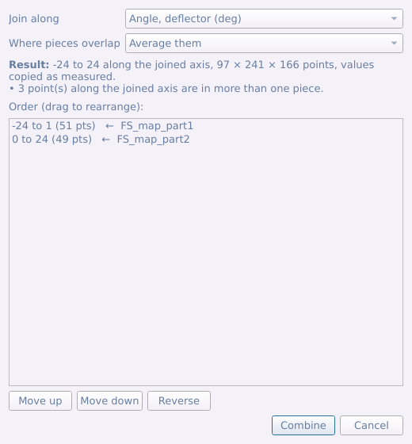
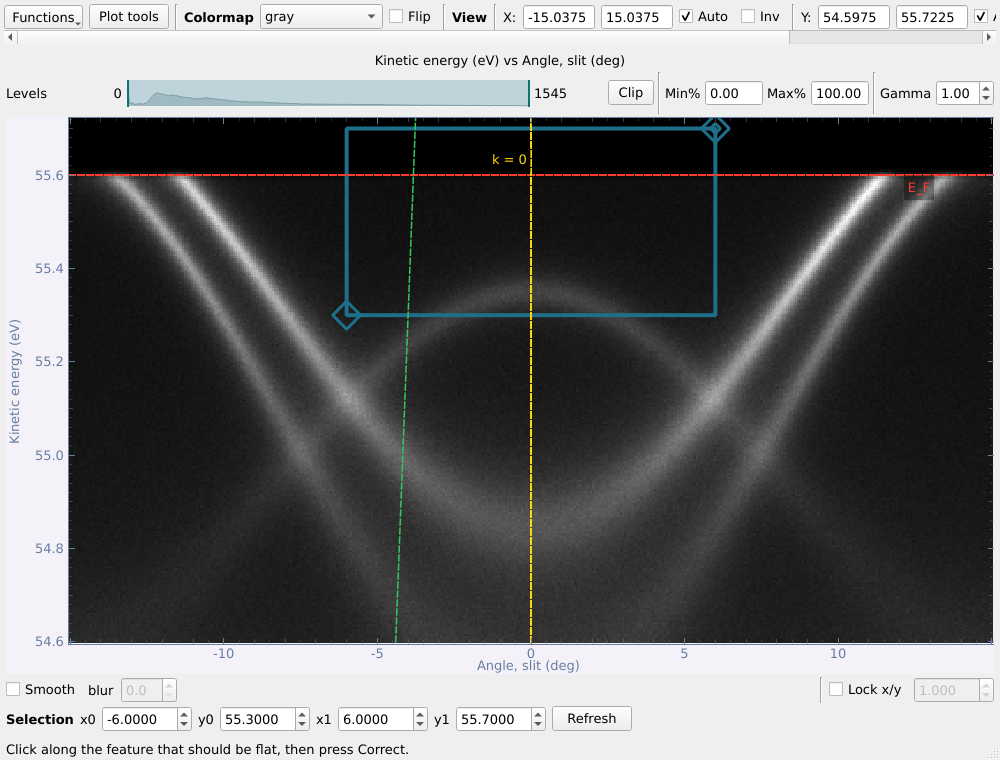

# ARPES viewer — User Guide

*[中文版 / Chinese version](USER_GUIDE_zh.md) · [Version française](USER_GUIDE_fr.md)*

*Last updated: 25 October 2026 — for ARPES viewer v1.0.2*

The version and its date are in the main window's title bar and at the bottom of
the main window. Bug reports, questions and the latest version:
<https://github.com/DingPei1995/ARPES-data-browser> (please give the version
number when reporting a bug).

This guide walks through the program's main features with screenshots, in
the order you would normally use them: loading data, looking at it,
converting it to momentum, analysing it, and making figures. The technical
background for each step (formulas, test results, design choices) is in the
[README](../README.md) and [CHANGELOG](../CHANGELOG.md).

Every screenshot was taken from the running program, using the synthetic
data written by `devtools/demo_data.py`, so you can follow along without a
beamtime (see [Trying it with demo data](#2-trying-it-with-demo-data)).

---

## Contents

1. [Installing and starting](#1-installing-and-starting)
2. [Trying it with demo data](#2-trying-it-with-demo-data)
3. [The main window](#3-the-main-window)
4. [Loading data](#4-loading-data)
5. [What the viewers have in common](#5-what-the-viewers-have-in-common)
6. [Maps: the contour and its two cuts](#6-maps-the-contour-and-its-two-cuts)
7. [Cuts: from raw spectrum to band parameters](#7-cuts-from-raw-spectrum-to-band-parameters)
8. [From angles to momentum for a map, and the Brillouin zone](#8-from-angles-to-momentum-for-a-map-and-the-brillouin-zone)
9. [Arbitrary cuts and Fermi-surface correction](#9-arbitrary-cuts-and-fermi-surface-correction)
10. [Processing: smoothing, derivatives, curvature](#10-processing-smoothing-derivatives-curvature)
11. [Stack plots and the 3-D view](#11-stack-plots-and-the-3-d-view)
12. [Cut arithmetic: dichroism and reference division](#12-cut-arithmetic-dichroism-and-reference-division)
13. [Photon-energy scans (kz)](#13-photon-energy-scans-kz)
14. [Removing the detector grid](#14-removing-the-detector-grid)
15. [Curves: EDCs, MDCs and spin-resolved data](#15-curves-edcs-mdcs-and-spin-resolved-data)
16. [Spatially resolved scans (nano-ARPES)](#16-spatially-resolved-scans-nano-arpes)
17. [Figures and export](#17-figures-and-export)
18. [Autosave, memory and recovery](#18-autosave-memory-and-recovery)
19. [Tips and troubleshooting](#19-tips-and-troubleshooting)

---

## 1. Installing and starting

You need Python 3.9 or newer and five packages:

```bash
pip install PyQt5 pyqtgraph numpy h5py scipy
```

Then, from the `ARPES_viewer` folder:

```bash
python ARPES_viewer.py
```

The program reads:

| Beamline / source | Files |
|---|---|
| SOLEIL **ANTARES** | NeXus/HDF5 `*.nxs` (cuts, deflector maps, spatial scans) |
| SOLEIL **CASSIOPEE** | Scienta SES text files — single spectra, and numbered folders assembled into a map or a photon-energy scan |
| CASSIOPEE **spin end station** (MBS A-1) | `*.krx` and `*.txt` — cuts, deflector maps and spin-resolved EDCs |
| This program | its own saved `*.nxs` format |

## 2. Trying it with demo data

```bash
python devtools/demo_data.py            # writes ./demo_data/*.nxs
```

This writes six files of synthetic data: a Fermi-surface map, a pair of cuts
taken with LH and LV polarisation, a photon-energy scan, a spin-resolved EDC,
a small real-space scan and a map with a detector mesh printed on it. They
come from a toy band structure (a hexagonal electron pocket and a hole band
at Γ, hole pockets at K) with a Fermi cut-off, the analyser resolution and
Poisson noise, and open exactly like measured data.

To re-take every screenshot in this guide after changing a window:

```bash
python devtools/guide_screenshots.py    # writes docs/images/*.png
```

---

## 3. The main window


The main window is a **browser**: one row per *dataset*, not per file (one
`.nxs` file often holds several measurements, and each gets its own row). The
kind is written after the name: `[Cut]`, `[Map]`, `[kz map]`, `[k-map]`,
`[SPEM]`, `[EDC]`, `[Spin EDC]` …

| Action | How |
|---|---|
| Open a dataset in its own window | **double-click** the row (or right-click → **Open**) |
| Stack several cuts into one map (temperature, gate voltage, photon energy → kz map ...), or join a map / kz map measured in segments | select them → **Combine datasets...** (or right-click → **Combine N datasets...**) |
| Everything else that works on datasets | **right-click** the row (or a selection of rows) |
| Read the axes: first/last value, points, step | right-click → **Show information** (fills *Data Information*) |
| Change the grid or scale — crop to a range, bin points, normalise each spectrum to itself — for several datasets at once | **Crop / bin / normalise...** |
| Bring out the bands — smooth, second derivative, curvature, background subtraction, symmetrise | **Smooth / derivative...** |
| See and free memory | the **Memory** box at the bottom |
| See which version you are running, report a bug, get the latest version | the title bar and the last line of the window (link to GitHub) |

The three buttons under the list sit in a box called **With the selected
datasets**: each acts on the rows selected above it, and each makes new rows
— the originals are never changed.

### Which name does what

Several buttons were renamed (v1.0.0) so that the name says what happens. If
you knew the old names:

| Now | Was | What it does |
|---|---|---|
| **Combine datasets...** | Combine data... | stack cuts into a map, or join pieces of one measurement |
| **Crop / bin / normalise...** | Data operations... | changes the grid or scale: crop (truncate), bin (compress), self-normalise |
| **Smooth / derivative...** | Process... | filters that bring out bands: smooth, derivative, curvature, background, symmetrise |
| Functions section **Transform** | Data operations | conversions and corrections in a viewer's Functions menu |
| **Fermi edge fit...** | Fermi level... | fit E_F (and resolution) on a cut |
| **Convert to momentum (k)...** | Cut / Map k conversion... | angle → k∥ |
| **Align Fermi levels (kz map)...** | kz map processing... | fit and align E_F of every photon energy |
| **Convert to momentum (kz, k∥)...** | kz -> momentum... | photon-energy scan → (k_z, k∥) |
| **Straighten bands (FS correction)...** | FS correction... | flatten a curved Fermi edge or feature |
| **Remove detector grid...** | De-grid... / De-grid map... | remove the MCP / mesh pattern |
| **Multi-slice figure...** | Slice figure... | a page of slices through a map |
| **Freeze slice in a new window** | Open slice in a new panel | a frozen copy of the slice on screen |
| **Plot tools** (viewer top row) | — (new) | guide lines and labels drawn on the live plot |
| **Figure composer...** (frozen slice), **Open in figure composer...** (list) | Plot tools, Plot as a figure... | make a figure for a paper |
| **Figure tools...** (inside the figure composer) | Plot tools | size, fonts, ticks, colour bars, annotations of that figure |

The right-click menu only offers what fits the selection. A greyed entry says
why when you hover over it — for example, *Cut arithmetic* needs exactly two
cuts, the *3D view* needs a map.

**Show information** also opens the full metadata of the dataset in a window
of its own, with a filter box and **Export metadata (.csv)**:


**Clear list** asks first, and offers to save anything computed in this
session that has not been saved yet. Files on disk are never deleted.

### Combining datasets: stacking and joining

**Combine datasets...** (under the list, or right-click → **Combine N
datasets...**) does two different things, and asks which:

- **Stack** — *cuts only*. Each cut becomes one slice of a new map, along an
  axis you name: a temperature series, a gate-voltage series, one cut per
  photon energy. The result is looked at like any map — sliced at constant
  energy, or along the new axis.
- **Join** — *cuts, maps, kz maps or k-maps, all of one kind*. The pieces of
  one measurement that was taken in segments are put back end to end along
  one of their own axes: a map whose deflector range was scanned in two
  parts, a kz map whose photon-energy range was split over several runs, a
  cut whose energy window was taken in two halves.

**Stacking cuts**

1. Select the cuts in the list (Ctrl/Shift-click) and press **Combine
   datasets...**. Stacking needs the same axes point for point (same number
   of points, same values, same units); if they differ, *Stack* is greyed
   with the first difference named, and *Join* is offered instead.
2. It asks whether to combine them **in the list's order**. *Yes* keeps that
   order; *No* lets you choose it.
3. Choose **Stack**, then set the new axis: **New axis is** (temperature,
   gate voltage, photon energy, delay, position, other — this fills in
   *Name* and *Unit*, which you can change), **Start** and **Step**. Each
   cut is listed with the value it gets. If you chose to reorder, **drag**
   the rows (or use **Move up** / **Move down** / **Reverse**). Press
   **Combine**.


A photon-energy series of angle cuts becomes a `kz map`, so *Align Fermi
levels (kz map)* and *Convert to momentum (kz, k∥)* take it (see
[§13](#13-photon-energy-scans-kz)); any other axis gives a `map` whose first
axis is marked as not an angle, so no k conversion is offered for it.

**Joining pieces of a measurement**

1. Select the pieces (all maps, or all kz maps, or all cuts …) and press
   **Combine datasets...**. Maps and kz maps go straight to *Join*.
2. **Join along**: the axis the measurement was split along. It starts on
   the axis whose range differs between the pieces — a map's deflector
   axis, a kz map's photon energy, or the energy of cuts taken in two
   energy windows — so it is usually right already.
3. **Where pieces overlap**: *Average them*, or keep the earlier / later
   piece in the order shown (drag the rows to change it).
4. The dialog lists each piece's range and shows the **Result** — the joined
   range and the number of points — with notes on anything it had to do.
   Press **Combine**.



How the axes are handled:

- Pieces on one common grid (same step, ranges that meet or overlap by whole
  points — the usual case) are **copied as measured**, nothing
  interpolated.
- A piece with a different step or a half-step offset is **interpolated**
  onto the common axis (the first piece's step), and the dialog says so.
- If the **other axes** differ — an energy window a few meV different
  between runs, a different number of slit channels — every piece is
  resampled onto the range they **all** cover, and the dialog says so.
- A stretch that no piece covers is a **gap**, left at zero and reported.
- A joined kz map is still a `kz map`: run *Align Fermi levels (kz map)*
  on the joined result rather than on the pieces (per-photon-energy fit
  results of the pieces are not carried over).

---

## 4. Loading data

**Load data...** opens the loader. **Quick add...** skips it and adds the
chosen files with everything detected automatically.


1. **Files** — pick one or many (*Select file(s)...*). The file filter is built
   from what the installed readers can open.
2. **Reader** — detected automatically, and the result is shown
   (*Detected: 3 × This program's own format*). Override it only if a file is
   being misread.
3. **Datasets found** — what is inside each file, read from its *structure*
   only. This is instant even for a multi-GB scan; nothing is read until you
   open a row.
4. **Axes** — *Axis order* reorders the array's dimensions once, at the door.
   *First axis of a map is* says what was scanned: a deflector angle (the
   default), a **photon energy**, a temperature, a gate voltage, a delay… This
   keeps the right unit everywhere afterwards, and stops a k conversion being
   offered for an axis that is not an angle.

**CASSIOPEE folders.** Select any file of a numbered series
(`name_1_ROI1_.txt`, `name_2_ROI1_.txt`, …) and the whole folder is listed
once, as one assembled cube. Whether it becomes an angle map or a kz map is
read from the `_i` parameter files next to the spectra. The row is named
with the photon energy and polarisation read from those files —
`FineMap 117eV LH`, or `KzScan 40-120eV LH` for a photon-energy scan — so
repeats of the same scan at another energy or polarisation can be told
apart.

**ANTARES photon-energy (PhD) files.** A PhD `.nxs` file (one `Phd_NNNN`
entry per photon energy) is listed as one `kz map`: the frames are sorted by
photon energy and each kinetic-energy axis is referred to E_F with its own
hν (work function 4.5 eV, which the k_z conversion then uses). Each frame
still opens on its own as a cut.

### Data kinds

| Kind | Axes | What it is |
|---|---|---|
| `cut` | angle (or k) × E | one spectrum |
| `map` | angle × angle × E | a deflector or polar-angle scan |
| `k_map` | kx × ky × E | a map converted to momentum |
| `kz_map` | hν × angle × E | a photon-energy scan |
| `kz_map_k` | k_z × k∥ × E | that scan converted to momentum |
| `spem_4d`, `spem_1d` | x (× y) × angle × E | real-space scans |
| `edc`, `mdc`, `spin_edc` | E (or k) × channels | curves, with optional σ channels |

---

## 5. What the viewers have in common

Each dataset opens in its own window, so you can put a map, its cuts and
another file side by side.


- **The top row**: the **Functions** menu (everything the window can do),
  **Plot tools** (guide lines and labels on this plot — see below), the
  colormap (per window) with **Flip**, and the view controls — axis ranges,
  **Auto**, **Inv** (invert), **Reset**, **Grid**.
- **Above each image**: the **Levels** bar (drag the two handles, or type
  **Min%/Max%** percentiles; **Clip** applies them) and **Gamma**. A min/max
  you set is kept while you move the slice (the energy of a contour, the
  angle of a cut, the cursor of a spatial map), so every position is on the
  same colour scale; drag the handles back to both ends, or set 0%–100%, to
  follow each frame's own range again.
- **Under each image**: **Smooth** (display only, does not change the data)
  and **Lock x/y** (aspect ratio).
- **Readout cursor** — right-click the image → *Readout cursor*. It reports
  the value under it and, on a cut, draws the **EDC** (right) and **MDC**
  (below) through that point. **EDC ±** / **MDC ±** integrate over a window,
  shown as a shaded band on the image. Type a position into the **Cursor**
  row and press Enter to put it exactly there.
- **EDC → list** / **MDC → list** put the curve on screen in the main list as
  a dataset of its own (see [§15](#15-curves-edcs-mdcs-and-spin-resolved-data)).
- **Right-click the image → Export** saves what the panel shows — data
  (`.nxs`), an image, or vector axes (`.eps`); see [§17](#17-figures-and-export).
- **Functions → Slice → Save slice to the main list / Freeze slice in a new
  window** keeps a copy of the slice on screen. The frozen window (and *Open
  this position in a new window* on a spatial map) opens with the panel's
  min/max and gamma, so the two can be compared directly. It has its own
  **Plot tools**, and a **Figure composer...** button to make a figure of it
  ([§17](#17-figures-and-export)).

The **Functions** menu is organised in sections:

| Viewer | Analysis | Transform | Visualization |
|---|---|---|---|
| map / kz map / k-map | | Arbitrary cut, Convert to momentum (k), Align Fermi levels (kz map), Convert to momentum (kz, k∥), Remove detector grid | Brillouin zone (k-maps), Multi-slice figure |
| cut | Fermi edge fit, MDC / EDC fit | Straighten bands (FS correction), Convert to momentum (k), Cut arithmetic, Remove detector grid | |
| curve | Curve fit, Spin analysis | Crop, Bin, Normalise, Background, Shift axis, Add √N errors | Figure composer |

An entry that does not apply is not shown; one that applies but cannot run
yet is greyed, with the reason in its tooltip.

### Plot tools: guide lines and labels on the plot

**Plot tools** on the top row of every viewer (cuts, maps, spatial scans,
curves, frozen slices) opens a small window that draws **on the plot in
front of you**:



|  | |
|---|---|

- **Type**: *Vertical line*, *Horizontal line*, *Line at an angle* (through a
  point; the angle is in the plot's own units, i.e. the slope is tan(angle)
  y-units per x-unit), or *Text label*.
- **Position** (x, y), **Angle**, an optional **Label** (shown on the line,
  e.g. `E_F`, `Γ`), a **Colour** (nine one-click colours, or **More...**),
  **Width**, **Style** (solid, dashed, dotted, dash-dot) and **Text size**.
- **Add** draws it at the position typed (**Centre of view** fills that in);
  **Place by clicking** draws one wherever you click on the plot.
- **Drag** a line on the plot to move it; the window follows. Select a guide
  in the list to **edit** it — every change shows at once — or **Remove** it;
  **New guide** stops editing; **Remove all** clears the plot.
- With two panels (a spatial scan), **Draw on** chooses which.
- Guides stay while the slice moves (an E_F line stays at E_F as you scroll
  through a map) and while the Plot tools window is closed. The panel's
  **Export → Image** draws them too (*Include the Plot tools guides*).

*Plot tools* are for looking at the data. To make a figure for a paper, use
the **figure composer** and its **Figure tools** ([§17](#17-figures-and-export)).

---

## 6. Maps: the contour and its two cuts

A map opens on its **constant-energy contour**. The slider at the top picks
the energy (**Pos** in eV, or **Ind** as an index; **±** integrates over a
window, **mean** or **sum**). **Deflector cut** and **Slit cut** open the two
orthogonal cuts, each in its own window.


| Slit cut (slit angle vs energy) | Deflector cut (deflector angle vs energy) |
|---|---|
|  |  |

**One cursor for all three windows.** Switching the readout cursor on in any
of them switches it on in the others, and moving it anywhere re-slices the
others through the new point. The axes keep one colour each everywhere:
**deflector red, slit green, energy blue**. A cursor line has the colour of
the axis it holds constant, and the EDC or MDC it feeds is drawn in the same
colour. Integration widths (the ± boxes) belong to each window and are never
shared.

From the list you can also open a map's cut straight away (right-click →
**Open slit cut** / **Open deflector cut**); the contour then stays hidden
until you ask for it (*Functions → Show the map*).

---

## 7. Cuts: from raw spectrum to band parameters

The usual order for a single cut is: **Fermi edge fit → offset the energy axis →
convert to momentum → MDC/EDC fit**.

### 7.1 Fermi edge fit

*Functions → Fermi edge fit...* fits a Fermi edge (Fermi–Dirac × linear DOS,
convolved with a Gaussian resolution) to the EDC summed over a box.


1. Press **Show the selection box** and drag the box on the cut over the edge
   (or type the angle and energy ranges). The angle range says which channels
   are summed; the energy range is the fit window.

   

2. **Estimate**, then **Fit**. Tick **Hold** to keep a parameter fixed
   (the temperature is held at the recorded value by default). Every
   parameter is reported with its uncertainty.
3. **Offset energy axis** lists a copy of the cut on **E − E_F**.

The *Advanced* corner divides the Fermi cut-off out (for gaps and reference
samples) or fits E_F channel by channel.

### 7.2 Converting a cut to momentum

*Functions → Convert to momentum (k)...* converts the angle axis to k∥ (Å⁻¹). A cut
is a line in the (kx, ky) plane that generally misses Γ, so the dialog asks
where Γ is: type the angles, or **From a converted map...** to inherit them
from a map already converted.


If the cut is already on E − E_F, the dialog fills in **Energy offset** with
the E_F that was subtracted (the note under it says so): the conversion uses
true kinetic energies, and the result stays on E − E_F.


### 7.3 MDC / EDC fit

*Functions → MDC / EDC fit...* fits peaks line by line and reads the band
off the fitted centres. It only accepts a cut whose axis is already in Å⁻¹ —
a velocity in eV·deg would be meaningless.


1. **Bands** tab: **Add band** for each branch; select a band, press **Place
   a seed** and click the peak on the curve (right). Four or five seeds down a
   band are enough; **Line at** moves the line being looked at.
2. **Try this line** shows the fit of the current line (dashed: the guess).
3. **Fit settings** tab: MDC or EDC, peak shape (Lorentzian, Gaussian,
   Voigt), background, step, then **Fit the series**. Fitted positions are
   drawn on the image, sized by amplitude.
4. **Dispersion...** fits the band: **v_F** (straight line), **m\*** (parabola)
   — and checks how far out the fit is stable. **Self-energy...** gives Re Σ
   and Im Σ.


**Save table...** writes every fitted line; **Band to list** puts a band in
the main list.

### 7.4 Core-level check

A wide scan of the core levels is listed as a cut too. Right-click it in the
main list → **Core-level check...** to find out what its peaks are.

1. Type the sample's elements — `NbSCl` or `Nb, S, Cl` — and press **Next**.
   *Match within* (0.5 eV) is how close a peak must be to a tabulated level
   to count as the sample's.

   

2. Check the energy reference. E_F is fitted when the window holds the
   Fermi edge, otherwise put at hν − W. Change the photon energy, the work
   function or E_F if they are wrong (the green line can be dragged); a
   hν − E_F far from 4–5 eV means the photon energy is off. Press
   **Analyse**.

   

3. The results: the EDC on a binding-energy axis, each peak marked —
   green *sample* (orbital named), orange *uncertain* (a level of the
   sample within 2 eV: chemical shift or charging — your call), red *not
   the sample* (common elements that could explain it: contamination,
   higher-order light, Auger lines). Click a row for the full list of
   candidates. Type your own assignment in the *Assignment* column.

   

**Weak lines and peaks by hand.** Tick **Log counts** to see weak lines next
to a strong one; **Min height** (default 0.2 % of the strongest) sets how
small a found peak may be. To add a peak the search missed, press **Click to
add peak** and click the plot (a double-click always works), or type its
binding energy after *or at* and press **Add**: its position is refined by a
local fit, it is marked ◆, and it is named with every tabulated level within
±2 eV. **Remove selected** drops peaks; **Reset peaks** brings back the found
ones and forgets those added by hand. Assignments you typed survive a
**Re-analyse**.

**Peak table...** lists every tabulated level, filtered by element and
binding-energy range: look a peak up, show a level on the plot, or add it as
a peak with that level as its assignment. **Select range** shows a band you
drag over a region; **Zoom window...** opens it (or the current view) in a
window of its own with a cursor, a Gaussian fit at the cursor, and the
negative second derivative divided by the intensity — which shows a shoulder
or a weak line beside a strong one as clearly as the strong one.

If every peak is off by the same amount, the notes say so and **Apply
suggested shift** corrects it (a charged sample, or a wrong E_F). **Add EDC
to list** lists the EDC on the binding-energy scale; **Copy report** copies
the whole result as text. Measuring at a second photon energy settles what
stays doubtful: core levels stay put in binding energy, Auger lines and
higher-order light move.

---

## 8. From angles to momentum for a map, and the Brillouin zone

### 8.1 Converting a map to momentum

*Functions → Convert to momentum (k)...* on the contour window. Drag the readout
cursor to the point that should become **k = (0, 0)** — the dialog follows
it — then **Convert**. The result is a new `k-map` row in the list.


- **Γ deflector angle / Γ slit angle**: the angles of the point that becomes
  k = (0, 0), filled in from the cursor. (These were called *Theta offset*
  and *Phi offset*; they are the same two numbers the cut conversion asks
  for.)
- **Sample rotation** turns the map about the surface normal; **Set rotation
  from contour...** reads it off a direction you click on the contour (two
  points along a mirror line, say).
- **Output grid**: number of points, or resolution (Å⁻¹, meV). The
  numbers of points start at the measured ones — as many kx points as
  deflector angles, ky points as slit angles, E points as energies.
- **Energy offset** is added to the energy axis before converting, for an
  axis that is not a true kinetic energy (filled in automatically for a map on
  E − E_F).


### 8.2 Brillouin zone

On a k-map: *Functions → Visualization → Brillouin zone...*.


1. **Space group** first (1–230); the lattice parameters it fixes are greyed
   and follow the free ones. Or switch to **2D layer** for a surface lattice.
2. **Cut plane**: the surface normal (hkl) and an offset along it — the cut of
   the 3-D zone by that plane is drawn, for any surface, not only (001).
   **Through point** lists the offsets at which the plane passes through a
   high-symmetry point (Γ, Z, L, F ... for a rhombohedral crystal); choose
   one rather than working the number out. **Show cut plane in 3D...**
   previews it, with the named points marked and the ones in the plane
   ringed; **Label high-symmetry points** writes them on the contour, which
   is the quickest way to set the azimuth. The dialog opens on the last
   crystal you used, so a second map of the same sample needs no retyping.
3. **Conventional** or **Irreducible** zone; **Azimuth** (or **Pick
   direction from contour...**); **Repeat across the field of view**.
4. **Moiré** adds a second, twisted or mismatched layer and its moiré zone.
5. **Plot**.


---

## 9. Arbitrary cuts and Fermi-surface correction

### 9.1 Arbitrary cut

*Functions → Arbitrary cut...* on any contour: click up to six points (or type
them) and the cut runs through them in order — here Γ → M → K → Γ on the
k-map. **One dataset per segment** lists each leg separately.

| Path on the contour | Points |
|---|---|
|  |  |

The result is a cut against the distance along the path; the corners of the
path are marked with dashed green lines, so a kink there is not mistaken for
physics.


### 9.2 Fermi-surface (FS) correction

*Functions → Straighten bands (FS correction)...* on a cut (or a map's slit cut) straightens a
feature that should be flat — usually the Fermi edge, which curves across the
analyser angle. Click along the feature; a polynomial (order 2 by default) is
fitted and every angle column is shifted in energy. **From a reference
(Au)...** takes the curve from a gold spectrum in the list instead. On a
map's slit cut the same shift is applied to the whole cube.


---

## 10. Processing: smoothing, derivatives, curvature

Select one or more cuts (or maps) in the list and press **Smooth /
derivative...**.
Every result is a new dataset carrying the steps that made it.


- Tabs: **Smooth** (Gaussian, box, …; optional despiking), **Derivative**,
  **Curvature** (1-D and 2-D), **Background**, **Symmetrise**.
- **Source** and **Result** are shown side by side on the same scale, so you
  can see when a setting has eaten the band. They pan and zoom together.
- **Shape**: *Square pixels* (one data point is square — undistorted for an
  angle-vs-energy cut), *Equal axes* (one unit is the same length on both
  axes — right for angle-vs-angle or k-vs-k; chosen automatically when both
  axes have the same unit), or *Fill the box*.
- **Live preview** re-computes as you change a value; **Apply** lists the
  result.
- Starting values: **Symmetrise** mirrors about a vertical line through
  angle (or k) = 0, i.e. k → −k; the **Fermi cut-off** under *Background*
  starts at the E_F the file records, or else at the steepest fall of the
  angle-integrated EDC, with the file's temperature and resolution.

For a map the panel works plane by plane, and asks **which planes** first —
constant-energy maps or dispersions — since the curvature of a contour and
the curvature of a cut are different quantities. **Preview at** picks the
plane shown; **Apply to the whole cube** runs it on every plane. The
operations and widths are named after the chosen plane's own axes
(*Second derivative along Kinetic energy*, *Normalise each line along
Angle, slit*…), and the smoothing widths start at 1/100 of each axis.


**Crop / bin / normalise...** (main window) changes the grid or the scale
of one or several datasets at once — as long as they have the same kind and
the same number of points on every axis. Tabs: **Crop (truncate)** to a
range, **Normalise** each spectrum to itself, **Bin (compress)** points
together.

**Normalise** divides each piece of the data by its own total (or peak):

- **Normalise** picks the piece in ARPES terms, and starts on the usual
  one: *each EDC* for a cut, *each cut (slit × energy at one scan step)*
  for a map, k-map or kz map — this takes a flux or beam-current drift
  along the scan out. Other choices: each MDC, each EDC of a map, each
  constant-energy map, or *custom*.
- **Summed over** shows the axes this sums over; the ticks can be changed by
  hand, and the sentence under them says what the current ticks do ("Each
  plane over Angle, slit × Kinetic energy is divided by its own total — one
  factor for every Angle, deflector").
- **Sum only over** restricts the sum to a window on one of the summed axes
  — the energy by default — for example the energies of a core level.


---

## 11. Stack plots and the 3-D view

**Stack plot** (right-click a cut): a waterfall of EDCs or MDCs, with the
number of curves, binning, normalisation, offset, shear and colouring
controls; **Send to figure composer** makes it a figure panel.


**3D view** (right-click a map) first asks for the region and the sampling,
since every frame resamples the cube — *Fast*, *Balanced* or *Fine* decide
whether it keeps up with the mouse.


Then drag the picture to turn it. **Slices** shows three orthogonal planes at
the positions you set, **Notched cube** cuts a corner out of the cube, and
**Projection** sums along an axis. Colormap, levels, gamma, azimuth,
elevation and depth aspect are on the right; **Save the view...** exports
the picture.


---

## 12. Cut arithmetic: dichroism and reference division

Two cuts combined into a third: linear dichroism (LH − LV), circular
dichroism, dividing by a gold reference, or plain differences, ratios and
sums. Select two cuts in the list → right-click → **Cut arithmetic on the
two...** (the first selected is A), or in a cut's viewer *Functions → Cut
arithmetic...* and then click the other cut in the list.


- **The table at the top** compares what the two measurements recorded
  (polarisation, photon energy, angles, sample position, temperature, pass
  energy, lens mode). Rows in orange differ beyond a tolerance — a dichroism
  map between two spots on the sample is a map of *that* difference.
- **Purpose** presets: *Linear dichroism* (A − B, B scaled to the same total
  intensity), *Circular dichroism* ((A − B)/(A + B)), *Divide by a reference*,
  *Custom*. Warnings appear if the polarisations look swapped (**Swap A ↔ B**).
- **Scale B to A** by total intensity or by a region; **Hide where A+B below**
  blanks the background.
- A and B are drawn on one colour scale; the result on a red-white-blue scale
  symmetric about zero. With raw counts on both, the Poisson uncertainty is
  propagated and summarised under the plot.
- **Result to list**, **Uncertainty to list**, **All three as a figure**.

---

## 13. Photon-energy scans (kz)

A photon-energy scan is listed as a `kz map`; its contour is photon energy
against angle at one energy.


### 13.1 Aligning the Fermi levels of a kz map

Nothing in the files says where each spectrum's Fermi level really is.
*Functions → Align Fermi levels (kz map)...* measures it from the spectra themselves.

1. The slit cut opens with a box on it. Drag the box over a Fermi edge — the
   angle range sets the channels summed, the energy range the fit window.

   

2. **Fit and assemble**: the same box (by detector index) is used for every
   spectrum; each is shifted to put its own edge at zero; the cube is cropped
   to the range they all cover; and, by default, each spectrum is
   **normalised by its total intensity**, which divides out the photon flux.


E_F against photon energy is plotted. A smooth curve means the fits are
sound; points whose fit is not believed are marked and filled in from their
neighbours.

### 13.2 Converting a kz map to momentum

*Functions → Convert to momentum (kz, k∥)...* converts the scan to (k_z, k∥).


- **Inner potential V0** is the unknown: the preview reconverts one energy
  slice as you change it, in milliseconds.
- With the **lattice** (space group, a, b, c), the **surface normal** and the
  in-plane direction, the zone boundaries are drawn over the preview.
- **Scan V0** converts at a range of V0 values and reports where the k_z
  period matches the lattice — and how well that pins V0.
- **Measure a k_z period...**: click two points that are the same feature one
  zone apart; the matching reciprocal-lattice planes are listed.
- The yellow banner warns when the Fermi edge still bends across the analyser
  angle — correct it first (Straighten bands (FS correction) on the slit cut).
- **Convert the whole cube** lists a `kz map (k)`.


---

## 14. Removing the detector grid

MCP (hexagonal) and mesh (square) patterns print on every image. **Do it
first**: only data still on the detector's pixels can be de-gridded, so the
button refuses anything already converted, corrected or smoothed, and says
why.

*Functions → Remove detector grid...* on a map (or its slit cut), or on a
cut. For a map, no reference is needed — the grid stays on the same pixels in
every slice while the photoemission moves. **Find and remove the grid**:


- **Before / After** a chosen slice on one colour scale (tick **Show
  −∂²I/∂E²** to make any grid obvious).
- **The grid found**, its **k-space regions** (in red), and the **contrast
  and shift** fitted for every slice.
- The power left in the grid regions (1 = no grid left).
- **Also list the grid pattern** keeps a `[grid]` dataset, which a cut taken
  later with the same lens mode and pass energy will find and use.

---

## 15. Curves: EDCs, MDCs and spin-resolved data

**EDC → list** / **MDC → list** under any image, or a spin-resolved file,
give a curve dataset, which opens in the **curve viewer**:


Channels can be hidden, offset into a waterfall (**Offset**), shown with
**Error bars** (from a σ channel), and **Range** marks an x window used by
the operations. *Functions → Transform* gives **Crop**, **Bin**,
**Normalise**, **Subtract a background** (constant, linear, Shirley),
**Shift the axis** and **Add counting errors (√N)**; each makes a new dataset
and propagates σ correctly.

### 15.1 Curve fit

*Functions → Curve fit...*: **Peaks on a background** (Lorentzian, Gaussian
or Voigt peaks placed by clicking or **Find peaks**; none / constant /
linear / Shirley background; instrumental resolution; optional **× Fermi
edge**), or the **Fermi edge** itself. Weighting is the channel's own σ,
√N, or uniform. Every parameter comes with its error; the residual is shown
in units of σ.


**Fit to list** keeps data, fit, residual and components; **Copy results**
copies a tab-separated table. A Fermi-edge fit can **List a copy with
E_F = 0**.

### 15.2 Spin analysis

A spin EDC opens with one curve per spin channel:


*Functions → Spin analysis...*:


- The table reads each channel's label (manipulator setting, target
  magnetisation, axis and sign counted as "up"); **Axis** and **Counts as**
  can be overridden.
- **Cross ratio** (default when the channels allow it) cancels both the
  transmission and the target reflectivity exactly; **one pair** is available
  but carries the instrumental asymmetry, which is measured and reported (ε).
- **S_eff** (Sherman function, default 0.2), **Bin**, optional **Zero
  reference** window.
- Plots: raw channels, P with its error bars, and I↑ / I↓ with errors.
- **P to list**, **I↑ / I↓ to list**, **As a figure** (opens the figure composer).

---

## 16. Spatially resolved scans (nano-ARPES)

A real-space scan opens the **spatial map** (left, the total intensity at
each position) together with the **E vs k spectrum at the cursor** (right).
Drag the red target to read the spectrum at another point. Right-click a
panel for the two integrations:

- on the map, **Integrate selection → E vs k panel** sums the spectra over a
  region of the sample;
- on the spectrum, **Integrate selection → spatial panel** maps the intensity
  of a chosen (k, E) window across the sample — how a domain or a flake edge
  is found.


---

## 17. Figures and export

### 17.1 Figure composer

Select cuts (or curves) in the list → right-click → **Open in figure
composer...** (or, from a frozen slice, its **Figure composer...** button). The
composer lays panels out for a paper: one size per column, labels only on
the outer edges, (a)/(b)/(c) letters, shared colour scales if you want them.


**Figure tools...** sets everything (size in mm, fonts, ticks, colour bars,
lines, arrows, text, insets, scale bars) — not to be confused with a viewer's
**Plot tools**, which draw guides on the live plot; **Add panel...** adds another dataset;
**PDF**, **PNG**, **SVG** export, **Copy** puts it on the clipboard.

### 17.2 Multi-slice figure

From a map: *Functions → Multi-slice figure...* lays out a series of slices through
the cube — constant-energy contours, or cuts — evenly spaced or at chosen
values, with integration, one shared colour scale and titles.

| Settings | Result |
|---|---|
|  |  |

### 17.3 Exporting a panel

Right-click any image → **Export** → **Data (.nxs)...**, **Image...** or
**Axes only (.eps)...**. It always exports exactly what the panel shows
(range and all): the data as a dataset this program reads back; an image
with the colormap applied (PNG, TIFF or JPEG, at a chosen size and dpi, with
or without the axes, and with the Plot tools guides if there are any); or the frame, ticks and labels as vector PostScript to
place the image in, in Illustrator.


**Save** (right-click rows in the list) writes datasets to a `.nxs` file of
your own; several selected rows go into one file.

---

## 18. Autosave, memory and recovery

- **Autosave.** Every computed dataset (a k-map, a processed cut, a fit
  result…) is written, uncompressed, to this session's folder in
  `~/.arpes_viewer/sessions/` the moment it exists. Real-space scans are not
  (they are the measurement itself, and large).
- **A normal close deletes the autosaved copies.** When you close the main
  window and confirm (everything you want is saved, or *Close anyway*), the
  open viewers are closed and the session folder is deleted straight away.
  A dataset's copy also goes as soon as you save it to a file of your own.
- **Recovery after a crash.** Only if the program did not close normally (a
  crash, a kill) is the session folder kept: the next start offers its
  datasets back, and it is deleted after three days.
- **Operations log.** `~/.arpes_viewer/sessions/operations.log`, one line per
  store / save / discard — how to find what was where.
- **Memory box.** This program's memory, the system's, how many viewers and
  HDF5 files are open, and how much computed data is held. **Free memory**
  drops cached copies of computed data (they are re-read from their autosaved
  file when needed); **Close all viewers** closes every window and then frees
  memory.
- **Open auto-save folder** (below the Memory box) shows the session folders
  in the system's file browser, to delete old working copies by hand. The
  folder of the session now running (named in the status bar) is in use.
- **Long operations** (reading a big map, converting, de-gridding, assembling
  a folder) run off the GUI thread with a progress bar and a working Cancel.
- **Closing** with unsaved computed data asks first, and names the datasets:
  **Save to a file...**, **Close anyway** (the autosaved copies are deleted)
  or **Cancel** (nothing happens).

## 19. Tips and troubleshooting

- **"Not available here" in the Functions menu** — hover over the entry: the
  tooltip says why (e.g. the MDC/EDC fit needs a cut already in Å⁻¹).
- **A k conversion is not offered** — the first axis of the map is not an
  angle (a photon energy, temperature…). Check *First axis of a map is* in
  the loader.
- **Cut k conversion of an E − E_F cut** — the energy offset is filled in for
  you from the Fermi fit; if you shifted the axis some other way, type the
  kinetic energy of E_F (photon energy − work function) into *Energy offset*.
- **A file is misread** — choose the reader explicitly in the loader, and see
  *Assumptions worth knowing about* in the README (axis order in SOLEIL
  files).
- **Dragging the cursor on a big map is sluggish** — a map read lazily from
  its file re-slices in about 0.1 s per window, so the other windows wait for
  the mouse to pause. Once the map has been read into memory it follows live.
- **Typing numbers** — every number box takes a decimal point (`0.05`),
  whatever the system language; a comma is not accepted.
- **The machine is paging** — watch the Memory bar (amber past a third of the
  RAM, red past a half); use **Free memory** or **Close all viewers**.
