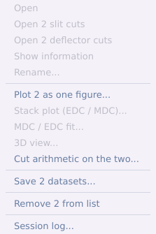
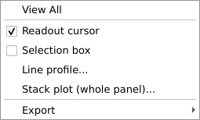
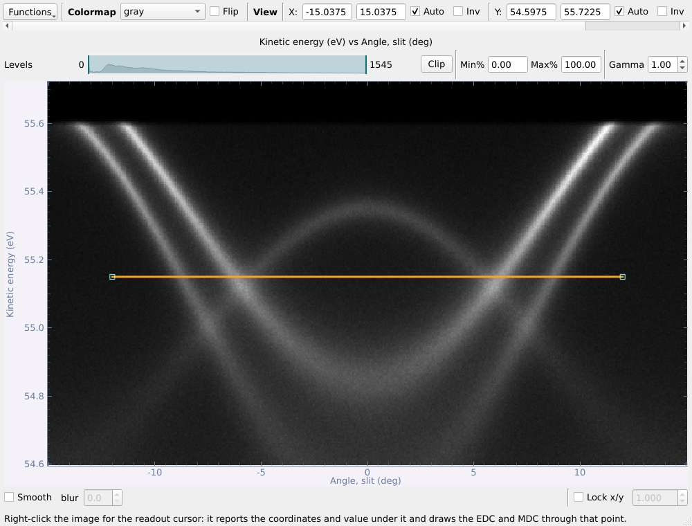
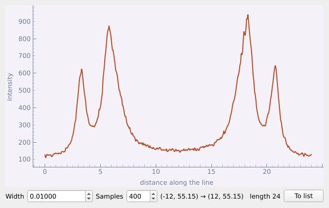
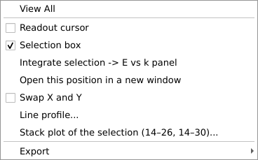
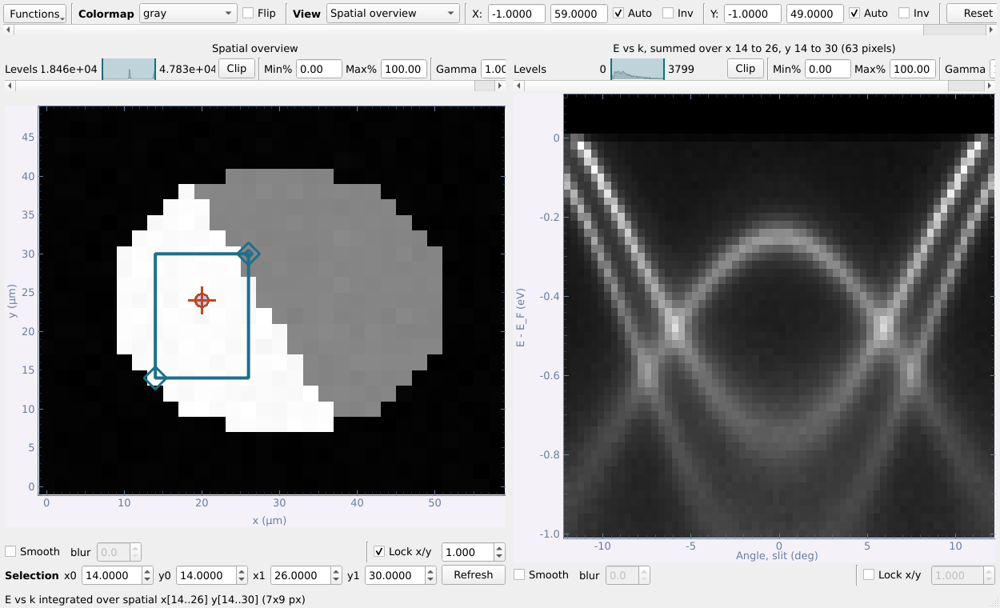
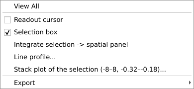
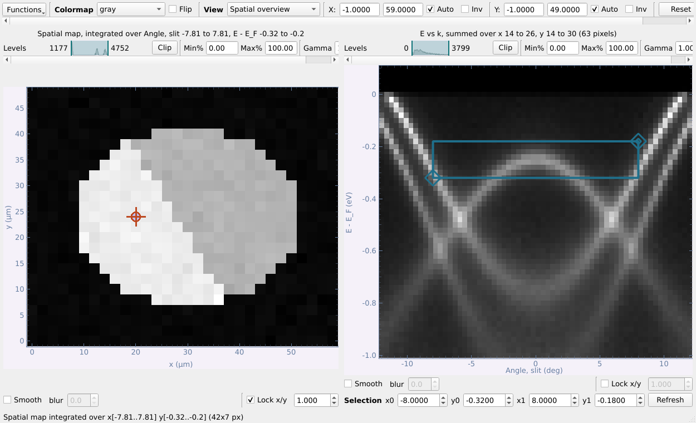

# ARPES viewer — Guide de l'utilisateur

*[English version](USER_GUIDE_en.md) · [中文版](USER_GUIDE_zh.md)*

**Version du programme 2026-10-12** · code source :
<https://github.com/DingPei1995/ARPES-data-browser>

Ce guide est organisé en quatre parties :

- **Partie I — Installation et configuration** : la version, l'adresse du
  code, les données que le programme lit, et la mise en place de Python.
- **Partie II — Visualiser les données pendant l'expérience** : la fenêtre
  principale, les menus contextuels (clic droit) et les fenêtres de
  visualisation des données SPEM, des cartes et des coupes. Ce sont les
  outils qui permettent de décider vite, sur la ligne, où mesurer ensuite.
- **Partie III — Traitement avancé pour la publication** : suppression de la
  grille, niveau de Fermi, conversion en k, zone de Brillouin, kz, courbure,
  dichroïsme, ajustements de pics et figures, dans l'ordre que suivent
  d'habitude les données d'un article.
- **Partie IV — Dépannage** : sauvegarde automatique et récupération après un
  plantage, mémoire, et réponses aux problèmes courants.

Toutes les captures ont été prises sur le programme en fonctionnement, avec
les données synthétiques écrites par `devtools/demo_data.py` : vous pouvez
donc suivre le guide sans temps de faisceau ([§3](#3-essayer-avec-des-données-de-démonstration)).
Les formules, les tests et les choix de conception de chaque étape se
trouvent dans le [README](../README.md) et le [CHANGELOG](../CHANGELOG.md),
en anglais.

Les noms des boutons et des menus sont donnés tels qu'ils apparaissent dans
le programme, c'est-à-dire en anglais.

---

## Sommaire

**Partie I — Installation et configuration**

1. [À propos du programme](#1-à-propos-du-programme)
2. [Installer Python et lancer le programme](#2-installer-python-et-lancer-le-programme)
3. [Essayer avec des données de démonstration](#3-essayer-avec-des-données-de-démonstration)

**Partie II — Visualiser les données pendant l'expérience**

4. [La fenêtre principale et son menu contextuel](#4-la-fenêtre-principale-et-son-menu-contextuel)
5. [Charger des données](#5-charger-des-données)
6. [Fenêtres d'image : commandes et menu contextuel](#6-fenêtres-dimage--commandes-et-menu-contextuel)
7. [Balayages SPEM (espace réel) : trouver où mesurer](#7-balayages-spem-espace-réel--trouver-où-mesurer)
8. [Les cartes : le contour et ses deux coupes](#8-les-cartes--le-contour-et-ses-deux-coupes)
9. [Les coupes : coups d'œil rapides](#9-les-coupes--coups-dœil-rapides)
10. [Balayages en énergie de photon, courbes et EDC de spin : coups d'œil rapides](#10-balayages-en-énergie-de-photon-courbes-et-edc-de-spin--coups-dœil-rapides)
11. [La vue 3D d'une carte](#11-la-vue-3d-dune-carte)

**Partie III — Traitement avancé pour la publication**

12. [L'ordre habituel du traitement](#12-lordre-habituel-du-traitement)
13. [Supprimer la grille du détecteur](#13-supprimer-la-grille-du-détecteur)
14. [Niveau de Fermi et correction de la surface de Fermi](#14-niveau-de-fermi-et-correction-de-la-surface-de-fermi)
15. [D'angles en impulsion](#15-dangles-en-impulsion)
16. [La zone de Brillouin et les coupes arbitraires](#16-la-zone-de-brillouin-et-les-coupes-arbitraires)
17. [Balayages en énergie de photon : traitement kz et kz → impulsion](#17-balayages-en-énergie-de-photon--traitement-kz-et-kz--impulsion)
18. [Traitement : lissage, dérivées, courbure](#18-traitement--lissage-dérivées-courbure)
19. [Arithmétique de coupes : dichroïsme et division par une référence](#19-arithmétique-de-coupes--dichroïsme-et-division-par-une-référence)
20. [Ajustement MDC / EDC : dispersion, v_F, m\*, self-énergie](#20-ajustement-mdc--edc--dispersion-v_f-m-self-énergie)
21. [Ajustement de courbes et analyse de spin](#21-ajustement-de-courbes-et-analyse-de-spin)
22. [Figures, exportation et enregistrement](#22-figures-exportation-et-enregistrement)

**Partie IV — Dépannage**

23. [Sauvegarde automatique, récupération et mémoire](#23-sauvegarde-automatique-récupération-et-mémoire)
24. [Problèmes courants](#24-problèmes-courants)

---

# Partie I — Installation et configuration

## 1. À propos du programme

| | |
|---|---|
| **Version** | 2026-10-12 (dernière modification le 12 octobre 2026). La version figure aussi en tête du [README](../README.md) ; le [CHANGELOG.md](../CHANGELOG.md) liste chaque modification. |
| **Code source** | <https://github.com/DingPei1995/ARPES-data-browser> (le programme est dans le dossier `ARPES_viewer/`) |
| **Écrit en** | Python 3, PyQt5 et pyqtgraph ; numpy, scipy et h5py pour les calculs et les fichiers |
| **Plates-formes** | Windows, macOS et Linux — partout où PyQt5 fonctionne |

### Données lues par le programme

| Ligne / source | Fichiers | Ouverts comme |
|---|---|---|
| SOLEIL **ANTARES** | NeXus/HDF5 `*.nxs` | coupes, cartes en déflecteur, balayages spatiaux (SPEM) |
| SOLEIL **CASSIOPEE** | fichiers texte Scienta SES : spectres isolés et dossiers numérotés | coupes ; un dossier devient une carte ou un balayage en énergie de photon (kz) |
| **Station spin** de CASSIOPEE (MBS A-1) | `*.krx` et `*.txt` | coupes, cartes en déflecteur, EDC résolues en spin |
| Ce programme | son propre format `*.nxs` | tout ce qu'il enregistre, avec les étapes qui l'ont produit |

Ajouter une ligne de lumière revient à ajouter un fichier de lecture dans
`loader/` (voir *Adding a beamline* dans le README).

### Types de données

Chaque jeu de données du programme est d'un de ces types. Le type décide de
la fenêtre qui l'ouvre et des fonctions qui lui sont proposées.

| Type | Listé comme | Axes | Ce que c'est |
|---|---|---|---|
| `cut` | `[Cut]` | angle (ou k) × E | un spectre |
| `map` | `[Map]` | angle × angle × E | un balayage en déflecteur ou en angle polaire |
| `k_map` | `[k-map]` | kx × ky × E | une carte convertie en impulsion |
| `kz_map` | `[kz map]` | hν × angle × E | un balayage en énergie de photon |
| `kz_map_k` | `[kz map (k)]` | k_z × k∥ × E | ce balayage converti en impulsion |
| `spem_4d`, `spem_1d` | `[SPEM]` | x (× y) × angle × E | balayages en espace réel (nano-ARPES) |
| `edc`, `mdc`, `spin_edc` | `[EDC]`, `[MDC]`, `[Spin EDC]` | E (ou k) × canaux | courbes, avec canaux σ éventuels |

## 2. Installer Python et lancer le programme

**Python.** Il faut Python **3.9 ou plus récent** (testé jusqu'à 3.13).
N'importe quelle distribution convient : python.org, Anaconda/Miniconda, ou le
Python du système sous Linux.

**Paquets.** Il en faut cinq :

```bash
pip install PyQt5 pyqtgraph numpy h5py scipy
```

Le plus propre est de les installer dans un environnement dédié, pour que le
programme ne dépende pas des autres travaux Python de la machine, et ne les
perturbe pas :

```bash
# avec venv
python -m venv arpes-env
source arpes-env/bin/activate          # Windows : arpes-env\Scripts\activate
pip install PyQt5 pyqtgraph numpy h5py scipy

# ou avec conda
conda create -n arpes python=3.12 pyqt pyqtgraph numpy h5py scipy -c conda-forge
conda activate arpes
```

Versions des derniers tests : PyQt5 5.15, pyqtgraph 0.14 (0.13 convient
aussi), numpy 2.3, h5py 3.16, scipy 1.18.

**Obtenir le code.** Téléchargez-le depuis la page GitHub (*Code → Download
ZIP*), ou :

```bash
git clone https://github.com/DingPei1995/ARPES-data-browser.git
cd ARPES-data-browser/ARPES_viewer
```

**Lancement.** Depuis le dossier `ARPES_viewer` :

```bash
python ARPES_viewer.py
```

**Réglages et fichiers de travail** sont rangés dans le dossier
`.arpes_viewer` de votre répertoire personnel :

| Fichier | Contenu |
|---|---|
| `~/.arpes_viewer/config.json` | le dernier dossier de données, et la palette d'une nouvelle fenêtre |
| `~/.arpes_viewer/sessions/` | les copies de travail des données calculées, sauvegardées automatiquement ([§23](#23-sauvegarde-automatique-récupération-et-mémoire)) |
| `~/.arpes_viewer/sessions/operations.log` | une ligne par sauvegarde automatique, enregistrement et suppression |

Supprimer `config.json` rétablit les réglages par défaut ; rien d'autre n'est
conservé.

**Vérifier l'installation.** La suite de tests fonctionne sans écran :

```bash
python -m pytest            # depuis le dossier ARPES_viewer ; nécessite pip install pytest
```

## 3. Essayer avec des données de démonstration

```bash
python devtools/demo_data.py            # écrit ./demo_data/*.nxs
```

Six fichiers de données synthétiques sont écrits : une carte de surface de
Fermi, une paire de coupes prises en polarisation LH et LV, un balayage en
énergie de photon, une EDC résolue en spin, un petit balayage en espace réel
d'un flocon à deux domaines, et une carte où est imprimée la grille d'un
détecteur. Ils proviennent d'une structure de bandes simplifiée (une poche
d'électrons hexagonale et une bande de trous en Γ, des poches de trous en K)
avec une coupure de Fermi, la résolution de l'analyseur et un bruit de
Poisson, et s'ouvrent exactement comme des données mesurées. Pointez le
champ de dossier de la fenêtre principale sur `demo_data/` et ajoutez-les.

Pour reprendre toutes les captures de ce guide après avoir modifié une
fenêtre :

```bash
python devtools/guide_screenshots.py    # écrit docs/images/*.png
python devtools/build_guide_pdfs.py     # refait les PDF (nécessite pandoc et playwright)
```

---

# Partie II — Visualiser les données pendant l'expérience

## 4. La fenêtre principale et son menu contextuel


La fenêtre principale est un **navigateur** : une ligne par *jeu de données*,
et non par fichier. Un fichier `.nxs` contient souvent plusieurs mesures, et
chacune a sa ligne. Le type est écrit après le nom : `[Cut]`, `[Map]`,
`[kz map]`, `[k-map]`, `[SPEM]`, `[EDC]`, `[Spin EDC]` …

| Pour … | faites ceci |
|---|---|
| ouvrir un jeu de données dans sa propre fenêtre | **double-clic** sur la ligne, ou **Open selected** |
| agir sur un ou plusieurs jeux de données | sélectionnez-les et faites un **clic droit** (menu ci-dessous) |
| lire les axes : première et dernière valeur, nombre de points, pas | clic droit → **Show information** (remplit *Data Information*) |
| tronquer, normaliser ou regrouper plusieurs jeux à la fois | **Data operations...** ([§18](#18-traitement--lissage-dérivées-courbure)) |
| lisser, dériver, courbure, fond, symétriser | **Process...** ([§18](#18-traitement--lissage-dérivées-courbure)) |
| voir et libérer la mémoire | le cadre **Memory** en bas ([§23](#23-sauvegarde-automatique-récupération-et-mémoire)) |

### Le menu contextuel de la liste

Sélectionnez une ou plusieurs lignes et faites un clic droit. Le menu agit
sur **toute la sélection** (Maj-clic et Ctrl-clic sélectionnent plusieurs
lignes) :



| Entrée | S'applique à | Effet |
|---|---|---|
| **Open** | un jeu de données | l'ouvre dans sa fenêtre — comme un double-clic |
| **Open slit cut** / **Open deflector cut** | une ou plusieurs cartes | ouvre seulement cette coupe de chaque carte, sans le contour |
| **Show information** | un jeu de données | type, axes et métadonnées complètes dans la fenêtre d'information |
| **Rename...** | un jeu de données | change le nom sous lequel il est listé et enregistré (le fichier sur disque garde le sien) |
| **Plot as a figure...** | coupes ou courbes | un panneau par jeu de données dans le compositeur de figures ([§22](#22-figures-exportation-et-enregistrement)) |
| **Stack plot (EDC / MDC)...** | une coupe | une cascade d'EDC ou de MDC ([§9](#9-les-coupes--coups-dœil-rapides)) |
| **MDC / EDC fit...** | une coupe en k | le panneau d'ajustement de pics ([§20](#20-ajustement-mdc--edc--dispersion-v_f-m-self-énergie)) |
| **3D view...** | une carte | plans orthogonaux, cube entaillé et projections ([§11](#11-la-vue-3d-dune-carte)) |
| **Cut arithmetic on the two...** | exactement deux coupes | dichroïsme, rapports, différences ([§19](#19-arithmétique-de-coupes--dichroïsme-et-division-par-une-référence)) ; la première sélectionnée est A |
| **Save dataset(s)...** | tous | écrit la sélection dans un fichier `.nxs` à vous |
| **Remove from list** | tous | retire les lignes de la liste, après confirmation ; les fichiers sur disque ne sont jamais supprimés |
| **Session log...** | — | ce qui a été sauvegardé automatiquement, enregistré et supprimé, et où ([§23](#23-sauvegarde-automatique-récupération-et-mémoire)) |

Le menu est construit d'après la seule sélection, sans lire de données : il
s'ouvre donc tout de suite, quelle que soit la taille des fichiers. Une
entrée qui ne convient pas à la sélection est **grisée** ; survolez-la et
son info-bulle dit pourquoi (par exemple, *Cut arithmetic* demande
exactement deux coupes, la *3D view* une carte).

**Show information** ouvre aussi toutes les métadonnées du jeu de données
dans une fenêtre à part, avec un filtre et **Export metadata (.csv)** :


**Clear list** demande d'abord confirmation, et propose d'enregistrer ce qui
a été calculé pendant la session et ne l'est pas encore. Les fichiers sur
disque ne sont jamais supprimés.

## 5. Charger des données

**Load data...** ouvre le chargeur. **Quick add...** le saute et ajoute les
fichiers choisis avec la détection automatique — le plus rapide pendant un
temps de faisceau.


1. **Files** — choisissez un ou plusieurs fichiers (*Select file(s)...*). Le
   filtre de fichiers est construit à partir de ce que savent ouvrir les
   lecteurs installés.
2. **Reader** — détecté automatiquement, et le résultat est affiché
   (*Detected: 3 × This program's own format*). Ne le changez que si un
   fichier est mal lu.
3. **Datasets found** — ce que contient chaque fichier, lu à partir de sa
   seule *structure*. C'est instantané même pour un balayage de plusieurs Go ;
   rien n'est lu tant que vous n'ouvrez pas une ligne.
4. **Axes** — *Axis order* réordonne les dimensions du tableau une fois pour
   toutes, à l'entrée. *First axis of a map is* indique ce qui a été balayé :
   un angle de déflecteur (par défaut), une **énergie de photon**, une
   température, une tension de grille, un délai… L'unité reste ainsi juste
   partout ensuite, et aucune conversion en k n'est proposée pour un axe qui
   n'est pas un angle.

**Dossiers CASSIOPEE.** Sélectionnez n'importe quel fichier d'une série
numérotée (`nom_1_ROI1_.txt`, `nom_2_ROI1_.txt`, …) : le dossier entier est
listé une fois, comme un seul cube assemblé. Carte en angle ou carte kz :
c'est lu dans les fichiers de paramètres `_i` placés à côté des spectres.

## 6. Fenêtres d'image : commandes et menu contextuel

Chaque jeu de données s'ouvre dans sa propre fenêtre : une carte, ses coupes
et un autre fichier peuvent être côte à côte.


- **La rangée du haut** : le menu **Functions** (tout ce que la fenêtre sait
  faire), la palette (propre à chaque fenêtre) avec **Flip**, et les
  commandes de vue — plages des axes, **Auto**, **Inv** (inverser), **Reset**,
  **Grid**.
- **Au-dessus de chaque image** : la barre **Levels** (faites glisser les deux
  poignées, ou tapez des centiles **Min%/Max%** et appuyez sur **Clip** ; un
  *clic droit* sur **Clip** propose des couples tout faits : 0,5–99,5 %,
  1–99 %, 2–98 %, 5–95 %, 0–100 %) et **Gamma**.
- **Sous chaque image** : **Smooth** (affichage seulement ; les données ne
  sont pas modifiées) et **Lock x/y** (rapport d'aspect).
- **Souris** : glisser pour déplacer, molette pour zoomer, **glisser avec le
  bouton droit** pour zoomer chaque axe séparément.

### Le menu contextuel des images

Clic droit sur n'importe quelle image :



| Entrée | Effet |
|---|---|
| **View All** | recadre la vue sur l'image entière |
| **Readout cursor** | un réticule que l'on fait glisser. La ligne **Cursor** sous l'image donne sa position et la valeur à cet endroit ; tapez une position et appuyez sur Entrée pour l'y placer exactement. Sur une coupe, il trace aussi l'**EDC** (à droite) et la **MDC** (en dessous) passant par ce point ; **EDC ±** / **MDC ±** intègrent sur une fenêtre, montrée comme une bande ombrée. |
| **Selection box** | un rectangle avec deux poignées d'angle. Ses coins apparaissent dans la ligne **Selection** sous l'image, où on peut les taper (puis **Refresh**). Dans une fenêtre SPEM, c'est la région sur laquelle on intègre ([§7](#7-balayages-spem-espace-réel--trouver-où-mesurer)) ; partout, elle fixe la plage de l'empilement de courbes. |
| **Line profile...** | l'intensité le long d'une ligne de direction quelconque, avec une largeur d'intégration ([ci-dessous](#profil-le-long-dune-ligne)) |
| **Stack plot of the selection...** | une cascade d'EDC ou de MDC à travers le rectangle de sélection — ou à travers tout le panneau s'il n'y en a pas. L'entrée affiche la plage qu'elle utilisera. |
| **Export → Data (.nxs) / Image / Axes only (.eps)** | enregistre exactement ce que montre ce panneau ([§22](#22-figures-exportation-et-enregistrement)) |

Les fenêtres SPEM ajoutent trois entrées, décrites au
[§7](#7-balayages-spem-espace-réel--trouver-où-mesurer). Les entrées propres à
pyqtgraph (mode souris, sous-menus d'axes, options de tracé, son dialogue
d'exportation) ont été retirées exprès : ce qu'elles avaient d'utile est sur
la barre de vue, visible.

**EDC → list** / **MDC → list** (à côté des courbes) mettent la courbe
affichée dans la liste principale comme jeu de données à part entière
([§10](#10-balayages-en-énergie-de-photon-courbes-et-edc-de-spin--coups-dœil-rapides)).
**Functions → Slice → Save slice to the main list / Open slice in a new
panel** garde une copie de la tranche affichée.

### Profil le long d'une ligne

**Clic droit → Line profile...** pose une ligne orange sur l'image et ouvre
une fenêtre avec l'intensité le long de cette ligne. Faites glisser la ligne
ou ses extrémités ; **Width** intègre de part et d'autre (dans l'unité de
l'axe vertical), **Samples** fixe le nombre de points, et **To list** garde
le profil comme jeu de données. Fermer la fenêtre retire la ligne. C'est
l'outil pour une bande qui traverse l'image en biais, que ni l'EDC ni la MDC
ne suivent.

| La ligne sur la coupe | Le profil le long de la ligne |
|---|---|
|  |  |

### Le menu Functions

| Fenêtre | Analysis | Data operations | Visualization |
|---|---|---|---|
| carte / kz map / k-map | | Arbitrary cut, Map k conversion, kz map processing, kz → momentum, De-grid map | Brillouin zone (k-maps), Slice figure |
| coupe | Fermi level, MDC / EDC fit | FS correction, Cut k conversion, Cut arithmetic, De-grid | |
| courbe | Curve fit, Spin analysis | Crop, Bin, Normalise, Background, Shift axis, Add √N errors | As a figure |

Une entrée qui ne s'applique pas n'est pas affichée ; une entrée qui
s'applique mais ne peut pas encore s'exécuter est grisée, la raison étant
donnée dans son info-bulle.

## 7. Balayages SPEM (espace réel) : trouver où mesurer

Un balayage en espace réel (nano-ARPES, `[SPEM]`) ouvre deux panneaux côte à
côte : la **carte spatiale** à gauche — l'intensité totale à chaque position
de l'échantillon — et le **spectre E vs k** à droite. La cible rouge sur la
carte choisit le pixel dont le spectre est affiché, et le titre du panneau
de droite dit lequel (*E vs k at x=20, y=24*).


**Faites glisser la cible rouge** pour lire le spectre n'importe où sur
l'échantillon. C'est le moyen le plus rapide de voir si un flocon montre des
bandes, et si elles sont nettes.

### Clic droit sur la carte spatiale



| Entrée | Effet |
|---|---|
| **Selection box** | trace un rectangle sur la carte |
| **Integrate selection -> E vs k panel** | le spectre **sommé sur tous les pixels du rectangle** : plus de coups, et la moyenne sur une région de l'échantillon |
| **Spatial map over the whole spectrum** | apparaît après qu'un rectangle du spectre a été intégré sur la carte (ci-dessous) : revient à la carte sommée sur tous les k et E |
| **Open this position in a new window** | une copie du spectre affiché, dans sa propre fenêtre — gardez-en plusieurs ouvertes pour comparer des points |
| **Swap X and Y** | dessine la carte transposée, pour un laboratoire dont la convention met l'autre platine à l'horizontale. Le curseur et le rectangle restent sur les mêmes pixels de l'échantillon ; seul le dessin change. |
| Readout cursor, Line profile, Stack plot, Export | comme sur toutes les images ([§6](#6-fenêtres-dimage--commandes-et-menu-contextuel)) |

**Intégrer une région de l'échantillon.** Clic droit sur la carte →
**Selection box**, placez le rectangle sur la région (ou tapez ses coins dans
la ligne **Selection** et appuyez sur **Refresh**), puis clic droit →
**Integrate selection -> E vs k panel**. Le spectre est maintenant la somme
sur le rectangle, et son titre le dit (*E vs k, summed over x 14 to 26, y 14
to 30 (63 pixels)*) :



### Clic droit sur le spectre : d'où vient un détail sur l'échantillon ?



Le sens inverse. Clic droit sur le spectre → **Selection box**, encadrez un
détail en (k, E) — une bande, un épaulement, le front de Fermi d'une phase —
puis clic droit → **Integrate selection -> spatial panel**. La carte est
redessinée avec l'intensité de **cette fenêtre seulement** à chaque
position, et son titre dit laquelle. Ici le rectangle encadre une bande que
seul un des domaines du flocon possède, et la carte éclaire exactement ce
domaine :



C'est ainsi qu'on trouve des domaines, des bords de flocon, des terrasses ou
une seconde phase. Pour retrouver la carte complète : clic droit sur la
carte → **Spatial map over the whole spectrum**.

**Une routine pratique sur la ligne :**

1. Ouvrez le balayage d'ensemble ; promenez la cible rouge sur le flocon et
   regardez les spectres.
2. Encadrez un détail du spectre → intégrez-le sur la carte pour voir où il
   est le plus fort.
3. Encadrez la meilleure région de la carte → intégrez-la sur le spectre pour
   vérifier les bandes avec une bonne statistique.
4. **Open this position in a new window** pour les candidats, comparez-les
   côte à côte, et relevez les coordonnées sur la ligne du curseur pour la
   mesure suivante.

Un balayage en ligne (`spem_1d`) s'ouvre de la même façon, position × angle à
gauche ; l'intégration par rectangle demande une carte 2D, elle n'est donc
proposée que pour les balayages 2D.

## 8. Les cartes : le contour et ses deux coupes

Une carte s'ouvre sur son **contour à énergie constante**. Le curseur du haut
choisit l'énergie (**Pos** en eV, ou **Ind** comme indice ; **±** intègre sur
une fenêtre, en **mean** ou **sum**). **Deflector cut** et **Slit cut**
ouvrent les deux coupes orthogonales, chacune dans sa fenêtre.


| Coupe en fente (angle de fente vs énergie) | Coupe en déflecteur (angle du déflecteur vs énergie) |
|---|---|
|  |  |

**Un seul curseur pour les trois fenêtres.** Activer le curseur de lecture
dans l'une d'elles (clic droit → *Readout cursor*) l'active dans les autres,
et le déplacer n'importe où recoupe les autres par le nouveau point. Les axes
gardent une couleur chacun partout : **déflecteur en rouge, fente en vert,
énergie en bleu**. Une ligne du curseur a la couleur de l'axe qu'elle
maintient constant, et l'EDC ou la MDC qu'elle alimente est tracée dans la
même couleur. Les largeurs d'intégration (les cases ±) appartiennent à
chaque fenêtre et ne sont jamais partagées.

Depuis la liste, on peut aussi ouvrir directement une coupe d'une carte
(clic droit → **Open slit cut** / **Open deflector cut**) ; le contour reste
alors caché jusqu'à ce qu'on le demande (*Functions → Show the map*).

Pendant un temps de faisceau, cela répond à *l'échantillon est-il aligné, où
est Γ, quelle direction la coupe va-t-elle suivre* — avant toute conversion.

## 9. Les coupes : coups d'œil rapides

Une coupe s'ouvre dans un seul panneau d'image ([§6](#6-fenêtres-dimage--commandes-et-menu-contextuel)).
Les outils du clic droit répondent vite :

- **Readout cursor** avec **EDC ±** / **MDC ±** : les courbes passant par
  n'importe quel point, intégrées sur une fenêtre.
- **Line profile...** : l'intensité le long de n'importe quelle ligne.
- **Empilement de courbes** : clic droit sur la coupe (ou sur sa ligne dans
  la liste) → **Stack plot of the selection...**. Les courbes parcourent le
  rectangle de sélection s'il y en a un : un rectangle plus haut que large
  donne des EDC sur sa plage d'angles, un rectangle large des MDC sur sa
  plage d'énergies. La fenêtre règle le nombre de courbes, le regroupement,
  la normalisation, le décalage, le cisaillement et les couleurs ; **Send to
  figure composer** en fait un panneau de figure.


- **Niveau de Fermi** : *Functions → Fermi level...* donne E_F et la
  résolution en quelques secondes ([§14](#14-niveau-de-fermi-et-correction-de-la-surface-de-fermi))
  — utile pour vérifier l'étalonnage en énergie juste après un changement
  d'énergie de photon.

## 10. Balayages en énergie de photon, courbes et EDC de spin : coups d'œil rapides

**Balayages en énergie de photon.** Un balayage en énergie de photon est
listé comme `kz map` ; son contour est l'énergie de photon en fonction de
l'angle à une énergie donnée, et ses coupes s'ouvrent comme celles d'une
carte. Avant le traitement (§17), le niveau de Fermi de chaque spectre n'est
pas aligné : c'est un coup d'œil.


**Courbes.** **EDC → list** / **MDC → list** sous n'importe quelle image, ou
un fichier de spin, donnent un jeu de données de type courbe, qui s'ouvre
dans la **fenêtre des courbes** :


Les canaux peuvent être masqués, décalés en cascade (**Offset**), affichés
avec **Error bars** (à partir d'un canal σ), et **Range** marque une fenêtre
en x utilisée par les opérations. *Functions → Data operations* propose
**Crop**, **Bin**, **Normalise**, **Subtract a background** (constant,
linéaire, Shirley), **Shift the axis** et **Add counting errors (√N)** ;
chacune crée un nouveau jeu de données et propage σ.

**EDC de spin.** Une EDC résolue en spin s'ouvre avec une courbe par canal de
spin : on peut vérifier les taux de comptage de tous les canaux au fur et à
mesure. La polarisation elle-même est dans *Functions → Spin analysis...*
([§21](#21-ajustement-de-courbes-et-analyse-de-spin)).


## 11. La vue 3D d'une carte

**3D view** (clic droit sur une carte dans la liste) demande d'abord la région
et l'échantillonnage, puisque chaque image rééchantillonne le cube — *Fast*,
*Balanced* ou *Fine* décident si elle suit la souris.


Faites ensuite glisser l'image pour la tourner. **Slices** montre trois plans
orthogonaux aux positions choisies, **Notched cube** retire un coin du cube,
et **Projection** somme le long d'un axe. Palette, niveaux, gamma, azimut,
élévation et rapport de profondeur sont à droite ; **Save the view...**
exporte l'image.


---

# Partie III — Traitement avancé pour la publication

## 12. L'ordre habituel du traitement

Chaque étape crée un **nouveau jeu de données** dans la liste, qui garde la
trace des étapes qui l'ont produit : les données brutes ne sont jamais
modifiées, et chaque résultat peut être retracé. L'ordre compte, car
certaines étapes ne fonctionnent que sur les données brutes du détecteur :

1. **Supprimer la grille** de la carte ou de la coupe brute, si un motif de
   maille ou de MCP apparaît ([§13](#13-supprimer-la-grille-du-détecteur)).
2. **Niveau de Fermi**, et **correction FS** si le front se courbe le long de
   l'angle de l'analyseur ([§14](#14-niveau-de-fermi-et-correction-de-la-surface-de-fermi)).
3. **Conversion en k** de la coupe ou de la carte ([§15](#15-dangles-en-impulsion)) ;
   pour un balayage en énergie de photon, **traitement kz** puis **kz →
   impulsion** ([§17](#17-balayages-en-énergie-de-photon--traitement-kz-et-kz--impulsion)).
4. Superposition de la **zone de Brillouin** et **coupes arbitraires** le long
   des chemins de haute symétrie ([§16](#16-la-zone-de-brillouin-et-les-coupes-arbitraires)).
5. **Courbure / dérivée seconde** pour affiner les bandes, **dichroïsme**
   ([§18](#18-traitement--lissage-dérivées-courbure), [§19](#19-arithmétique-de-coupes--dichroïsme-et-division-par-une-référence)).
6. **Ajustements de pics** : dispersion, v_F, m\*, self-énergie ([§20](#20-ajustement-mdc--edc--dispersion-v_f-m-self-énergie)) ;
   ajustements de courbes et de spin ([§21](#21-ajustement-de-courbes-et-analyse-de-spin)).
7. **Figures et exportation** ([§22](#22-figures-exportation-et-enregistrement)).

## 13. Supprimer la grille du détecteur

Les motifs de MCP (hexagonal) et de maille (carré) s'impriment sur chaque
image. **Faites-le en premier** : seules les données encore sur les pixels du
détecteur peuvent en être débarrassées ; la fonction refuse donc tout ce qui
a déjà été converti, corrigé ou lissé, et dit pourquoi.

*Functions → De-grid map...* sur une carte (ou sa coupe en fente), ou
*De-grid...* sur une coupe. Pour une carte, aucune référence n'est
nécessaire — la grille reste sur les mêmes pixels dans chaque tranche alors
que la photoémission se déplace. **Find and remove the grid** :


- **Before / After** une tranche choisie, sur une même échelle de couleurs
  (cochez **Show −∂²I/∂E²** pour rendre toute grille évidente).
- **La grille trouvée**, ses **régions dans l'espace k** (en rouge), et le
  **contraste et le décalage** ajustés pour chaque tranche.
- La puissance restant dans les régions de la grille (1 = plus de grille).
- **Also list the grid pattern** garde un jeu de données `[grid]`, qu'une
  coupe prise plus tard avec le même mode de lentille et la même énergie de
  passage trouvera et utilisera.

## 14. Niveau de Fermi et correction de la surface de Fermi

### 14.1 Niveau de Fermi

*Functions → Fermi level...* ajuste un front de Fermi (Fermi–Dirac × densité
d'états linéaire, convoluée par une résolution gaussienne) sur l'EDC sommée
dans un rectangle.


1. Appuyez sur **Show the selection box** et placez le rectangle sur le front
   (ou tapez les plages d'angle et d'énergie). La plage d'angle dit quels
   canaux sont sommés ; la plage d'énergie est la fenêtre d'ajustement.

   

2. **Estimate**, puis **Fit**. Cochez **Hold** pour fixer un paramètre (la
   température est fixée par défaut à la valeur enregistrée). Chaque
   paramètre est donné avec son incertitude.
3. **Offset energy axis** ajoute à la liste une copie de la coupe en
   **E − E_F**.

Le coin *Advanced* divise par la coupure de Fermi (pour les gaps et les
échantillons de référence) ou ajuste E_F canal par canal.

### 14.2 Correction de la surface de Fermi (FS)

*Functions → FS correction...* sur une coupe (ou la coupe en fente d'une
carte) redresse un détail qui devrait être plat — d'habitude le front de
Fermi, qui se courbe le long de l'angle de l'analyseur. Cliquez le long du
détail ; un polynôme (d'ordre 2 par défaut) est ajusté et chaque colonne
d'angle est décalée en énergie. **From a reference (Au)...** prend la courbe
sur un spectre d'or de la liste. Sur la coupe en fente d'une carte, le même
décalage est appliqué à tout le cube.


## 15. D'angles en impulsion

### 15.1 Conversion en k d'une coupe

*Functions → Cut k conversion...* convertit l'axe d'angle en k∥ (Å⁻¹). Une
coupe est une ligne du plan (kx, ky) qui en général ne passe pas par Γ ; le
dialogue demande donc où est Γ : tapez les angles, ou **From a converted
map...** pour les reprendre d'une carte déjà convertie.


Si la coupe est déjà en E − E_F, le dialogue remplit **Energy offset** avec
l'E_F qui a été soustrait (la note en dessous l'indique) : la conversion
utilise les vraies énergies cinétiques, et le résultat reste en E − E_F.


### 15.2 Conversion en k d'une carte

*Functions → Map k conversion...* dans la fenêtre du contour. Placez le
curseur de lecture sur le point qui doit devenir **k = (0, 0)** — le dialogue
le suit — puis **Convert**. Le résultat est une nouvelle ligne `k-map` dans
la liste.


- **Sample rotation** tourne la carte autour de la normale à la surface ;
  **Set rotation from contour...** la lit sur une direction cliquée sur le
  contour (deux points le long d'une ligne miroir, par exemple).
- **Output grid** : nombre de points, ou résolution (Å⁻¹, meV).
- **Energy offset** est ajouté à l'axe d'énergie avant la conversion, pour un
  axe qui n'est pas une vraie énergie cinétique (rempli automatiquement pour
  une carte en E − E_F).


## 16. La zone de Brillouin et les coupes arbitraires

### 16.1 Zone de Brillouin

Sur une k-map : *Functions → Visualization → Brillouin zone...*.


1. D'abord le **groupe d'espace** (1–230) ; les paramètres de maille qu'il
   fixe sont grisés et suivent les paramètres libres. Ou passez en **2D
   layer** pour un réseau de surface.
2. **Cut plane** : la normale à la surface (hkl) et un décalage le long
   d'elle — la section de la zone 3D par ce plan est tracée, pour n'importe
   quelle surface, pas seulement (001). **Show cut plane in 3D...** en donne un
   aperçu (glisser pour tourner, glisser avec le bouton droit pour zoomer).
3. Zone **Conventional** ou **Irreducible** ; **Azimuth** (ou **Pick
   direction from contour...**) ; **Repeat across the field of view**.
4. **Moiré** ajoute une seconde couche, tournée ou désaccordée, et sa zone de
   moiré.
5. **Plot**.


### 16.2 Coupe arbitraire

*Functions → Arbitrary cut...* sur n'importe quel contour : cliquez jusqu'à
six points (ou tapez-les) et la coupe les parcourt dans l'ordre — ici
Γ → M → K → Γ sur la k-map. **One dataset per segment** liste chaque segment
séparément.

| Chemin sur le contour | Points |
|---|---|
|  |  |

Le résultat est une coupe en fonction de la distance le long du chemin ; les
coins du chemin sont marqués par des tirets verts, pour qu'un coude à cet
endroit ne soit pas pris pour de la physique.


## 17. Balayages en énergie de photon : traitement kz et kz → impulsion

### 17.1 Traitement de la carte kz

Rien dans les fichiers ne dit où se trouve vraiment le niveau de Fermi de
chaque spectre. *Functions → kz map processing...* le mesure sur les spectres
eux-mêmes.

1. La coupe en fente s'ouvre avec un rectangle. Placez-le sur un front de
   Fermi — la plage d'angle fixe les canaux sommés, la plage d'énergie la
   fenêtre d'ajustement.

   

2. **Fit and assemble** : le même rectangle (en indices du détecteur) sert
   pour chaque spectre ; chacun est décalé pour placer son propre front à
   zéro ; le cube est rogné à la plage que tous couvrent ; et, par défaut,
   chaque spectre est **normalisé par son intensité totale**, ce qui élimine
   le flux de photons.


E_F en fonction de l'énergie de photon est tracé. Une courbe régulière
signifie que les ajustements sont sains ; les points dont l'ajustement n'est
pas fiable sont marqués et complétés à partir de leurs voisins.

### 17.2 kz → impulsion

*Functions → kz -> momentum...* convertit le balayage en (k_z, k∥).


- **Le potentiel interne V0** est l'inconnue : l'aperçu reconvertit une
  tranche d'énergie à chaque changement, en quelques millisecondes.
- Avec le **réseau** (groupe d'espace, a, b, c), la **normale à la surface**
  et la direction dans le plan, les limites de zone sont tracées sur
  l'aperçu.
- **Scan V0** convertit pour une gamme de V0 et indique où la période en k_z
  correspond au réseau — et avec quelle précision cela fixe V0.
- **Measure a k_z period...** : cliquez deux points qui sont le même détail à
  une zone d'écart ; les plans du réseau réciproque correspondants sont
  listés.
- Le bandeau jaune prévient quand le front de Fermi se courbe encore le long
  de l'angle de l'analyseur — corrigez-le d'abord (correction FS sur la coupe
  en fente).
- **Convert the whole cube** ajoute une `kz map (k)` à la liste.


## 18. Traitement : lissage, dérivées, courbure

Sélectionnez une ou plusieurs coupes (ou cartes) dans la liste et appuyez sur
**Process...**. Chaque résultat est un nouveau jeu de données qui garde les
étapes qui l'ont produit.


- Onglets : **Smooth** (gaussien, boîte, … ; suppression des pics en option),
  **Derivative**, **Curvature** (1D et 2D), **Background**, **Symmetrise**.
- **Source** et **Result** sont côte à côte sur la même échelle : on voit
  quand un réglage a mangé la bande. Ils se déplacent et zooment ensemble.
- **Shape** : *Square pixels* (un point de donnée est carré — sans distorsion
  pour une coupe angle-énergie), *Equal axes* (une unité a la même longueur
  sur les deux axes — adapté à angle-angle ou k-k ; choisi automatiquement
  quand les deux axes ont la même unité), ou *Fill the box*.
- **Live preview** recalcule à chaque changement ; **Apply** ajoute le
  résultat à la liste.

Pour une carte, le panneau travaille plan par plan, et demande d'abord
**quels plans** — cartes à énergie constante ou dispersions — car la
courbure d'un contour et celle d'une coupe sont des grandeurs différentes.
**Preview at** choisit le plan affiché ; **Apply to the whole cube** traite
tous les plans.


**Data operations...** (fenêtre principale) tronque, normalise sur elles-mêmes
ou compresse (regroupe) une ou plusieurs données à la fois — pourvu qu'elles
soient du même type et aient le même nombre de points sur chaque axe.


## 19. Arithmétique de coupes : dichroïsme et division par une référence

Deux coupes combinées en une troisième : dichroïsme linéaire (LH − LV),
dichroïsme circulaire, division par une référence d'or, ou simples
différences, rapports et sommes. Sélectionnez deux coupes dans la liste →
clic droit → **Cut arithmetic on the two...** (la première sélectionnée est
A), ou dans la fenêtre d'une coupe *Functions → Cut arithmetic...* puis
cliquez l'autre coupe dans la liste.


- **Le tableau du haut** compare ce que les deux mesures ont enregistré
  (polarisation, énergie de photon, angles, position de l'échantillon,
  température, énergie de passage, mode de lentille). Les lignes en orange
  diffèrent au-delà d'une tolérance — une carte de dichroïsme entre deux
  points de l'échantillon est une carte de *cette* différence-là.
- Préréglages **Purpose** : *Linear dichroism* (A − B, B ramené à la même
  intensité totale), *Circular dichroism* ((A − B)/(A + B)), *Divide by a
  reference*, *Custom*. Des avertissements apparaissent si les polarisations
  semblent inversées (**Swap A ↔ B**).
- **Scale B to A** par l'intensité totale ou par une région ; **Hide where
  A+B below** masque le fond.
- A et B sont tracés sur une même échelle ; le résultat sur une échelle
  rouge-blanc-bleu symétrique autour de zéro. Avec des comptages bruts des
  deux côtés, l'incertitude de Poisson est propagée et résumée sous le
  tracé.
- **Result to list**, **Uncertainty to list**, **All three as a figure**.

## 20. Ajustement MDC / EDC : dispersion, v_F, m\*, self-énergie

*Functions → MDC / EDC fit...* (ou clic droit sur la ligne → **MDC / EDC
fit...**) ajuste des pics ligne par ligne et lit la bande sur les centres
ajustés. Il n'accepte qu'une coupe dont l'axe est déjà en Å⁻¹ — une vitesse
en eV·deg n'aurait aucun sens — convertissez donc d'abord la coupe
([§15](#15-dangles-en-impulsion)).


1. Onglet **Bands** : **Add band** pour chaque branche ; sélectionnez une
   bande, appuyez sur **Place a seed** et cliquez le pic sur la courbe (à
   droite). Quatre ou cinq germes le long d'une bande suffisent ; **Line at**
   change la ligne examinée.
2. **Try this line** montre l'ajustement de la ligne courante (en tirets :
   l'estimation initiale).
3. Onglet **Fit settings** : MDC ou EDC, forme des pics (lorentzienne,
   gaussienne, Voigt), fond, pas, puis **Fit the series**. Les positions
   ajustées sont tracées sur l'image, avec une taille selon l'amplitude.
4. **Dispersion...** ajuste la bande : **v_F** (droite), **m\*** (parabole) —
   et vérifie jusqu'où l'ajustement est stable. **Self-energy...** donne Re Σ
   et Im Σ.


**Save table...** écrit toutes les lignes ajustées ; **Band to list** met une
bande dans la liste principale.

## 21. Ajustement de courbes et analyse de spin

### 21.1 Ajustement de courbes

Sur une courbe : *Functions → Curve fit...*. **Peaks on a background** (pics
lorentziens, gaussiens ou de Voigt placés par clic ou par **Find peaks** ;
fond nul / constant / linéaire / Shirley ; résolution instrumentale ;
**× Fermi edge** en option), ou le **Fermi edge** lui-même. La pondération
est le σ du canal, √N, ou uniforme. Chaque paramètre est donné avec son
erreur ; le résidu est affiché en unités de σ.


**Fit to list** garde données, ajustement, résidu et composantes ; **Copy
results** copie un tableau séparé par des tabulations. Un ajustement du front
de Fermi peut **List a copy with E_F = 0**.

### 21.2 Analyse de spin

Sur une EDC de spin : *Functions → Spin analysis...* :


- Le tableau lit l'étiquette de chaque canal (réglage du manipulateur,
  aimantation de la cible, axe et signe comptés comme « up ») ; **Axis** et
  **Counts as** peuvent être modifiés.
- **Cross ratio** (par défaut quand les canaux le permettent) annule
  exactement la transmission et la réflectivité de la cible ; **one pair** est
  disponible mais porte l'asymétrie instrumentale, qui est mesurée et
  indiquée (ε).
- **S_eff** (fonction de Sherman, 0,2 par défaut), **Bin**, fenêtre **Zero
  reference** en option.
- Tracés : canaux bruts, P avec ses barres d'erreur, et I↑ / I↓ avec erreurs.
- **P to list**, **I↑ / I↓ to list**, **As a figure**.

## 22. Figures, exportation et enregistrement

### 22.1 Compositeur de figures

Sélectionnez des coupes (ou des courbes) dans la liste → clic droit → **Plot
as a figure**. Le compositeur dispose les panneaux pour un article : une
taille par colonne, des étiquettes seulement sur les bords extérieurs, des
lettres (a)/(b)/(c), des échelles de couleurs partagées si vous le
souhaitez.


**Plot tools** règle tout (taille en mm, polices, graduations, barres de
couleurs, lignes, flèches, texte, encarts, barres d'échelle) ; **Add
panel...** ajoute un jeu de données ; export **PDF**, **PNG**, **SVG** ;
**Copy** le met dans le presse-papiers. Un empilement de courbes (**Send to
figure composer**) et un résultat de dichroïsme (**All three as a figure**)
y arrivent aussi.

### 22.2 Figure de tranches

Depuis une carte : *Functions → Slice figure...* dispose une série de
tranches du cube — contours à énergie constante, ou coupes — régulièrement
espacées ou à des valeurs choisies, avec intégration, une échelle de
couleurs commune et des titres.

| Réglages | Résultat |
|---|---|
|  |  |

### 22.3 Exporter un panneau

Clic droit sur n'importe quelle image → **Export** → **Data (.nxs)...**,
**Image...** ou **Axes only (.eps)...**. C'est toujours exactement ce que
montre le panneau (plage comprise) qui est exporté : les données comme un
jeu que ce programme relit ; une image avec la palette appliquée (PNG, TIFF
ou JPEG, à une taille et une résolution choisies, avec ou sans les axes) ;
ou le cadre, les graduations et les étiquettes en PostScript vectoriel, pour
y placer l'image dans Illustrator. Dans une fenêtre SPEM, faites un clic
droit sur le panneau voulu — la carte et le spectre s'exportent séparément.


### 22.4 Enregistrer des jeux de données

Clic droit sur des lignes de la liste → **Save dataset(s)...** les écrit dans
un fichier `.nxs` à vous ; plusieurs lignes sélectionnées vont dans un même
fichier, chacune sous son nom listé (utilisez d'abord **Rename...**). Le
fichier enregistré se rouvre avec toutes les étapes qui ont produit chaque
jeu de données, et l'enregistrement est noté dans le journal de session.

---

# Partie IV — Dépannage

## 23. Sauvegarde automatique, récupération et mémoire

- **Sauvegarde automatique.** Chaque jeu de données calculé (une k-map, une
  coupe traitée, un résultat d'ajustement…) est écrit, sans compression, dans
  le dossier de la session sous `~/.arpes_viewer/sessions/` dès qu'il existe.
  Les balayages en espace réel ne le sont pas (ce sont les mesures
  elles-mêmes, et elles sont volumineuses).
- **Une fermeture normale supprime les copies.** Quand vous fermez la
  fenêtre principale et confirmez (tout ce que vous voulez est enregistré, ou
  *Close anyway*), les fenêtres ouvertes sont fermées et le dossier de la
  session est supprimé aussitôt. La copie d'un jeu de données disparaît aussi
  dès que vous l'enregistrez dans un fichier à vous.
- **Récupération après un plantage.** Ce n'est que si le programme ne s'est
  pas fermé normalement (plantage, arrêt forcé, coupure de courant) que le
  dossier de la session est conservé : au démarrage suivant, ses jeux de
  données sont proposés, et il est supprimé au bout de trois jours.
- **Journal des opérations.** `~/.arpes_viewer/sessions/operations.log` (ou
  clic droit dans la liste → **Session log...**), une ligne par sauvegarde
  automatique, enregistrement et suppression, avec les chemins — pour
  retrouver ce qui était où.
- **La fermeture**, s'il reste des données calculées non enregistrées,
  demande d'abord confirmation et nomme ces données : **Save to a file...**,
  **Close anyway** (les copies automatiques sont supprimées) ou **Cancel**
  (rien ne se passe).
- **Le cadre Memory.** La mémoire de ce programme, celle du système, le
  nombre de fenêtres et de fichiers HDF5 ouverts, et la quantité de données
  calculées en mémoire. **Free memory** abandonne les copies en cache des
  données calculées (elles sont relues depuis leur fichier de sauvegarde au
  besoin) ; **Close all viewers** ferme toutes les fenêtres puis libère la
  mémoire.
- **Les opérations longues** (lire une grande carte, convertir, supprimer la
  grille, assembler un dossier) tournent hors du fil de l'interface, avec une
  barre de progression et un bouton Cancel qui fonctionne.

## 24. Problèmes courants

### Installation et démarrage

- **`ModuleNotFoundError: No module named 'PyQt5'`** (ou pyqtgraph, h5py…) —
  les paquets sont installés dans un autre Python que celui qui lance le
  programme. Activez l'environnement ([§2](#2-installer-python-et-lancer-le-programme))
  et vérifiez avec `python -c "import PyQt5, pyqtgraph, h5py, scipy"`.
- **`qt.qpa.plugin: Could not load the Qt platform plugin "xcb"`** (Linux) —
  une bibliothèque Qt du système manque ; installez-la avec le gestionnaire
  de paquets (`sudo apt install libxcb-xinerama0 libxkbcommon-x11-0` sous
  Ubuntu), ou utilisez l'installation conda.
- **Polices ou fenêtres trop grandes ou trop petites** (écrans haute
  résolution) — le programme suit la mise à l'échelle du système ; définissez
  `QT_SCALE_FACTOR=0.9` (ou une autre valeur) dans l'environnement avant de le
  lancer.
- **Les réglages semblent faux** — supprimez `~/.arpes_viewer/config.json`.

### Lecture des données

- **Un fichier est mal lu** — choisissez le lecteur explicitement dans le
  chargeur, et voyez *Assumptions worth knowing about* dans le README (ordre
  des axes dans les fichiers SOLEIL).
- **Aucune conversion en k n'est proposée** — le premier axe de la carte
  n'est pas un angle (énergie de photon, température…). Vérifiez *First axis
  of a map is* dans le chargeur.
- **Un dossier CASSIOPEE est listé en spectres séparés** — les fichiers de
  paramètres `_i` à côté des spectres manquent ou ont été renommés ; ce sont
  eux qui disent ce qui a été balayé.

### Menus contextuels

- **Une entrée de la liste est grisée** — survolez-la : l'info-bulle dit ce
  qui manque à la sélection (une ligne, deux coupes, une carte, une coupe en
  k…).
- **« Integrate selection » est grisé** — tracez d'abord un rectangle (clic
  droit → **Selection box**).
- **« Integrate selection » n'apparaît pas** — il n'existe que dans les
  fenêtres SPEM avec une carte 2D ; sur un balayage en ligne, une coupe ou
  une carte, le rectangle sert à l'empilement de courbes et aux coordonnées.
- **La carte SPEM reste sombre ou ne montre qu'une partie de l'échantillon**
  — elle affiche l'intensité d'un rectangle du spectre (son titre le dit).
  Clic droit sur la carte → **Spatial map over the whole spectrum**.
- **La carte SPEM semble transposée ou retournée** — **Swap X and Y** (clic
  droit sur la carte) et les cases **Inv** de la barre de vue ne changent que
  le dessin ; les balayages ANTARES s'ouvrent comme la ligne les dessine.
- **La ligne du profil a disparu** — elle est retirée quand sa fenêtre se
  ferme ; rouvrez-la depuis le menu contextuel.
- **L'ajustement MDC / EDC refuse une coupe** — son axe est encore un angle ;
  convertissez-la d'abord ([§15](#15-dangles-en-impulsion)).

### Traitement

- **« Not available here » dans le menu Functions** — survolez l'entrée :
  l'info-bulle dit pourquoi.
- **La suppression de la grille refuse un jeu de données** — il a déjà été
  converti, corrigé ou lissé ; traitez d'abord les données brutes
  ([§13](#13-supprimer-la-grille-du-détecteur)).
- **Conversion en k d'une coupe en E − E_F** — le décalage en énergie est
  rempli pour vous à partir de l'ajustement de Fermi ; si l'axe a été décalé
  autrement, tapez l'énergie cinétique de E_F (énergie de photon − travail de
  sortie) dans *Energy offset*.

### Vitesse et mémoire

- **Le curseur traîne sur une grande carte** — une carte lue à la demande
  depuis son fichier se recoupe en 0,1 s environ par fenêtre, si bien que les
  autres fenêtres attendent une pause de la souris. Une fois la carte lue en
  mémoire, elles suivent en direct.
- **La machine swappe** — surveillez la barre Memory (ambre au-delà d'un tiers
  de la RAM, rouge au-delà de la moitié) ; utilisez **Free memory** ou **Close
  all viewers**.
- **Après un plantage** — relancez le programme : il propose de récupérer les
  jeux de données sauvegardés automatiquement. Le journal (**Session
  log...**) dit où se trouve chacun.
