# ARPES viewer — Guide de l'utilisateur

*[English version](USER_GUIDE_en.md) · [中文版](USER_GUIDE_zh.md)*

Ce guide présente les principales fonctions du programme, captures d'écran à
l'appui, dans l'ordre où on les utilise d'habitude : charger les données, les
visualiser, les convertir en impulsion, les analyser et préparer des figures.
Le contexte technique de chaque étape (formules, résultats des tests, choix
de conception) se trouve dans le [README](../README.md) et le
[CHANGELOG](../CHANGELOG.md), en anglais.

Toutes les captures ont été prises sur le programme en fonctionnement, avec
les données synthétiques écrites par `devtools/demo_data.py` : vous pouvez
donc suivre le guide sans temps de faisceau (voir
[Essayer avec des données de démonstration](#2-essayer-avec-des-données-de-démonstration)).

Les noms des boutons et des menus sont donnés tels qu'ils apparaissent dans
le programme, c'est-à-dire en anglais.

---

## Sommaire

1. [Installation et lancement](#1-installation-et-lancement)
2. [Essayer avec des données de démonstration](#2-essayer-avec-des-données-de-démonstration)
3. [La fenêtre principale](#3-la-fenêtre-principale)
4. [Charger des données](#4-charger-des-données)
5. [Ce que les fenêtres de visualisation ont en commun](#5-ce-que-les-fenêtres-de-visualisation-ont-en-commun)
6. [Les cartes : le contour et ses deux coupes](#6-les-cartes--le-contour-et-ses-deux-coupes)
7. [Les coupes : du spectre brut aux paramètres de bande](#7-les-coupes--du-spectre-brut-aux-paramètres-de-bande)
8. [D'angles en impulsion pour une carte, et la zone de Brillouin](#8-dangles-en-impulsion-pour-une-carte-et-la-zone-de-brillouin)
9. [Coupes arbitraires et correction de la surface de Fermi](#9-coupes-arbitraires-et-correction-de-la-surface-de-fermi)
10. [Traitement : lissage, dérivées, courbure](#10-traitement--lissage-dérivées-courbure)
11. [Empilements de courbes et vue 3D](#11-empilements-de-courbes-et-vue-3d)
12. [Arithmétique de coupes : dichroïsme et division par une référence](#12-arithmétique-de-coupes--dichroïsme-et-division-par-une-référence)
13. [Balayages en énergie de photon (kz)](#13-balayages-en-énergie-de-photon-kz)
14. [Supprimer la grille du détecteur](#14-supprimer-la-grille-du-détecteur)
15. [Courbes : EDC, MDC et données résolues en spin](#15-courbes--edc-mdc-et-données-résolues-en-spin)
16. [Balayages résolus spatialement (nano-ARPES)](#16-balayages-résolus-spatialement-nano-arpes)
17. [Figures et exportation](#17-figures-et-exportation)
18. [Sauvegarde automatique, mémoire et récupération](#18-sauvegarde-automatique-mémoire-et-récupération)
19. [Conseils et dépannage](#19-conseils-et-dépannage)

---

## 1. Installation et lancement

Il faut Python 3.9 ou plus récent, et cinq paquets :

```bash
pip install PyQt5 pyqtgraph numpy h5py scipy
```

Puis, depuis le dossier `ARPES_viewer` :

```bash
python ARPES_viewer.py
```

Le programme lit :

| Ligne de lumière / source | Fichiers |
|---|---|
| SOLEIL **ANTARES** | NeXus/HDF5 `*.nxs` (coupes, cartes au déflecteur, balayages spatiaux) |
| SOLEIL **CASSIOPEE** | fichiers texte Scienta SES — spectres isolés, et dossiers numérotés assemblés en carte ou en balayage en énergie de photon |
| **Station de spin** de CASSIOPEE (MBS A-1) | `*.krx` et `*.txt` — coupes, cartes au déflecteur et EDC résolues en spin |
| Ce programme | son propre format `*.nxs` |

## 2. Essayer avec des données de démonstration

```bash
python devtools/demo_data.py            # écrit ./demo_data/*.nxs
```

Six fichiers de données synthétiques sont écrits : une carte de surface de
Fermi, une paire de coupes en polarisation LH et LV, un balayage en énergie
de photon, une EDC résolue en spin, un petit balayage en espace réel et une
carte sur laquelle est imprimée une grille de détecteur. Ils proviennent
d'une structure de bandes modèle (une poche d'électrons hexagonale et une
bande de trous en Γ, des poches de trous en K) avec la coupure de Fermi, la
résolution de l'analyseur et un bruit de Poisson, et s'ouvrent exactement
comme des données mesurées.

Pour refaire toutes les captures de ce guide après avoir modifié une fenêtre :

```bash
python devtools/guide_screenshots.py    # écrit docs/images/*.png
```

---

## 3. La fenêtre principale

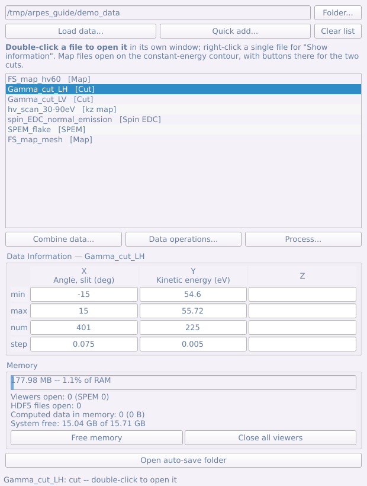

La fenêtre principale est un **navigateur** : une ligne par *jeu de
données*, et non par fichier (un fichier `.nxs` contient souvent plusieurs
mesures, chacune sur sa propre ligne). Le type est indiqué après le nom :
`[Cut]`, `[Map]`, `[kz map]`, `[k-map]`, `[SPEM]`, `[EDC]`, `[Spin EDC]`…

| Action | Comment |
|---|---|
| Ouvrir un jeu de données dans sa propre fenêtre | **double-clic** sur la ligne, ou **Open selected** |
| Tout ce qui agit sur des jeux de données | **clic droit** sur la ligne (ou sur une sélection de lignes) |
| Lire les axes : première/dernière valeur, nombre de points, pas | clic droit → **Show information** (remplit *Data Information*) |
| Tronquer / normaliser / compresser plusieurs jeux à la fois | **Data operations...** |
| Lisser, dériver, courbure, fonds, symétriser | **Process...** |
| Voir et libérer la mémoire | le cadre **Memory** en bas |

Le menu contextuel ne propose que ce qui convient à la sélection. Une entrée
grisée explique pourquoi au survol — par exemple *Cut arithmetic* demande
exactement deux coupes, la *3D view* une carte.

**Show information** ouvre aussi toutes les métadonnées du jeu de données
dans une fenêtre à part, avec un champ de filtre et **Export metadata
(.csv)** :

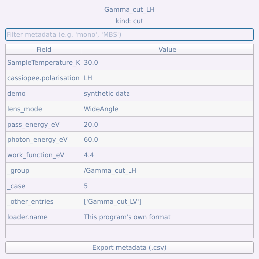

**Clear list** demande confirmation, et propose d'enregistrer ce qui a été
calculé pendant la session sans avoir encore été sauvegardé. Les fichiers sur
le disque ne sont jamais supprimés.

---

## 4. Charger des données

**Load data...** ouvre la fenêtre de chargement. **Quick add...** la saute et
ajoute les fichiers choisis avec la détection automatique.

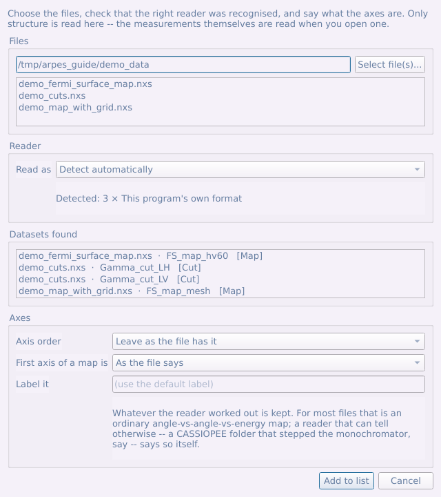

1. **Files** — choisir un ou plusieurs fichiers (*Select file(s)...*). Le
   filtre de fichiers est construit à partir de ce que les lecteurs installés
   savent ouvrir.
2. **Reader** — détecté automatiquement, et le résultat est affiché
   (*Detected: 3 × This program's own format*). À ne changer que si un
   fichier est mal lu.
3. **Datasets found** — le contenu de chaque fichier, lu à partir de sa seule
   *structure*. C'est instantané même pour un balayage de plusieurs Go ; rien
   n'est lu avant d'ouvrir une ligne.
4. **Axes** — *Axis order* réordonne une fois pour toutes les dimensions du
   tableau, dès le chargement. *First axis of a map is* indique ce qui a été
   balayé : un angle de déflecteur (par défaut), une **énergie de photon**, une
   température, une tension de grille, un délai… L'unité reste ainsi correcte
   partout ensuite, et aucune conversion en k n'est proposée pour un axe qui
   n'est pas un angle.

**Dossiers CASSIOPEE.** Sélectionnez n'importe quel fichier d'une série
numérotée (`nom_1_ROI1_.txt`, `nom_2_ROI1_.txt`, …) : tout le dossier est
listé une seule fois, comme un cube assemblé. Qu'il devienne une carte en
angle ou une carte kz est déterminé à partir des fichiers de paramètres `_i`
placés à côté des spectres.

### Types de données

| Type | Axes | Ce que c'est |
|---|---|---|
| `cut` | angle (ou k) × E | un spectre |
| `map` | angle × angle × E | un balayage au déflecteur ou en angle polaire |
| `k_map` | kx × ky × E | une carte convertie en impulsion |
| `kz_map` | hν × angle × E | un balayage en énergie de photon |
| `kz_map_k` | k_z × k∥ × E | ce balayage converti en impulsion |
| `spem_4d`, `spem_1d` | x (× y) × angle × E | balayages en espace réel |
| `edc`, `mdc`, `spin_edc` | E (ou k) × canaux | courbes, avec canaux σ facultatifs |

---

## 5. Ce que les fenêtres de visualisation ont en commun

Chaque jeu de données s'ouvre dans sa propre fenêtre : on peut placer côte à
côte une carte, ses coupes et un autre fichier.

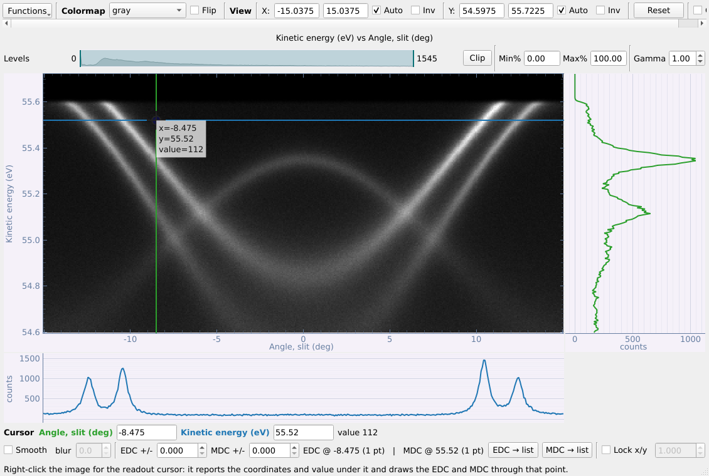

- **La ligne du haut** : le menu **Functions** (tout ce que la fenêtre sait
  faire), la palette de couleurs (propre à chaque fenêtre) avec **Flip**, et
  les réglages de vue — étendue des axes, **Auto**, **Inv** (inverser),
  **Reset**, **Grid**.
- **Au-dessus de chaque image** : la barre **Levels** (faire glisser les deux
  poignées, ou saisir des centiles **Min%/Max%** ; **Clip** les applique) et
  **Gamma**.
- **Sous chaque image** : **Smooth** (affichage seulement, les données ne
  changent pas) et **Lock x/y** (rapport d'aspect).
- **Curseur de lecture** — clic droit sur l'image → *Readout cursor*. Il
  donne la valeur sous le curseur et, sur une coupe, trace l'**EDC** (à
  droite) et la **MDC** (en dessous) passant par ce point. **EDC ±** /
  **MDC ±** intègrent sur une fenêtre, affichée comme une bande ombrée sur
  l'image. Saisissez une position dans la ligne **Cursor** et appuyez sur
  Entrée pour l'y placer exactement.
- **EDC → list** / **MDC → list** ajoutent la courbe affichée à la liste
  principale comme jeu de données à part entière (voir
  [§15](#15-courbes--edc-mdc-et-données-résolues-en-spin)).
- **Clic droit sur l'image → Export** enregistre ce que montre le panneau —
  données (`.nxs`), image, ou axes vectoriels (`.eps`) ; voir
  [§17](#17-figures-et-exportation).
- **Functions → Slice → Save slice to the main list / Open slice in a new
  panel** conserve une copie de la tranche affichée.

Le menu **Functions** est organisé en sections :

| Fenêtre | Analysis | Data operations | Visualization |
|---|---|---|---|
| carte / carte kz / carte k | | Arbitrary cut, Map k conversion, kz map processing, kz → momentum, De-grid map | Brillouin zone (cartes k), Slice figure |
| coupe | Fermi level, MDC / EDC fit | FS correction, Cut k conversion, Cut arithmetic, De-grid | |
| courbe | Curve fit, Spin analysis | Crop, Bin, Normalise, Background, Shift axis, Add √N errors | As a figure |

Une entrée qui ne s'applique pas n'est pas affichée ; une entrée qui
s'applique mais ne peut pas encore être lancée est grisée, et son infobulle
en donne la raison.

---

## 6. Les cartes : le contour et ses deux coupes

Une carte s'ouvre sur son **contour à énergie constante**. Le curseur du haut
choisit l'énergie (**Pos** en eV, ou **Ind** en indice ; **±** intègre sur une
fenêtre, en **mean** ou **sum**). **Deflector cut** et **Slit cut** ouvrent
les deux coupes orthogonales, chacune dans sa fenêtre.

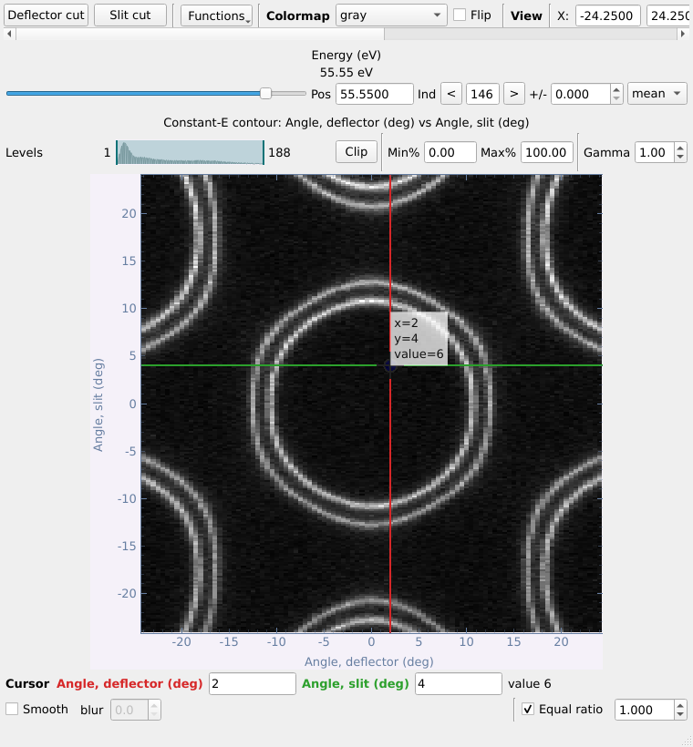

| Coupe selon la fente (angle de fente vs énergie) | Coupe selon le déflecteur (angle de déflecteur vs énergie) |
|---|---|
| 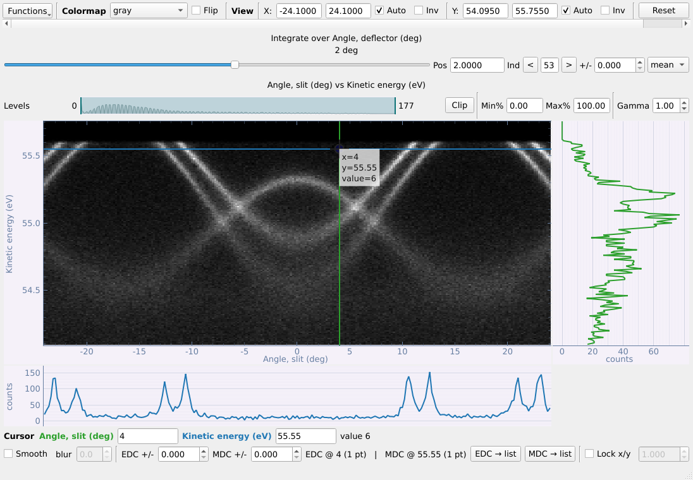 |  |

**Un seul curseur pour les trois fenêtres.** Activer le curseur de lecture
dans l'une l'active dans les autres, et le déplacer n'importe où recoupe les
autres en ce nouveau point. Chaque axe garde sa couleur partout :
**déflecteur en rouge, fente en vert, énergie en bleu**. Une ligne de curseur
a la couleur de l'axe qu'elle maintient constant, et l'EDC ou la MDC qu'elle
alimente est tracée de la même couleur. Les largeurs d'intégration (les
champs ±) appartiennent à chaque fenêtre et ne sont jamais partagées.

On peut aussi ouvrir directement une coupe d'une carte depuis la liste (clic
droit → **Open slit cut** / **Open deflector cut**) ; le contour reste alors
caché jusqu'à ce qu'on le demande (*Functions → Show the map*).

---

## 7. Les coupes : du spectre brut aux paramètres de bande

L'ordre habituel pour une coupe est : **niveau de Fermi → décaler l'axe en
énergie → conversion en k → ajustement MDC/EDC**.

### 7.1 Niveau de Fermi

*Functions → Fermi level...* ajuste un front de Fermi (Fermi–Dirac × densité
d'états linéaire, convoluée par une résolution gaussienne) sur l'EDC sommée
dans un cadre.

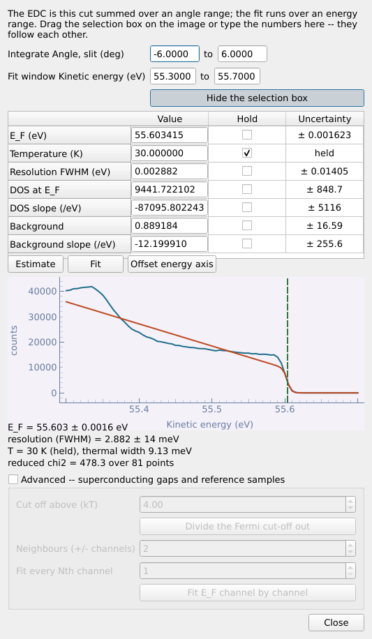

1. Appuyez sur **Show the selection box** et faites glisser le cadre sur le
   front, sur la coupe (ou saisissez les intervalles d'angle et d'énergie).
   L'intervalle d'angle fixe les canaux sommés ; l'intervalle d'énergie est
   la fenêtre d'ajustement.

   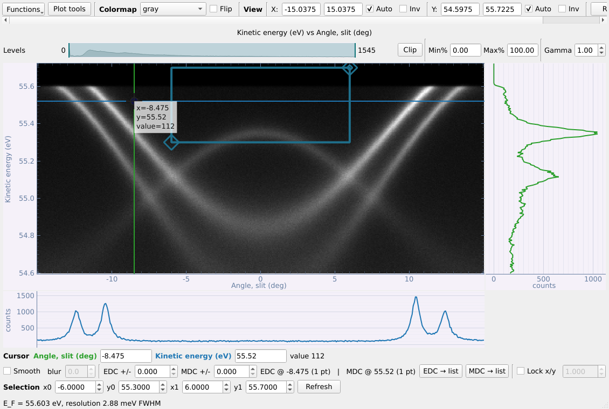

2. **Estimate**, puis **Fit**. Cochez **Hold** pour fixer un paramètre (la
   température est fixée par défaut à la valeur enregistrée). Chaque
   paramètre est donné avec son incertitude.
3. **Offset energy axis** ajoute à la liste une copie de la coupe en
   **E − E_F**.

Le coin *Advanced* divise par la coupure de Fermi (pour les gaps et les
échantillons de référence) ou ajuste E_F canal par canal.

### 7.2 Conversion en k d'une coupe

*Functions → Cut k conversion...* convertit l'axe angulaire en k∥ (Å⁻¹). Une
coupe est une droite du plan (kx, ky) qui, en général, ne passe pas par Γ :
la fenêtre demande donc où se trouve Γ. Saisissez les angles, ou utilisez
**From a converted map...** pour les reprendre d'une carte déjà convertie.

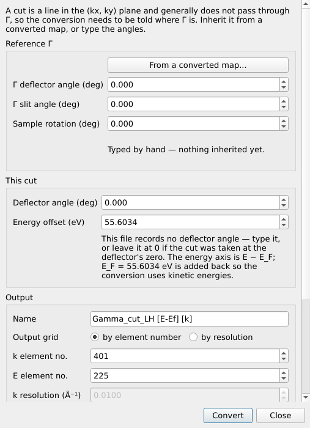

Si la coupe est déjà en E − E_F, la fenêtre remplit **Energy offset** avec le
E_F soustrait (la note en dessous le signale) : la conversion utilise les
vraies énergies cinétiques, et le résultat reste en E − E_F.

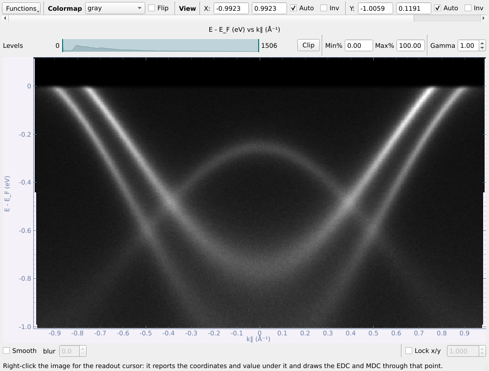

### 7.3 Ajustement MDC / EDC

*Functions → MDC / EDC fit...* ajuste des pics ligne par ligne et en déduit
la bande à partir des centres ajustés. N'accepte qu'une coupe dont l'axe est
déjà en Å⁻¹ — une vitesse en eV·deg n'aurait aucun sens.

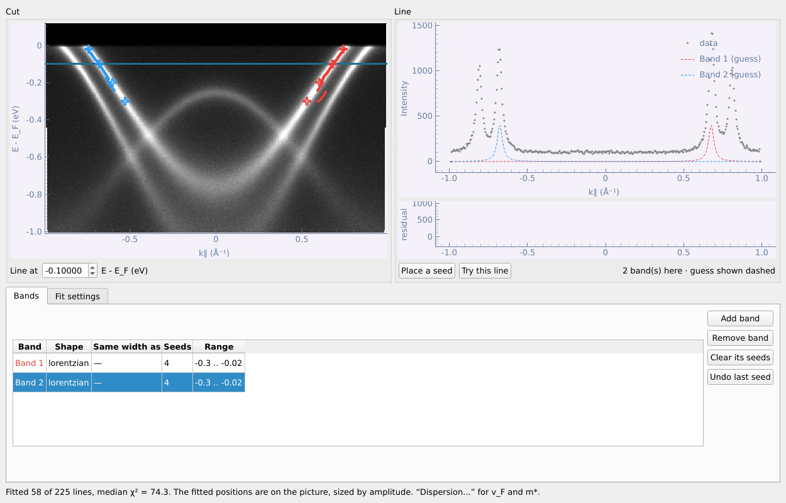

1. Onglet **Bands** : **Add band** pour chaque branche ; sélectionnez une
   bande, appuyez sur **Place a seed** et cliquez sur le pic, sur la courbe (à
   droite). Quatre ou cinq points de départ le long d'une bande suffisent ;
   **Line at** change la ligne examinée.
2. **Try this line** montre l'ajustement de la ligne courante (en tirets :
   l'estimation initiale).
3. Onglet **Fit settings** : MDC ou EDC, forme de pic (lorentzienne,
   gaussienne, Voigt), fond, pas, puis **Fit the series**. Les positions
   ajustées sont tracées sur l'image, avec une taille proportionnelle à
   l'amplitude.
4. **Dispersion...** ajuste la bande : **v_F** (droite), **m\*** (parabole) —
   et vérifie jusqu'où l'ajustement reste stable. **Self-energy...** donne
   Re Σ et Im Σ.

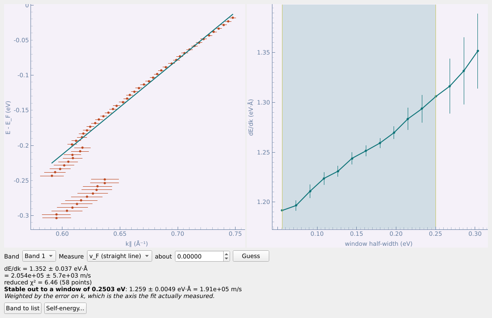

**Save table...** écrit toutes les lignes ajustées ; **Band to list** ajoute
une bande à la liste principale.

---

## 8. D'angles en impulsion pour une carte, et la zone de Brillouin

### 8.1 Conversion en k d'une carte

*Functions → Map k conversion...* dans la fenêtre du contour. Faites glisser
le curseur de lecture sur le point qui doit devenir **k = (0, 0)** — la
fenêtre le suit — puis **Convert**. Le résultat est une nouvelle ligne
`k-map` dans la liste.

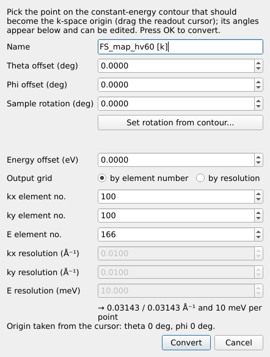

- **Sample rotation** fait tourner la carte autour de la normale à la
  surface ; **Set rotation from contour...** la déduit d'une direction
  cliquée sur le contour (deux points le long d'une ligne de symétrie, par
  exemple).
- **Output grid** : nombre de points, ou résolution (Å⁻¹, meV).
- **Energy offset** est ajouté à l'axe en énergie avant la conversion, pour
  un axe qui n'est pas une vraie énergie cinétique (rempli automatiquement
  pour une carte en E − E_F).

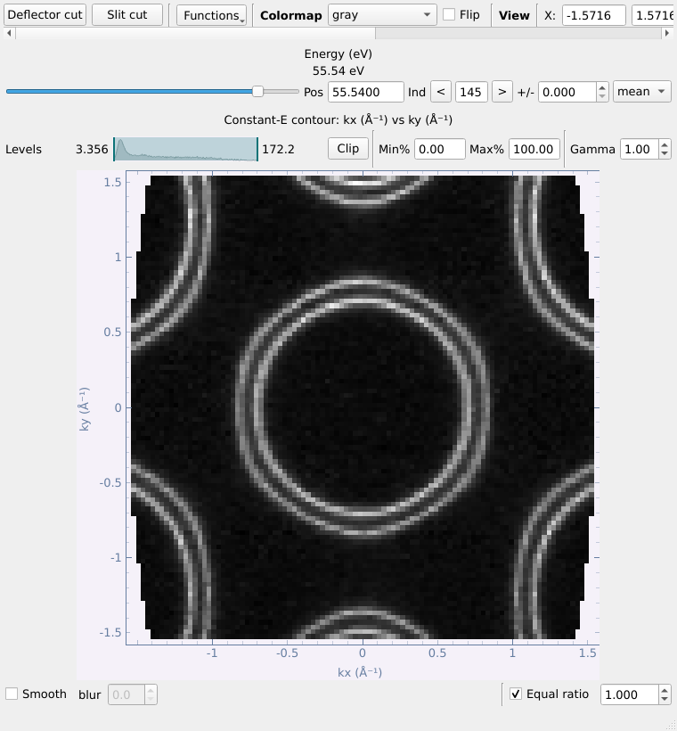

### 8.2 Zone de Brillouin

Sur une carte k : *Functions → Visualization → Brillouin zone...*.

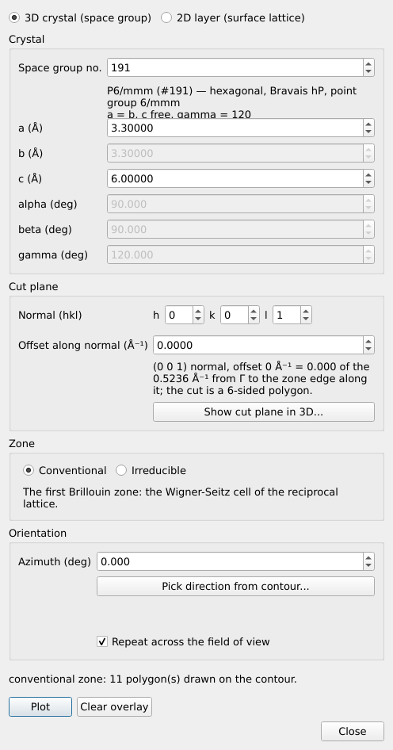

1. D'abord le **groupe d'espace** (1–230) ; les paramètres de maille qu'il
   impose sont grisés et suivent les paramètres libres. Ou passez en **2D
   layer** pour un réseau de surface.
2. **Cut plane** : la normale à la surface (hkl) et un décalage le long de
   celle-ci — on trace la section de la zone 3D par ce plan, pour n'importe
   quelle surface et pas seulement (001). **Show cut plane in 3D...** la
   prévisualise.
3. Zone **Conventional** ou **Irreducible** ; **Azimuth** (ou **Pick
   direction from contour...**) ; **Repeat across the field of view**.
4. **Moiré** ajoute une seconde couche, tournée ou désaccordée, et sa zone de
   moiré.
5. **Plot**.

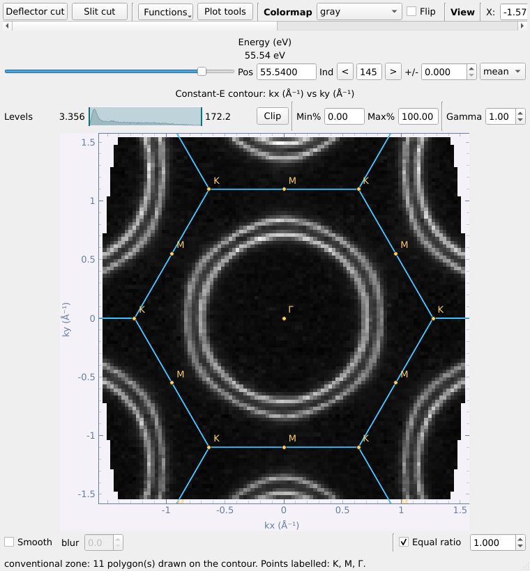

---

## 9. Coupes arbitraires et correction de la surface de Fermi

### 9.1 Coupe arbitraire

*Functions → Arbitrary cut...* sur n'importe quel contour : cliquez jusqu'à
six points (ou saisissez-les) ; la coupe les parcourt dans l'ordre — ici
Γ → M → K → Γ sur la carte k. **One dataset per segment** crée un jeu de
données par segment.

| Chemin sur le contour | Points |
|---|---|
| 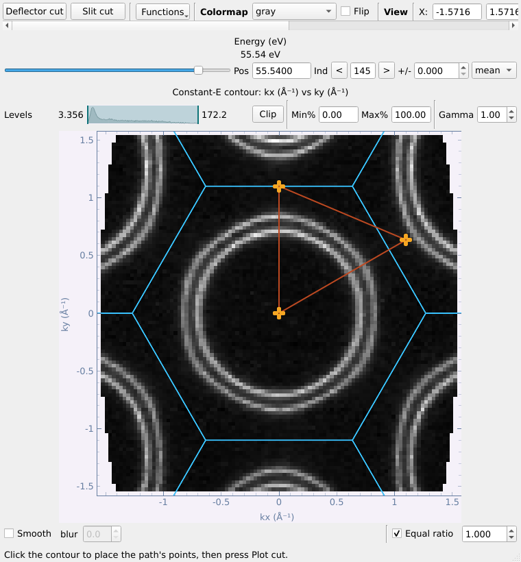 |  |

Le résultat est une coupe en fonction de la distance le long du chemin ; les
coins du chemin sont marqués par des tirets verts, pour qu'un coude à cet
endroit ne soit pas pris pour de la physique.

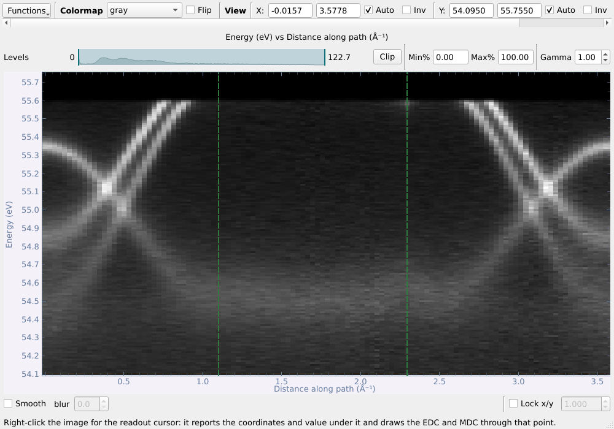

### 9.2 Correction de la surface de Fermi (FS)

*Functions → FS correction...* sur une coupe (ou sur la coupe selon la fente
d'une carte) redresse une structure qui devrait être plate — en général le
front de Fermi, courbé en fonction de l'angle de l'analyseur. Cliquez le long
de la structure : un polynôme (d'ordre 2 par défaut) est ajusté et chaque
colonne d'angle est décalée en énergie. **From a reference (Au)...** prend
plutôt la courbe sur un spectre d'or présent dans la liste. Sur la coupe
selon la fente d'une carte, le même décalage est appliqué à tout le cube.


---

## 10. Traitement : lissage, dérivées, courbure

Sélectionnez une ou plusieurs coupes (ou cartes) dans la liste et appuyez sur
**Process...**. Chaque résultat est un nouveau jeu de données qui garde la
trace des étapes qui l'ont produit.

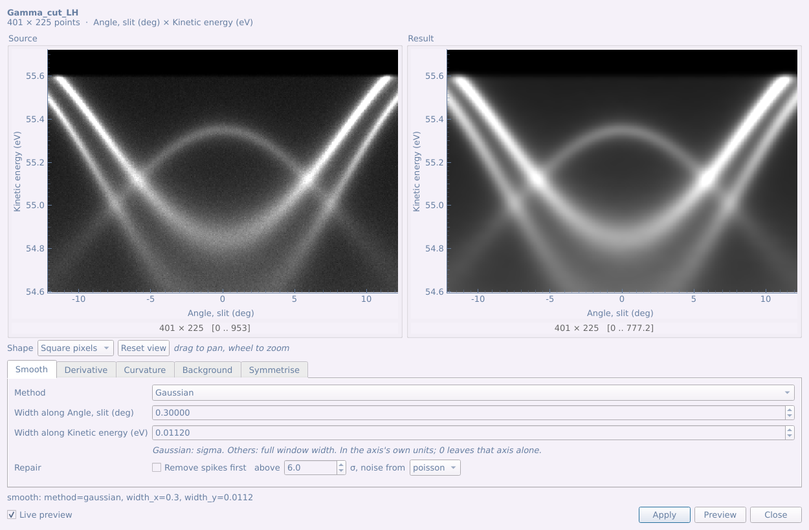

- Onglets : **Smooth** (gaussien, boîte, … ; suppression des pics
  facultative), **Derivative**, **Curvature** (1D et 2D), **Background**,
  **Symmetrise**.
- **Source** et **Result** sont affichés côte à côte, sur la même échelle,
  pour voir quand un réglage a « mangé » la bande. Ils se déplacent et
  zooment ensemble.
- **Shape** : *Square pixels* (un point de données est carré — sans
  distorsion pour une coupe angle-énergie), *Equal axes* (une unité a la même
  longueur sur les deux axes — adapté à angle-angle ou k-k ; choisi
  automatiquement quand les deux axes ont la même unité), ou *Fill the box*.
- **Live preview** recalcule à chaque changement de valeur ; **Apply** ajoute
  le résultat à la liste.

Pour une carte, le panneau travaille plan par plan et demande d'abord **sur
quels plans** — contours à énergie constante ou dispersions — car la courbure
d'un contour et celle d'une coupe sont des grandeurs différentes. **Preview
at** choisit le plan affiché ; **Apply to the whole cube** traite tous les
plans.

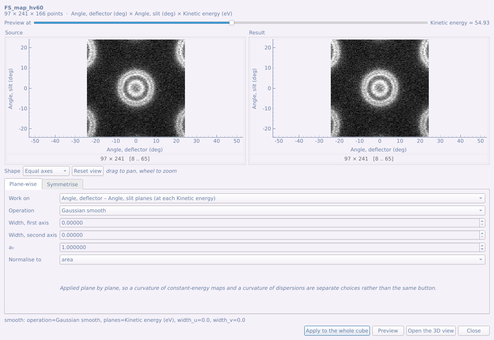

**Data operations...** (fenêtre principale) tronque, auto-normalise ou
compresse (regroupe des pixels) un ou plusieurs jeux de données à la fois — à
condition qu'ils soient du même type et aient le même nombre de points sur
chaque axe.


---

## 11. Empilements de courbes et vue 3D

**Stack plot** (clic droit sur une coupe) : une cascade d'EDC ou de MDC, avec
le nombre de courbes, le regroupement, la normalisation, le décalage, le
cisaillement et la coloration ; **Send to figure composer** en fait un
panneau de figure.


**3D view** (clic droit sur une carte) demande d'abord la région et
l'échantillonnage, car chaque image rééchantillonne le cube — *Fast*,
*Balanced* ou *Fine* déterminent si la vue suit la souris.


Faites ensuite glisser l'image pour la faire tourner. **Slices** montre trois
plans orthogonaux aux positions choisies, **Notched cube** retire un coin du
cube, et **Projection** somme le long d'un axe. Palette, niveaux, gamma,
azimut, élévation et rapport de profondeur sont à droite ; **Save the
view...** exporte l'image.

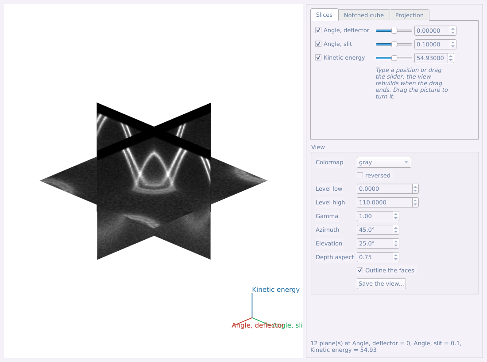

---

## 12. Arithmétique de coupes : dichroïsme et division par une référence

Deux coupes en donnent une troisième : dichroïsme linéaire (LH − LV),
dichroïsme circulaire, division par une référence d'or, ou simples
différences, rapports et sommes. Sélectionnez deux coupes dans la liste →
clic droit → **Cut arithmetic on the two...** (la première sélectionnée est
A), ou, dans la fenêtre d'une coupe, *Functions → Cut arithmetic...* puis
cliquez sur l'autre coupe dans la liste.


- **Le tableau du haut** compare ce que les deux mesures ont enregistré
  (polarisation, énergie de photon, angles, position de l'échantillon,
  température, énergie de passage, mode de lentille). Les lignes en orange
  diffèrent au-delà d'une tolérance — une carte de dichroïsme entre deux
  points de l'échantillon est une carte de *cette* différence-là.
- Préréglages **Purpose** : *Linear dichroism* (A − B, B mis à la même
  intensité totale), *Circular dichroism* ((A − B)/(A + B)), *Divide by a
  reference*, *Custom*. Un avertissement apparaît si les polarisations
  semblent inversées (**Swap A ↔ B**).
- **Scale B to A** par l'intensité totale ou celle d'une région ; **Hide
  where A+B below** masque le fond.
- A et B sont tracés sur une seule échelle de couleurs ; le résultat sur une
  échelle rouge-blanc-bleu symétrique autour de zéro. Avec des comptages
  bruts des deux côtés, l'incertitude de Poisson est propagée et résumée sous
  le graphique.
- **Result to list**, **Uncertainty to list**, **All three as a figure**.

---

## 13. Balayages en énergie de photon (kz)

Un balayage en énergie de photon est listé comme `kz map` ; son contour est
l'énergie de photon en fonction de l'angle, à une énergie donnée.

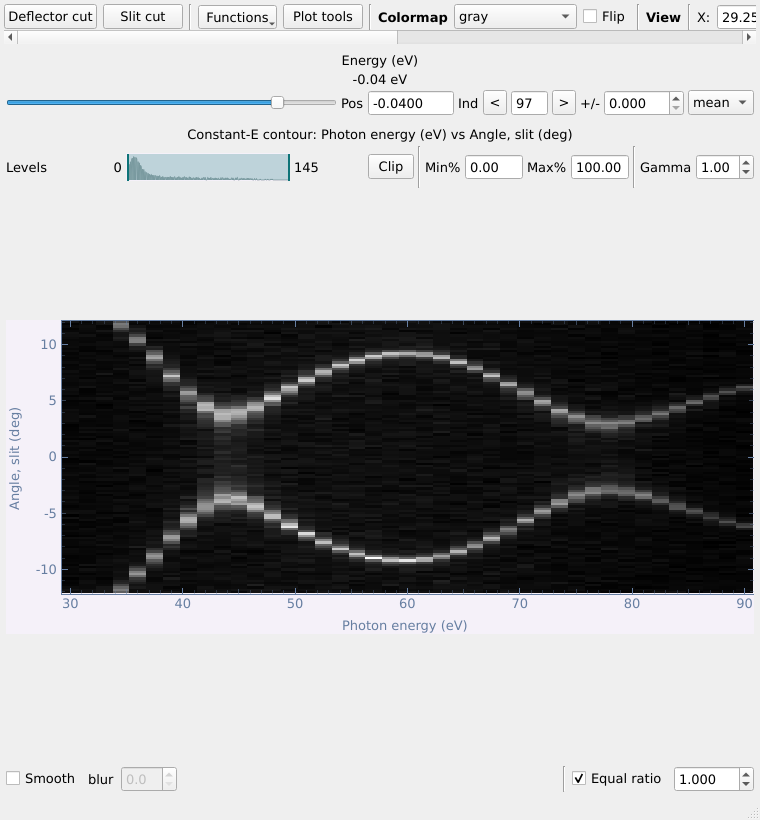

### 13.1 Traitement d'une carte kz

Rien dans les fichiers n'indique où se trouve réellement le niveau de Fermi
de chaque spectre. *Functions → kz map processing...* le mesure sur les
spectres eux-mêmes.

1. La coupe selon la fente s'ouvre avec un cadre. Faites glisser le cadre sur
   un front de Fermi — l'intervalle d'angle fixe les canaux sommés,
   l'intervalle d'énergie la fenêtre d'ajustement.

   

2. **Fit and assemble** : le même cadre (en indices du détecteur) est utilisé
   pour chaque spectre ; chacun est décalé pour placer son propre front à
   zéro ; le cube est rogné à l'intervalle couvert par tous ; et, par défaut,
   chaque spectre est **normalisé par son intensité totale**, ce qui élimine
   les variations du flux de photons.


E_F en fonction de l'énergie de photon est tracé. Une courbe régulière
signifie des ajustements fiables ; les points dont l'ajustement n'est pas
crédible sont signalés et remplacés par interpolation de leurs voisins.

### 13.2 kz → impulsion

*Functions → kz -> momentum...* convertit le balayage en (k_z, k∥).

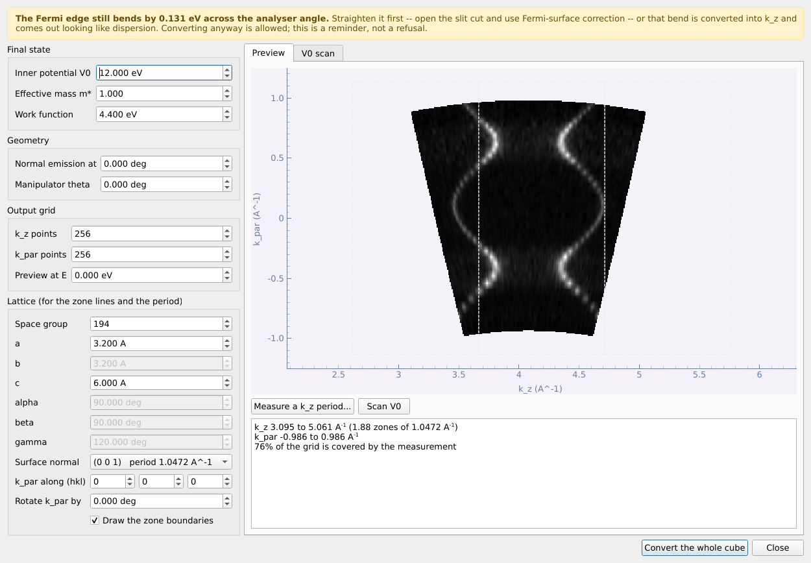

- Le **potentiel interne V0** est l'inconnue : l'aperçu reconvertit une
  tranche en énergie à chaque modification, en quelques millisecondes.
- Avec le **réseau** (groupe d'espace, a, b, c), la **normale à la surface**
  et la direction dans le plan, les limites de zone sont tracées sur
  l'aperçu.
- **Scan V0** convertit pour une série de valeurs de V0 et indique où la
  période en k_z correspond au réseau — et avec quelle précision cela fixe V0.
- **Measure a k_z period...** : cliquez deux points correspondant à la même
  structure, distants d'une zone ; les plans du réseau réciproque compatibles
  sont listés.
- Le bandeau jaune avertit quand le front de Fermi est encore courbé en
  fonction de l'angle de l'analyseur — corrigez-le d'abord (correction FS sur
  la coupe selon la fente).
- **Convert the whole cube** ajoute une `kz map (k)` à la liste.

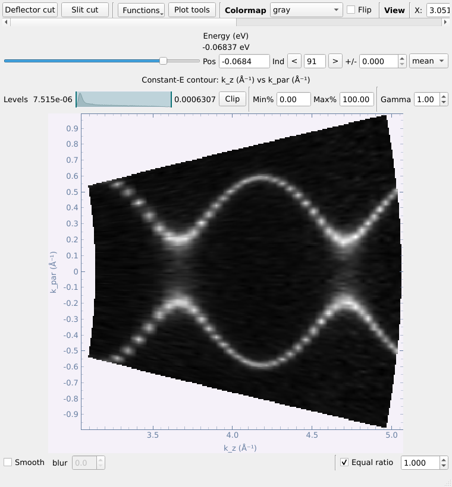

---

## 14. Supprimer la grille du détecteur

Les motifs du MCP (hexagonal) et de la grille (carré) s'impriment sur chaque
image. **À faire en premier** : seules les données encore sur les pixels du
détecteur peuvent être dégrillées ; le bouton refuse donc tout ce qui a déjà
été converti, corrigé ou lissé, et dit pourquoi.

*Functions → De-grid map...* sur une carte (ou sa coupe selon la fente), ou
*De-grid...* sur une coupe. Pour une carte, aucune référence n'est
nécessaire — la grille reste sur les mêmes pixels dans chaque tranche, alors
que la photoémission se déplace. **Find and remove the grid** :

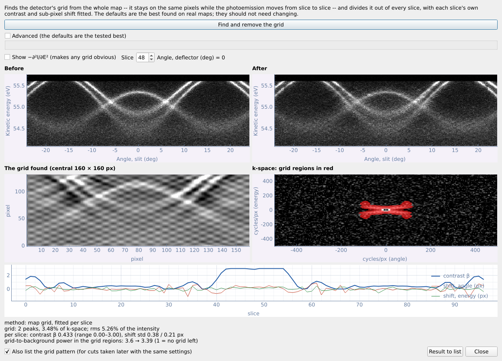

- **Before / After** pour une tranche choisie, sur une même échelle de
  couleurs (cochez **Show −∂²I/∂E²** pour rendre toute grille évidente).
- **La grille trouvée**, ses **régions dans l'espace réciproque** (en rouge),
  et le **contraste et le décalage** ajustés pour chaque tranche.
- La puissance restant dans les régions de la grille (1 = plus de grille).
- **Also list the grid pattern** conserve un jeu de données `[grid]`, qu'une
  coupe prise plus tard avec le même mode de lentille et la même énergie de
  passage retrouvera et utilisera.

---

## 15. Courbes : EDC, MDC et données résolues en spin

**EDC → list** / **MDC → list** sous n'importe quelle image, ou un fichier
résolu en spin, donnent un jeu de données de courbes, qui s'ouvre dans la
**fenêtre de courbes** :

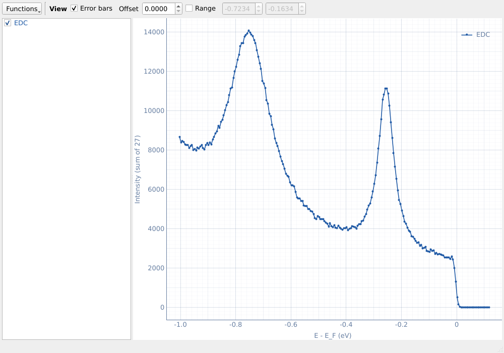

Les canaux peuvent être masqués, décalés en cascade (**Offset**), affichés
avec des **Error bars** (à partir d'un canal σ), et **Range** délimite une
fenêtre en x utilisée par les opérations. *Functions → Data operations*
propose **Crop**, **Bin**, **Normalise**, **Subtract a background**
(constant, linéaire, Shirley), **Shift the axis** et **Add counting errors
(√N)** ; chacune crée un nouveau jeu de données et propage correctement σ.

### 15.1 Ajustement de courbes

*Functions → Curve fit...* : **Peaks on a background** (pics lorentziens,
gaussiens ou de Voigt, placés par clic ou par **Find peaks** ; fond nul /
constant / linéaire / Shirley ; résolution instrumentale ; **× Fermi edge**
facultatif), ou le **Fermi edge** lui-même. La pondération est le σ propre au
canal, √N, ou uniforme. Chaque paramètre est donné avec son erreur ; le
résidu est affiché en unités de σ.

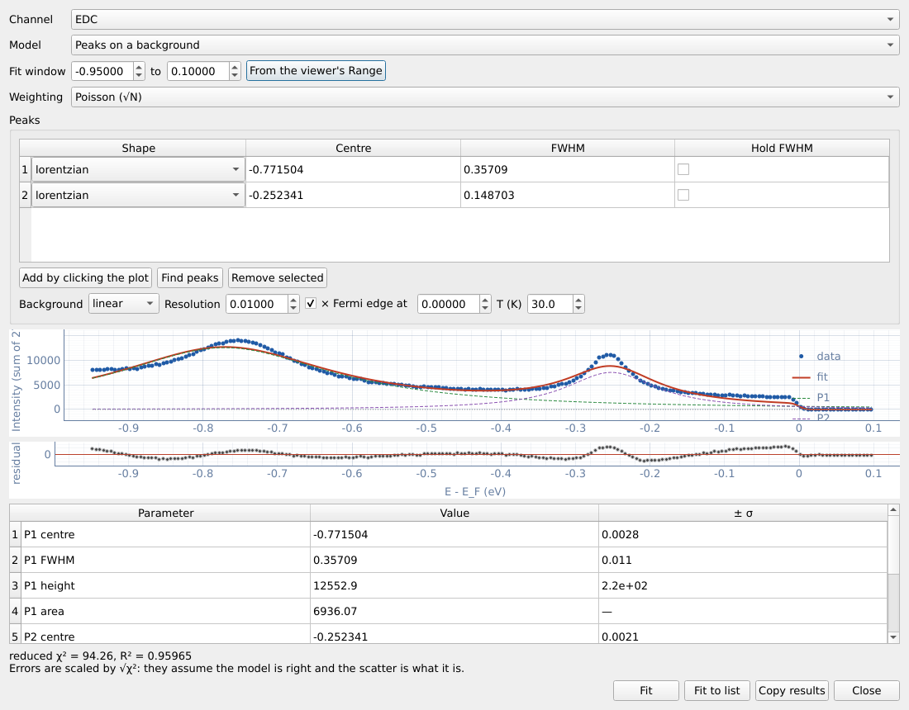

**Fit to list** conserve les données, l'ajustement, le résidu et les
composantes ; **Copy results** copie un tableau séparé par des tabulations.
Un ajustement du front de Fermi permet **List a copy with E_F = 0**.

### 15.2 Analyse de spin

Une EDC de spin s'ouvre avec une courbe par canal de spin :

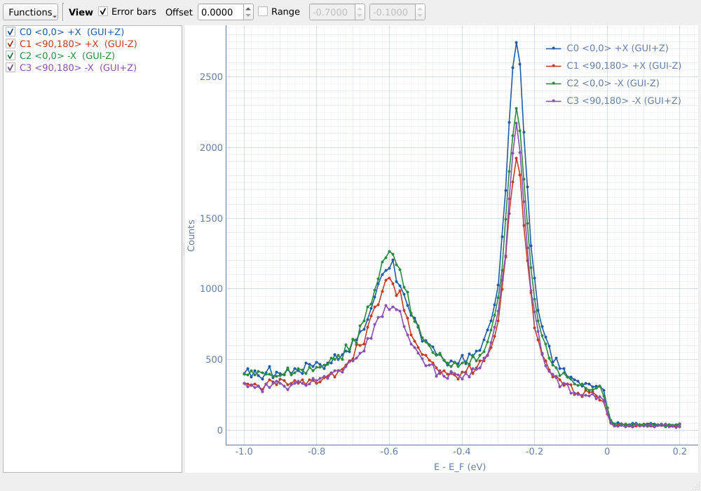

*Functions → Spin analysis...* :

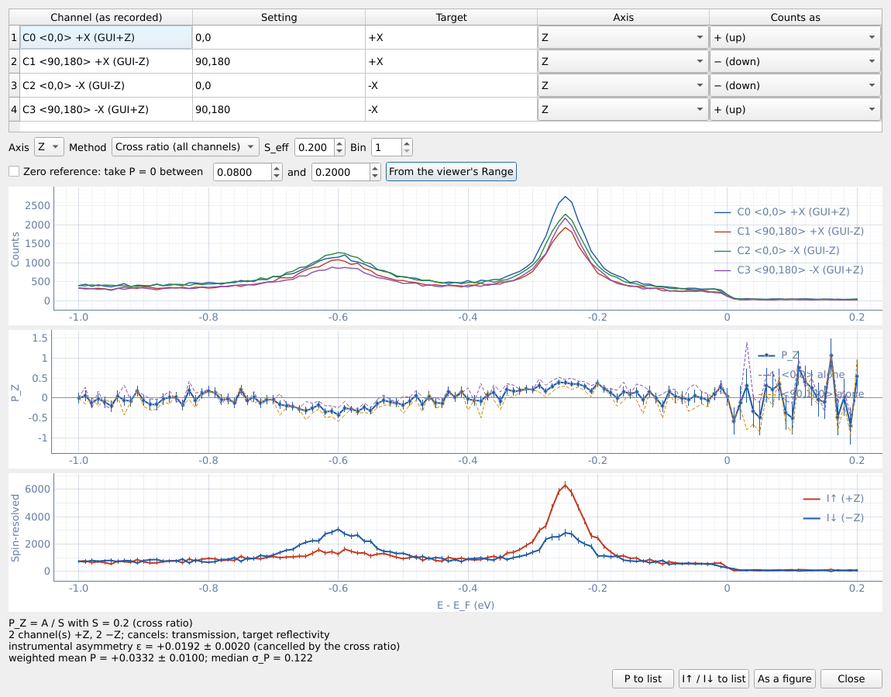

- Le tableau lit l'étiquette de chaque canal (réglage du manipulateur,
  aimantation de la cible, axe et signe comptés comme « haut ») ; **Axis** et
  **Counts as** peuvent être modifiés.
- Le **Cross ratio** (par défaut quand les canaux le permettent) élimine
  exactement à la fois la transmission et la réflectivité de la cible ; une
  **seule paire** est disponible mais porte l'asymétrie instrumentale, qui est
  mesurée et indiquée (ε).
- **S_eff** (fonction de Sherman, 0,2 par défaut), **Bin**, fenêtre **Zero
  reference** facultative.
- Graphiques : canaux bruts, P avec ses barres d'erreur, et I↑ / I↓ avec
  leurs erreurs.
- **P to list**, **I↑ / I↓ to list**, **As a figure**.

---

## 16. Balayages résolus spatialement (nano-ARPES)

Un balayage en espace réel ouvre la **carte spatiale** (à gauche, l'intensité
totale en chaque position) avec le **spectre E-k au curseur** (à droite).
Faites glisser la cible rouge pour lire le spectre en un autre point. Un clic
droit sur un panneau donne les deux intégrations :

- sur la carte, **Integrate selection → E vs k panel** somme les spectres sur
  une région de l'échantillon ;
- sur le spectre, **Integrate selection → spatial panel** cartographie sur
  l'échantillon l'intensité d'une fenêtre (k, E) choisie — c'est ainsi qu'on
  repère un domaine ou le bord d'un flocon.

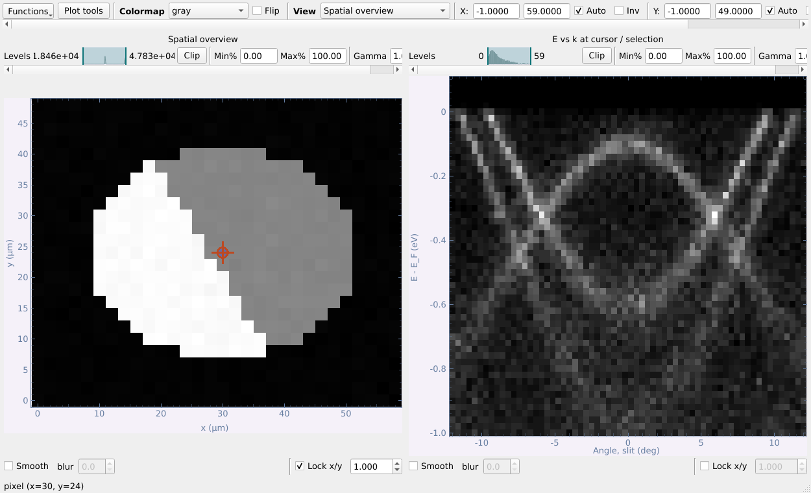

---

## 17. Figures et exportation

### 17.1 Composeur de figures

Sélectionnez des coupes (ou des courbes) dans la liste → clic droit → **Plot
as a figure**. Le composeur dispose les panneaux pour un article : une même
taille par colonne, des étiquettes seulement sur les bords extérieurs, des
lettres (a)/(b)/(c), et des échelles de couleurs partagées si on le souhaite.

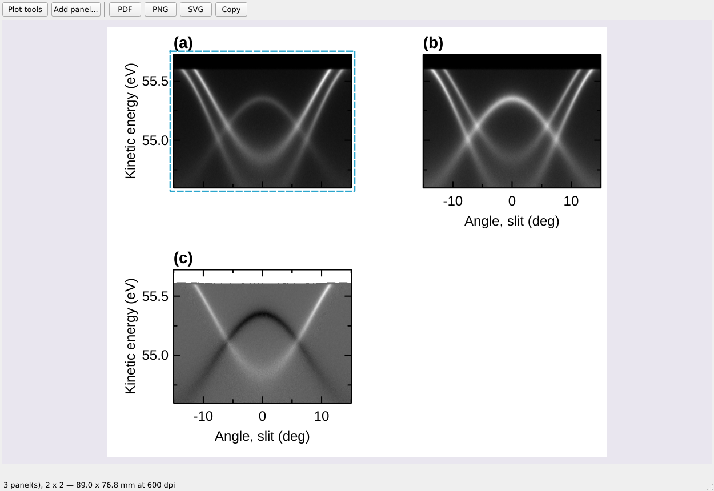

**Plot tools** règle tout (taille en mm, polices, graduations, barres de
couleurs, lignes, flèches, texte, encarts, barres d'échelle) ; **Add
panel...** ajoute un autre jeu de données ; **PDF**, **PNG**, **SVG**
exportent, **Copy** copie dans le presse-papiers.

### 17.2 Figure de tranches

Depuis une carte : *Functions → Slice figure...* dispose une série de
tranches du cube — contours à énergie constante ou coupes — régulièrement
espacées ou à des valeurs choisies, avec intégration, une échelle de couleurs
commune et des titres.

| Réglages | Résultat |
|---|---|
| 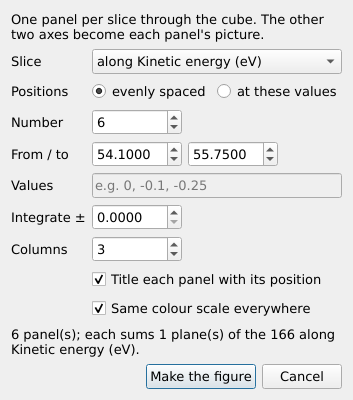 |  |

### 17.3 Exporter un panneau

Clic droit sur n'importe quelle image → **Export** → **Data (.nxs)...**,
**Image...** ou **Axes only (.eps)...**. L'exportation reprend toujours
exactement ce que montre le panneau (étendue comprise) : les données, comme
un jeu de données que ce programme sait relire ; une image avec la palette
appliquée (PNG, TIFF ou JPEG, à la taille et à la résolution choisies, avec
ou sans les axes) ; ou le cadre, les graduations et les étiquettes en
PostScript vectoriel, pour y placer l'image dans Illustrator.

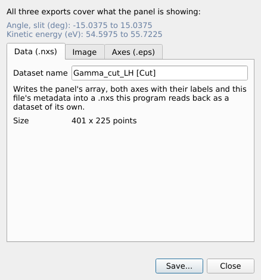

**Save** (clic droit sur des lignes de la liste) écrit des jeux de données
dans un fichier `.nxs` de votre choix ; plusieurs lignes sélectionnées vont
dans un même fichier.

---

## 18. Sauvegarde automatique, mémoire et récupération

- **Sauvegarde automatique.** Chaque jeu de données calculé (une carte k, une
  coupe traitée, un résultat d'ajustement…) est écrit, sans compression, dans
  le dossier de la session sous `~/.arpes_viewer/sessions/` dès qu'il existe.
  Les balayages en espace réel ne le sont pas (ce sont les mesures
  elles-mêmes, et elles sont volumineuses).
- **Une fermeture normale supprime les copies automatiques.** Quand vous
  fermez la fenêtre principale et confirmez (tout ce que vous voulez garder
  est enregistré, ou *Close anyway*), les fenêtres ouvertes sont fermées et le
  dossier de la session est supprimé immédiatement. La copie d'un jeu de
  données disparaît aussi dès que vous l'enregistrez dans un fichier à vous.
- **Récupération après un plantage.** Ce n'est que si le programme ne s'est
  pas fermé normalement (plantage, arrêt forcé) que le dossier de la session
  est conservé : au démarrage suivant, ses jeux de données vous sont
  proposés, et il est supprimé au bout de trois jours.
- **Journal des opérations.** `~/.arpes_viewer/sessions/operations.log`, une
  ligne par écriture / enregistrement / suppression — pour retrouver ce qui
  était où.
- **Cadre Memory.** La mémoire du programme et celle du système, le nombre de
  fenêtres et de fichiers HDF5 ouverts, et la quantité de données calculées
  conservées. **Free memory** abandonne les copies en cache des données
  calculées (elles sont relues depuis leur fichier de sauvegarde au besoin) ;
  **Close all viewers** ferme toutes les fenêtres puis libère la mémoire.
- **Open auto-save folder** (sous le cadre Memory) ouvre le dossier des
  sessions dans l'explorateur de fichiers, pour supprimer à la main les
  anciennes copies de travail. Le dossier de la session en cours (nommé dans
  la barre d'état) est utilisé : n'y touchez pas.
- **Les opérations longues** (lecture d'une grande carte, conversion,
  dégrillage, assemblage d'un dossier) tournent hors du fil de l'interface,
  avec une barre de progression et un bouton Cancel qui fonctionne.
- **La fermeture** avec des données calculées non enregistrées demande
  d'abord confirmation, en nommant les jeux de données : **Save to a
  file...**, **Close anyway** (les copies automatiques sont supprimées) ou
  **Cancel** (rien ne se passe).

## 19. Conseils et dépannage

- **« Not available here » dans le menu Functions** — survolez l'entrée :
  l'infobulle dit pourquoi (par ex. l'ajustement MDC/EDC exige une coupe déjà
  en Å⁻¹).
- **Aucune conversion en k n'est proposée** — le premier axe de la carte
  n'est pas un angle (énergie de photon, température…). Vérifiez *First axis
  of a map is* dans la fenêtre de chargement.
- **Conversion en k d'une coupe en E − E_F** — le décalage en énergie est
  rempli pour vous à partir de l'ajustement de Fermi ; si vous avez décalé
  l'axe autrement, saisissez dans *Energy offset* l'énergie cinétique de E_F
  (énergie de photon − travail de sortie).
- **Un fichier est mal lu** — choisissez explicitement le lecteur dans la
  fenêtre de chargement, et voyez *Assumptions worth knowing about* dans le
  README (ordre des axes dans les fichiers SOLEIL).
- **Le curseur est lent sur une grande carte** — une carte lue à la demande
  dans son fichier se recoupe en environ 0,1 s par fenêtre, si bien que les
  autres fenêtres attendent que la souris s'arrête. Une fois la carte lue en
  mémoire, elle suit en direct.
- **La machine utilise la mémoire d'échange** — surveillez la barre Memory
  (ambre au-delà d'un tiers de la RAM, rouge au-delà de la moitié) ; utilisez
  **Free memory** ou **Close all viewers**.
