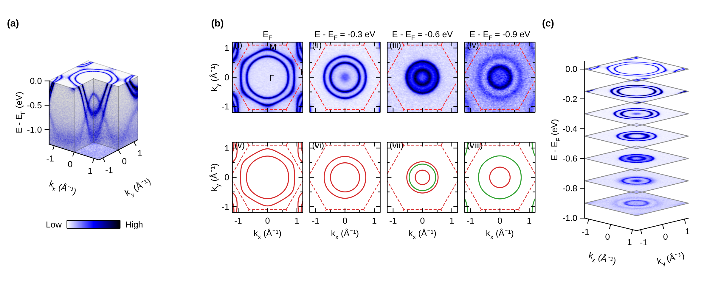
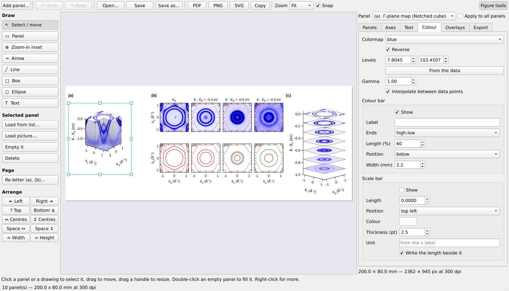
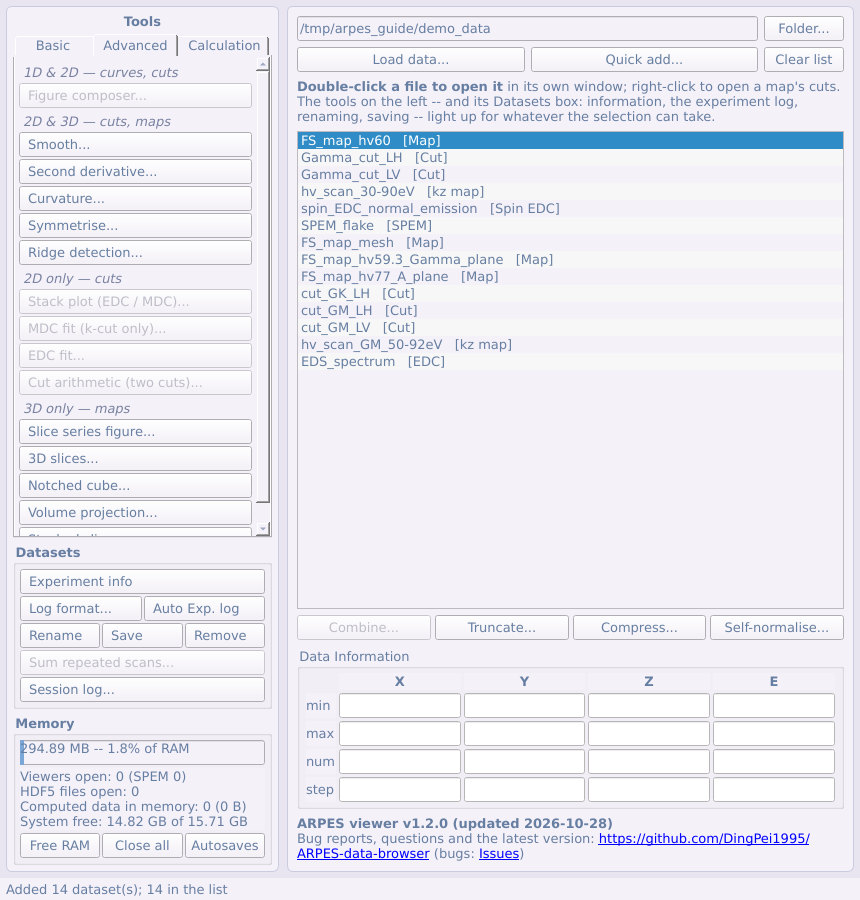
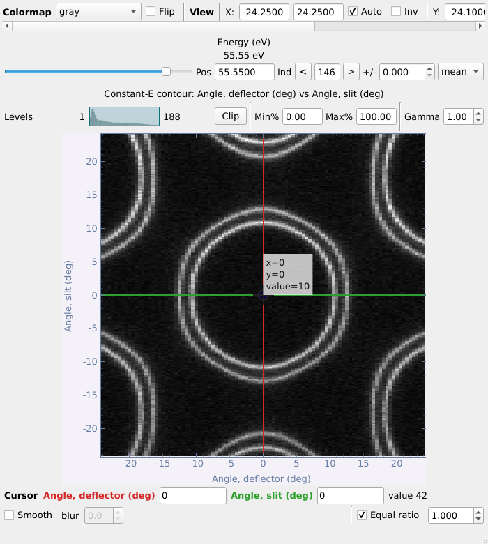

# ARPES viewer

[](https://doi.org/10.5281/zenodo.23771647)
[](https://pypi.org/project/arpes-viewer/)
[](https://github.com/DingPei1995/ARPES-viewer/blob/main/docs/USER_GUIDE_en.md)
[](https://github.com/DingPei1995/ARPES-viewer/blob/main/docs/AGENTIC_WORKFLOW_en.md)

**Version 1.2.3** (last modified 30 October 2026) — see
[CHANGELOG.md](CHANGELOG.md) for what changed. The version is in
`arpes_viewer/version.py` and is shown in the main window's title bar and at its foot,
with a link to this repository for bug reports and the latest version
(<https://github.com/DingPei1995/ARPES-viewer>). Please quote it when
reporting a bug, and upload the error log with the report ([below](#bug-reports)).

> **Terms of use.** This program is for **non-commercial use only**
> (academic research and teaching); any commercial use is not permitted.
> New and updated loaders cover data from **public large-scale facilities**
> (synchrotrons and similar user facilities), formats of individual
> laboratories' own set-ups can be added by the user him/herself. If you use this program for
> a paper on ARPES experiments, please cite it in its references:
> Ding Pei, *ARPES viewer*, Zenodo, <https://doi.org/10.5281/zenodo.23771647>
> (GitHub's *Cite this repository* gives the reference in other formats).
> If you write a paper related to AI that uses this program or its code,
> please discuss it with the author by e-mail first. For collaborations, or
> questions about the details, contact
> [ding.pei@synchrotron-soleil.fr](mailto:ding.pei@synchrotron-soleil.fr).
>
> **Licence and authorship.** Copyright (c) 2026 Ding Pei. Licensed under
> the [PolyForm Noncommercial License 1.0.0](LICENSE.md); see also
> [NOTICE](NOTICE). This is the author's personal work, developed from the
> author's own earlier code; no institution funded it. Some of its ideas
> were inspired by the ARPES data-processing programs of the author's
> former group, the [Chen Group at the University of Oxford](https://www.arpes.org.uk).
> The requirements, design decisions, trade-offs, physics, the testing on
> real experimental data and the feedback from it (drawing on
> [Phys. Rev. B 103, 245121 (2021)](https://doi.org/10.1103/PhysRevB.103.245121)
> and [Phys. Rev. B 95, 125126 (2017)](https://doi.org/10.1103/PhysRevB.95.125126)),
> and the review and acceptance of every change are Ding Pei's; the
> implementation was assisted by Claude (Anthropic), credited as co-author
> in the commits.

A Python/PyQt5 program for ARPES data: browse the measurements of a
beamtime, open them in their own windows, convert to momentum, cut, fit,
process, compare with a band-structure calculation, and lay the results out
as a publication figure.

---

## From raw data to a publication figure -- and an AI agent can drive it



> **These are not real experimental data.** Every panel above is made from
> the program's **synthetic demo data** (`devtools/demo_data.py`): an
> invented tight-binding toy model -- a triangular lattice, a = 3.3 Å,
> stacked with c = 6 Å, a few bands with orbital labels and a k_z
> dispersion -- turned into spectra with a Fermi-Dirac cut-off, the
> analyser resolution and Poisson counting noise, and written as beamline
> files. The "calculation" in panel (b) is the same toy Hamiltonian made
> deliberately 1/0.8 times wider and 50 meV higher, so that comparing it
> with the "measurement" has something to find. **No published data or
> literature were used to generate them**: the model and its parameters are
> invented, and names such as "Se-pxy" or "1T-TiSe₂-like" are labels for the
> toy, not a description of a real material. (The only tabulated values in
> the demo set are the X-ray line energies of its synthetic EDS spectrum,
> standard emission energies as listed in the X-ray Data Booklet; that
> spectrum is not part of this figure.)

<p align="center">
  
</p>
<p align="center">
  
  
</p>
<p align="center"><sub>Example figure 1 in the figure composer (top); the
main panel and a Fermi-surface map in momentum, in its viewer (bottom) --
also on the synthetic demo data.</sub></p>

Every step from the files to the finished figure is the program's own,
and every step is plain Python that a script -- or an **AI agent** -- can
run, without a screen:

| Step | In the program | In code |
|---|---|---|
| 1. Raw data | the beamline files, as the main panel lists them | `arpes_viewer.loader.registry.load(path, entry)` |
| 2. To momentum | the Γ-plane Fermi-surface map → k-map | `arpes_viewer.tools.momentum.kspace.convert_map(...)` |
| 3. The calculation | **Calculated bands**: a Wannier Hamiltonian; Z and the shift fitted on a cut | `BandsDialog.open_file(...)`, `.fit_alignment()` |
| 4. Measured vs calculated | constant-energy maps over the calculated contours, coloured by orbital weight (b) | `BandsDialog.series_panels(...)` |
| 5. 3-D views | the notched cube (a), the stacked contours (c) | `VolumeWindow(...).figure_panel()` |
| 6. The figure | the **figure composer**: arranged, lettered, exported as PNG / PDF, saved as `.afig` with the data and the files it came from | `FigureWindow(...)`, `.arrange(...)`, `.write(...)` |

`devtools/figure_tests.py` is exactly this script -- it writes the demo
files, reads them back, and builds this figure (and its companion, example
figure 2) in under a minute:

```
python devtools/figure_tests.py out_png/ out_afig/
```

In the step 3 fit it recovers what was built into the demo calculation
(Z = 0.798 ± 0.001 and a shift of −49.8 ± 0.4 meV, against 0.8 and −50 meV).

**Why an AI agent can drive it.** The computations live in `arpes_viewer/tools/`,
free of any user interface; the windows can run off-screen
(`QT_QPA_PLATFORM=offscreen`) and be driven call by call as a user drives
them; each step is documented in the [user guide](docs/USER_GUIDE_en.md)
and in the technical references beside the code; and a saved figure records
the data and the original files behind every panel. So a coding agent given
this repository and a folder of data can be asked in plain words -- *"convert
the Γ-plane map to momentum, compare it with the Wannier calculation in
`calc/`, and make a figure like example figure 1, with constant-energy maps
at E_F, −0.3, −0.6 and −0.9 eV"* -- write and run the script, look at the
PNG it made, and refine it, through to a figure ready for a manuscript. The
user guide's [worked example](docs/USER_GUIDE_en.md#30-worked-example-two-figures-in-the-figure-composer)
does the same by hand, step by step. As with any analysis, check what an
agent produced before you publish it -- and see the terms of use above for
papers related to AI.

---

## What it does

- **Reads** SOLEIL ANTARES and CASSIOPEE (including whole folders and the
  spin end station), ALS MAESTRO, ALBA LOREA, Diamond I05 and I05-1, MAX IV
  Bloch, Elettra APE, BESSY One Cube / One Square, SOLARIS URANOS, ASTRID2
  SGM4, and its own saved format ([loading data](docs/USER_GUIDE_en.md#4-loading-data)).
- **Shows** cuts, Fermi-surface maps, photon-energy scans, spatially resolved
  scans and spin-resolved curves, each in its own window with linked cursors
  ([the viewers](docs/USER_GUIDE_en.md#5-what-the-viewers-have-in-common)).
- **Converts** maps and cuts to momentum, photon-energy scans to k_z, with the
  Brillouin zone drawn over them
  ([§13](docs/USER_GUIDE_en.md#13-converting-a-map-to-momentum),
  [§14](docs/USER_GUIDE_en.md#14-photon-energy-scans-kz),
  [§15](docs/USER_GUIDE_en.md#15-brillouin-zone)).
- **Analyses**: Fermi-edge fits, Fermi-surface correction, MDC / EDC fits,
  ridge detection, curvature and second derivatives, dichroism, core levels,
  spin, de-gridding, detector corrections
  ([§7–§24](docs/USER_GUIDE_en.md#7-arbitrary-cuts-and-fermi-surface-correction)).
- **Compares with theory**: crystal structures, tight-binding fits, and
  calculated bands from Wien2k, VASP, Quantum ESPRESSO, Wannier90 and the
  FPLO + Wannier tools -- along a path, as constant-energy contours on any
  (hkl) plane, or as a 3-D Fermi surface
  ([§25–§27](docs/USER_GUIDE_en.md#27-calculated-bands)).
- **Makes figures**: the figure composer, laid out like a manuscript page,
  exported as PNG, PDF or SVG, and saved with its data
  ([§28–§30](docs/USER_GUIDE_en.md#28-the-figure-composer)).
- **Loses nothing**: every derived dataset is autosaved, a crash is recovered
  from, and long steps show a progress bar
  ([§31](docs/USER_GUIDE_en.md#31-autosave-memory-and-recovery)).

---

## Installing and starting

Needs Python 3.9+. With pip, which installs PyQt5, pyqtgraph, numpy,
h5py and scipy with it:

```
pip install arpes-viewer
arpes-viewer
```

(`python -m arpes_viewer` does the same; for the latest, unreleased
version: `pip install git+https://github.com/DingPei1995/ARPES-viewer`.)
Installed this way, the error logs go to `~/.arpes_viewer/error_logs/`.

From a downloaded copy of this repository, with those packages installed:

```
python ARPES_viewer.py
```

- **Windows:** double-click **`ARPES viewer.pyw`** in this folder: no
  console window to close by mistake (the output goes to
  `~/.arpes_viewer/launcher.log`).
- **macOS:** double-click **`ARPES viewer.app`** in this folder. It finds a
  Python that has the packages (conda included), remembers it, and says what
  to install if none has. The first time, if macOS calls it an app from an
  unidentified developer: **System Settings → Privacy & Security → Open
  Anyway**.
- **No beamtime at hand?** `python devtools/demo_data.py` writes the
  synthetic demo data above to `demo_data/`
  ([trying it with demo data](docs/USER_GUIDE_en.md#2-trying-it-with-demo-data)).

---

## Bug reports

The program saves what went wrong by itself, in
`error_logs/errors_<date>_<time>.txt` in its folder (in `~/.arpes_viewer/` when installed with pip), and keeps running. With
a bug report on [GitHub Issues](https://github.com/DingPei1995/ARPES-viewer/issues),
**upload that file** (drag it into the text box) **or paste its text** -- the
main panel's foot has **Copy the newest error log** and **Open the error
logs** -- and give the version number.

---

## Documentation

- **User guide**, with screenshots: [English](docs/USER_GUIDE_en.md) ·
  [中文](docs/USER_GUIDE_zh.md) · [Français](docs/USER_GUIDE_fr.md); as PDF:
  [English](docs/pdf/ARPES_viewer_user_guide_en.pdf) ·
  [中文](docs/pdf/ARPES_viewer_user_guide_zh.pdf) ·
  [Français](docs/pdf/ARPES_viewer_user_guide_fr.pdf).
- **Agentic workflow** (an AI agent driving the viewer on your own machine, no data uploaded): [guide](docs/AGENTIC_WORKFLOW_en.md) and the [`agentic/`](agentic/README.md) scripts and recipes.
- **What changed, and why**: [CHANGELOG.md](CHANGELOG.md).
- **Technical references**, beside the code they describe -- the formulas,
  the file layouts, the assumptions and the tests behind each step:
  - [Reading data](arpes_viewer/loader/README.md) -- every facility's files, the data
    kinds, adding a beamline, the assumptions the formats force;
  - [The windows](arpes_viewer/ui/README.md) -- the main panel, the viewers, autosave
    and recovery, long operations;
  - [Analysis](arpes_viewer/tools/README.md) -- what each tool does and what it assumes;
  - [Momentum conversion](arpes_viewer/tools/momentum/README.md) -- k conversion, k_z
    maps;
  - [Spectra](arpes_viewer/tools/spectra/README.md) -- core levels, curves, curve fits,
    spin;
  - [Processing](arpes_viewer/tools/processing/README.md) -- de-gridding, cut
    arithmetic;
  - [Figures, export and the experiment log](arpes_viewer/tools/output/README.md);
  - [For developers](docs/DEVELOPER.md) -- the layout of the code, and the
    tests (`python -m pytest`).
