# ARPES viewer 用户指南

*[English version / 英文版](USER_GUIDE_en.md) · [Version française / 法文版](USER_GUIDE_fr.md)*

*最后更新：2026 年 10 月 29 日——对应 ARPES viewer v1.2.1*

程序的版本号和更新日期显示在主窗口标题栏和主窗口最下方。报告 bug、提问或获取最新版本：
<https://github.com/DingPei1995/ARPES-data-browser>（报告 bug 时请注明版本号）。

本指南按照工具面板的顺序，配合截图介绍程序的功能：先是入门（安装、载入数据、
主窗口与各查看窗口），然后依次是 **Basic**、**Advanced**、**Calculation** 三个
标签页，再是作图——最后用作图器一步步完成两张论文图。每一步背后的技术细节（公式、测试结果、
设计取舍）见 [README](../README.md) 和 [CHANGELOG](../CHANGELOG.md)。

所有截图都来自实际运行的程序，所用数据是 `devtools/demo_data.py` 生成的模拟
数据，因此没有实验数据也可以跟着操作一遍（见[用演示数据试用](#2-用演示数据试用)）。

---

## 目录

**[第一部分 入门](#第一部分-入门)**

1. [安装与启动](#1-安装与启动)  
2. [用演示数据试用](#2-用演示数据试用)  
3. [主窗口](#3-主窗口)  
4. [载入数据](#4-载入数据)  
5. [各查看窗口的共同操作](#5-各查看窗口的共同操作)  
6. [Map：等能面及其两个切面](#6-map等能面及其两个切面)  
7. [任意路径切面与费米面校正](#7-任意路径切面与费米面校正)

**[第二部分 Basic 标签页](#第二部分-basic-标签页)**

8. [费米边拟合](#8-费米边拟合)  
9. [去除探测器网格与探测器校正](#9-去除探测器网格与探测器校正)  
10. [扣除背底](#10-扣除背底)  
11. [把 cut 转换到动量空间](#11-把-cut-转换到动量空间)  
12. [芯能级检查（Core-level check）](#12-芯能级检查core-level-check)  
13. [Map 的 k 转换](#13-map-的-k-转换)  
14. [光子能量扫描（kz）](#14-光子能量扫描kz)  
15. [布里渊区](#15-布里渊区)

**[第三部分 Advanced 标签页](#第三部分-advanced-标签页)**

16. [平滑、求导、曲率与对称化](#16-平滑求导曲率与对称化)  
17. [脊线提取（Ridge detection）](#17-脊线提取ridge-detection)  
18. [堆叠图](#18-堆叠图)  
19. [MDC 拟合与 EDC 拟合](#19-mdc-拟合与-edc-拟合)  
20. [Cut 运算：二色性与参考谱归一](#20-cut-运算二色性与参考谱归一)  
21. [切片序列图（Slice series figure）](#21-切片序列图slice-series-figure)  
22. [三维视图](#22-三维视图)  
23. [曲线：EDC、MDC 与自旋分辨数据](#23-曲线edcmdc-与自旋分辨数据)  
24. [空间分辨扫描（nano-ARPES）](#24-空间分辨扫描nano-arpes)

**[第四部分 Calculation 标签页](#第四部分-calculation-标签页)**

25. [晶体结构](#25-晶体结构)  
26. [紧束缚拟合](#26-紧束缚拟合)  
27. [计算能带（Calculated bands）](#27-计算能带calculated-bands)

**[第五部分 作图与输出](#第五部分-作图与输出)**

28. [作图器（Figure composer）](#28-作图器figure-composer)  
29. [导出单个面板与保存数据](#29-导出单个面板与保存数据)  
30. [实例：用作图器完成两张图](#30-实例用作图器完成两张图)

**[第六部分 日常维护](#第六部分-日常维护)**

31. [自动保存、内存与恢复](#31-自动保存内存与恢复)  
32. [技巧与常见问题](#32-技巧与常见问题)  

---

# 第一部分 入门

---

## 1. 安装与启动

需要 Python 3.9 或更高版本，以及五个依赖包：

```bash
pip install PyQt5 pyqtgraph numpy h5py scipy
```

然后在 `ARPES_viewer` 目录下运行：

```bash
python ARPES_viewer.py
```

**Mac 用户无需打开终端：** 双击程序文件夹中的 **`ARPES viewer.app`** 即可启动
（可以拖到 Dock 里常驻）。它会自动找到装有上述依赖包的 Python——与终端里
`python3` 相同的那个，包括 conda 环境——并记住它。如果没有任何 Python 装了这些
包，对话框会给出 `pip install` 命令（已复制到剪贴板，粘贴到终端运行一次即可），
或让你手动选择一个 Python。

- 如果 macOS 提示 app *来自身份不明的开发者、无法打开*（程序是以 ZIP 下载的）：
  打开 **系统设置 → 隐私与安全性**，点 **仍要打开**（旧版 macOS：右键 app →
  **打开**）。只需第一次。
- 把 app 复制到程序文件夹以外（例如"应用程序"）时，第一次会询问程序文件夹的位置。
- 如果程序因错误退出，对话框会显示 `~/.arpes_viewer/launcher.log` 的最后几行；
  报告 bug 时请附上该文件。

支持读取的数据：

| 线站 / 来源 | 文件 |
|---|---|
| SOLEIL **ANTARES** | NeXus/HDF5 `*.nxs`（cut、偏转器 map、空间扫描） |
| SOLEIL **CASSIOPEE** | Scienta SES 文本文件——单张谱，以及按编号组成的文件夹（自动拼成 map 或光子能量扫描） |
| CASSIOPEE **自旋端站**（MBS A-1） | `*.krx` 与 `*.txt`——cut、偏转器 map 和自旋分辨 EDC |
| 本程序 | 本程序自己保存的 `*.nxs` 格式 |

## 2. 用演示数据试用

```bash
python devtools/demo_data.py            # 写入 ./demo_data/
```

生成的模拟数据与实测数据的打开方式完全相同：

- 原有的一组——一张费米面 map、一对 LH 与 LV 偏振的 cut、一个光子能量扫描、一条
  自旋分辨 EDC、一个小的实空间扫描，以及一张印有探测器网格的 map——来自一个简单的
  能带结构（Γ 点的六角电子口袋和空穴带，K 点的空穴口袋）；
- **一个三维层状晶体**（`demo_bulk_bands.nxs`）：Γ 平面（59.3 eV）与布里渊区顶面
  （77 eV）光子能量下的 map，沿 Γ-M（LH 与 LV）和 Γ-K 的 cut，以及沿 Γ-M、覆盖
  k_z 一个完整周期的光子能量扫描。其中两条能带沿一条贯穿布里渊区的线交叉，交叉能量
  随 k_z 变化；
- **这个晶体的计算结果**，就像理论组发来的那样：一个 Wannier90 哈密顿量
  （`demo_calc_hr.dat` 及 `demo_calc.win`）和同一能带的网格文件（`demo_calc.bxsf`）。
  它是未经重整化的晶体——能带宽 1/0.8 倍、高 50 meV——正是与数据拟合后能找回的值
  （[第 27 节](#27-计算能带calculated-bands)）；
- 两个 CIF 格式的晶体结构（`demo_crystal.cif`，1T 层状六角晶体；
  `demo_tetragonal_crystal.cif`，ZrSiS 型晶体）和一条 EDS 谱（`demo_eds.nxs`）。

所有数据都带有费米截断、分析器分辨率和泊松噪声。

修改窗口后，重新拍摄本指南中的所有截图：

```bash
python devtools/guide_screenshots.py    # 写入 docs/images/*.png
```

[第 30 节](#30-实例用作图器完成两张图)的两张示例图由演示数据、用程序自身的窗口
重新生成：

```bash
python devtools/figure_tests.py docs/images [存放 .afig 文件的文件夹]
```

## 3. 主窗口

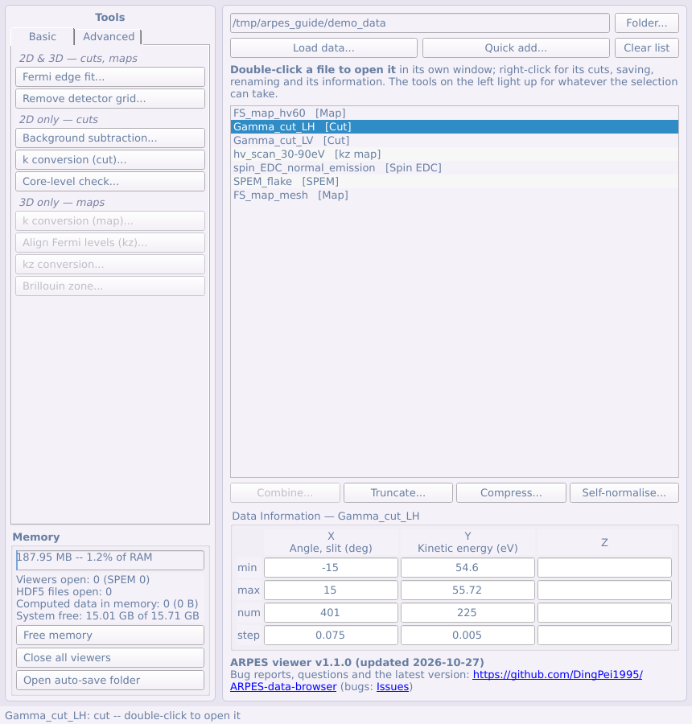

主窗口是一个**数据浏览器**：每行对应一个*数据集*，而不是一个文件（一个 `.nxs`
文件常常包含多个测量，每个测量单独一行）。名字后面标明数据类型：`[Cut]`、
`[Map]`、`[kz map]`、`[k-map]`、`[SPEM]`、`[EDC]`、`[Spin EDC]` 等。

主窗口分为三部分：

- **工具面板**（左侧）——所有分析与处理工具都以按钮形式放在这里，分三个标签页。
  **Basic**（启动时显示）包含几乎每个数据集都要经过的步骤：费米边拟合、去除探测器
  网格、探测器校正、扣背景、三种 k 转换、芯能级检查、对齐 kz map 的费米能级以及布里渊区。
  **Advanced** 包含其余工具：作图器、平滑及突出能带的滤波、对称化、脊线提取、堆叠图、
  MDC 与 EDC 拟合、cut 运算、切片组图以及四种三维视图。**Calculation** 包含计算而非
  测量得到的内容：晶体结构、紧束缚拟合与计算能带（见[第四部分](#第四部分-calculation-标签页)）。
  每个标签页内按所接受的数据分组
  （*2D & 3D — cuts, maps*、*2D only — cuts*、*3D only — maps* 等）。
- **列表**（右侧）及其下方的按钮。
- **Memory 区**（左下）和版本信息（右下）。


**工具按钮随所选数据变化。** 只有当列表中选中的行符合要求时按钮才可用——
k conversion (cut) 需要一张角度 cut，cut 运算需要恰好两张 cut，三维视图需要 map。
灰色按钮在鼠标悬停时会说明原因。

| 操作 | 方法 |
|---|---|
| 在独立窗口中打开数据集 | **双击**该行（或右键 → **Open**） |
| 对选中的行运行某个工具 | **工具面板**中对应的按钮 |
| 把多张 cut 叠成一个 map，或把分段采集的 map / kz map 拼接起来 | 列表下方的 **Combine...** |
| 裁剪范围、合并像素、每张谱自归一 | 列表下方的 **Truncate...**、**Compress...**、**Self-normalise...** |
| 打开 map 的 slit cut 或 scan-axis cut | **右键**该行（或选中的多行） |
| 查看元数据、生成实验记录、重命名、保存、移除 | 工具面板中 Memory 上方的 **Datasets** 区 |
| 查看并释放内存、关闭所有查看窗口、打开自动保存文件夹 | 左下的 **Memory** 区 |
| 查看当前版本、报告 bug、获取最新版本 | 标题栏，以及窗口最后一行（GitHub 链接） |

列表下方的四个按钮都作用于上方选中的行，结果都作为新行加入列表——原数据不会被修改。

**右键菜单**只保留三种打开方式：**Open**、**Open slit cut**、
**Open scan-axis cut**（map）。不适用于当前选择的条目显示为灰色，悬停提示会说明原因。

**Datasets 区**（工具面板中，位于工具和 Memory 之间）包含其余对行本身的操作：
**Experiment info**、并排的 **Log format...** 与 **Auto Exp. log**（见[实验记录](#实验记录)）、
同一行的 **Rename**、**Save**、**Remove**，以及 **Sum repeated scans...** 和
**Session log...**。这些按钮和工具按钮一样，会随选择变灰。

### 功能现在的位置（v1.2.1）

如果你用过早期版本：工具已从右键菜单和查看窗口的 *Functions* 菜单移到了工具面板，
每个工具只有一个入口，且始终可见。

| 现在 | 以前 |
|---|---|
| 工具面板 → Basic → **Fermi edge fit...**（cut 和 map） | 查看窗口 *Functions → Fermi edge fit* |
| 工具面板 → Basic → **Remove detector grid...** | 查看窗口 *Functions → Remove detector grid* |
| 工具面板 → Basic → **k conversion (cut)** / **(map)**、**kz conversion** | 查看窗口 *Functions → Convert to momentum* |
| 工具面板 → Basic → **Align Fermi levels (kz)...** | 查看窗口 *Functions → Align Fermi levels (kz map)* |
| 工具面板 → Basic → **Brillouin zone...** | k-map 窗口 *Functions → Brillouin zone* |
| 工具面板 → Basic → **Core-level check...** | 右键 → Core-level check |
| 工具面板 → Basic/Advanced → **Background subtraction**、**Smooth**、**Second derivative**、**Curvature**、**Symmetrise**（各自独立窗口） | **Smooth / derivative...**（一个带标签页的窗口） |
| 列表下方的 **Truncate...**、**Compress...**、**Self-normalise...** | **Crop / bin / normalise...** |
| 工具面板 → Advanced → **MDC fit (k-cut only)**、**EDC fit** | 查看窗口 *Functions → MDC / EDC fit* |
| 工具面板 → Advanced → **Cut arithmetic (two cuts)** | 右键 / 查看窗口 *Functions → Cut arithmetic* |
| 工具面板 → Advanced → **Slice series figure...** | map 窗口 *Functions → Multi-slice figure* |
| 工具面板 → Advanced → **3D slices**、**Notched cube**、**Volume projection** | 右键 → 3D view（一个窗口三种模式） |
| 工具面板 → Advanced → **Figure composer...** | 右键 → Open in figure composer |
| 右键 → **Open scan-axis cut**，查看窗口按钮 **Scan-axis cut** | Open deflector cut、Deflector cut |
| Memory 区 → **Free RAM**、**Close all**、**Autosaves**（同一行） | 列表下方；后为 Free memory、Close all viewers、Open auto-save folder |
| Datasets 区 → **Experiment info** | 右键 → Show information |
| Datasets 区 → **Rename**、**Save**、**Remove**（同一行）、**Session log...** | 右键；后为 Rename...、Save datasets...、Remove from list |
| 仅列表下方的 **Combine...** | 另有右键 → Combine N datasets |

**Experiment info** 还会在独立窗口中显示该数据集的全部元数据，带过滤框，
并可 **Export metadata (.csv)**：

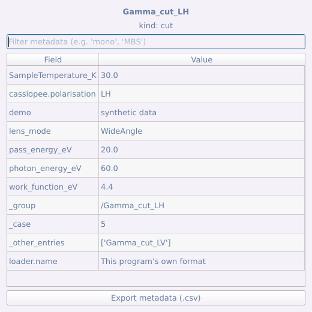

### 实验记录

**Datasets** 区里并排的两个按钮根据数据文件自身的元数据生成实验记录——一个 CSV
文件，每次测量一行：左边的 **Log format...** 只需设置一次，右边的
**Auto Exp. log** 单击即可把选中的数据加入记录。

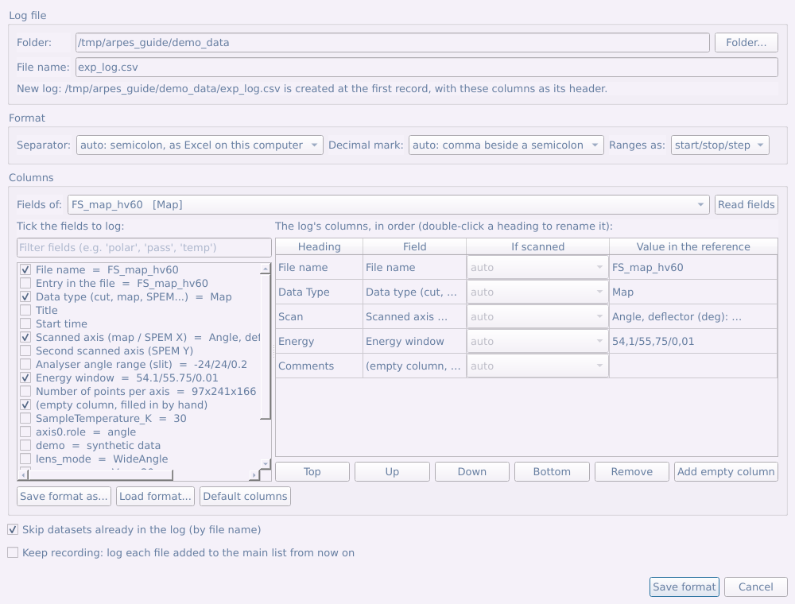

**Log format...**

1. **Log file（记录文件）。** 选择文件夹并输入文件名。如果该文件已存在，窗口显示的
   就是**这个文件自己的格式**，可以在此基础上调整。
2. **Format（格式）。** *Separator*（分隔符）和 *Decimal mark*（小数点）默认采用
   本机 Excel 的设置。Excel 按系统的列表分隔符拆分 CSV——凡是小数点为逗号的地区
   （法语、德语、意大利语等设置）都是**分号**——所以逗号分隔的文件在那里打开时所有
   内容都挤在第一列。除非记录要给设置不同的电脑使用，保持 *auto* 即可。
   *Ranges as:* 选择范围写成 `start/stop/step` 还是 `start:step:stop`。
3. **Columns（列）。** *Fields of:* 从主列表中选一个数据集（选最常记录的那种），
   **Read fields** 列出它的全部字段及取值：由数据推出的文件名、数据类型、开始时间、
   扫描范围，然后是所有元数据字段和电机位置。**勾选**字段即加为一列。在右侧表格中
   双击标题可改名（`hν/Δ`、`Polar/Δ`、`Epass`……），用 **Top / Up / Down /
   Bottom** 任意排序。**Add empty column** 加一列留空、手工填写（备注）。
   **Save format as...** / **Load format...** 可为每个线站各存一套格式。
4. **If scanned（扫描时）。** 位置或角度列写什么，取决于测量类型：
   - **cut**：样品位置固定——写电机的值；
   - **SPEM** 扫描：扫描的样品台轴写成 `start/stop/step`（对样品台的列选
     *SPEM: scanned X* / *Y*）；
   - 用机械手而非 deflector 转角采集的 **map**：角度写成 `start/stop/step`
     （*map: scanned angle*），而随角度修正的样品位置写成 `起点..终点`；
   - **kz map**：光子能量范围（*kz map: photon energy*）。

   默认的 *auto* 会按名字识别被扫描的电机，并按取值识别移动过的位置；其他测量
   写该字段本身的值。
5. **Save format（保存格式）。** 如果记录文件里已有记录而你改了格式，文件会
   **按新表头整体重写**：每条记录随所在列移动（改名或移动过的列都能跟上），新列
   对旧记录留空；被去掉的列会先列出来确认，因为其中的内容会被删除。表头始终只有
   第一行。

*Skip datasets already in the log* 会跳过文件名已在记录中的数据。勾选
**Keep recording** 后，此后加入列表的每个文件都会自动写入记录，直到关闭程序：
束线实验时每测完一个文件就把它加入列表，记录会自动更新。

**Auto Exp. log** 把选中的行加到记录最后一条之后，不弹出任何窗口；状态栏会显示
加入了几条。第一次使用（还没有保存过格式）时会先打开 *Log format...*。

如果记录文件正在 Excel 中打开，Windows 不允许写入：先在 Excel 中关闭再点一次。

### 合并数据集：叠加（Stack）与拼接（Join）

**Combine...**（列表下方）可以做两件不同的事，并会让你选择：

- **Stack（叠加）**——*仅限 cut*。每张 cut 成为新 map 的一个切片，沿一个由你命名的
  轴：温度序列、门电压序列、每个光子能量一张的 cut。结果可以像普通 map 一样查看——
  在固定能量处切片，或沿新轴切片。
- **Join（拼接）**——*cut、map、kz map 或 k-map，但须同一类型*。把一次分段采集的
  测量按其自身的某个轴首尾拼接起来：偏转角范围分两次扫描的 map、光子能量范围分几次
  采集的 kz map、能量窗口分两半采集的 cut。

**叠加 cut**

1. 在列表中选中这些 cut（Ctrl/Shift 多选），点 **Combine...**。叠加要求
   各 cut 的坐标轴逐点一致（点数、数值、单位都相同）；若不一致，*Stack* 选项变灰并
   指出第一处差异，此时可改用 *Join*。
2. 程序会询问是否**按列表中的顺序**合并。选 *Yes* 保持该顺序；选 *No* 则可自行
   调整顺序。
3. 选择 **Stack**，然后设置新轴：**New axis is**（温度、门电压、光子能量、延迟、
   位置、其他——会自动填入 *Name* 和 *Unit*，均可修改）、**Start**（起始值）和
   **Step**（间隔）。每张 cut 旁边会显示它对应的数值。如果选择了调整顺序，可
   **拖动**各行（或用 **Move up** / **Move down** / **Reverse**）。点 **Combine**。

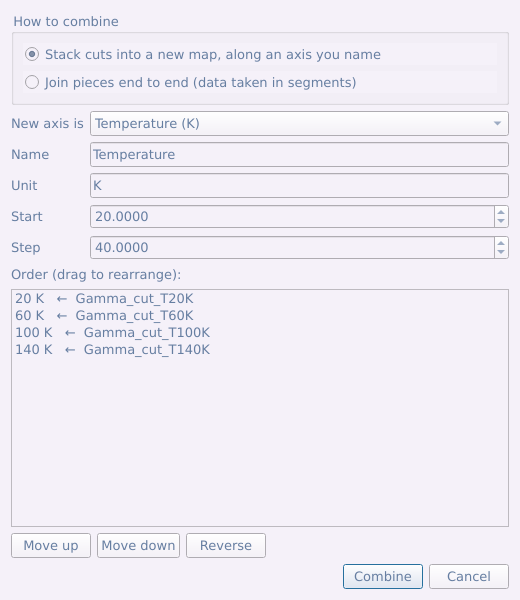

由角度 cut 组成的光子能量序列会成为 `kz map`，可直接使用 *Align Fermi levels (kz
map)* 和 *Convert to momentum (kz, k∥)*（见[第 14 节](#14-光子能量扫描kz)）；
其他轴得到的是 `map`，其第一个轴被标记为非角度，因此不会提供 k 转换。

**拼接分段采集的数据**

1. 选中各段（全是 map，或全是 kz map，或全是 cut……），点 **Combine...**。
   map 和 kz map 直接进入 *Join*。
2. **Join along**：测量被分段的那个轴。默认选中各段之间范围不同的那个轴——map 的
   偏转角轴、kz map 的光子能量，或分两个能量窗口采集的 cut 的能量轴——通常无需改动。
3. **Where pieces overlap**（重叠部分）：*Average them*（取平均），或按下方列表的
   顺序保留较早 / 较晚的一段（拖动各行可改变顺序）。
4. 对话框列出每一段的范围，并给出 **Result**（拼接后的范围和点数），以及处理过程中
   所做的说明。点 **Combine**。


坐标轴的处理方式：

- 各段在同一网格上（步长相同，范围相接或按整点重叠——通常情况）时，数据**按原样
  复制**，不做插值。
- 某段步长不同或有半步偏移时，会被**插值**到公共轴上（采用第一段的步长），对话框
  会说明。
- 若**其他轴**不同——几次采集的能量窗口相差几 meV、slit 通道数不同——所有段都会
  重采样到它们**共同覆盖**的范围，对话框会说明。
- 没有任何一段覆盖的区间是**空缺**，填为零并给出提示。
- 拼接后的 kz map 仍是 `kz map`：请在拼接结果上运行 *Align Fermi levels (kz
  map)*，而不是在各段上（各段按光子能量的拟合结果不会被带入）。

### 叠加重复测量

用于分多次短扫描采集的精细 cut 或 map，以便发现样品老化。选中这些扫描（同一类型的两个或
更多）→ **Sum repeated scans...**：

1. **是否为重复测量？** 列出每个扫描的网格和记录条件（光子能量、偏振、角度、位置、温度、
   通能、透镜模式）；与第一个扫描不同的值标为橙色。
2. **样品是否发生变化？** 点击 **Compare the scans**。每个扫描与其余扫描之和比较：
   *χ² / point* 对只差计数噪声的扫描基本相同，谱本身变化时会增大；明显高于其余的扫描标为
   **changed**。同时列出每个扫描 EDC 的能量漂移和计数率；点击某行可查看其 EDC 与其余的对比。
3. **叠加。** 勾选要保留的扫描（标为 changed 的默认不勾选），选择是否消除能量漂移、
   **Sum** 或 **Mean**，然后 **Sum to list**。

### 分步窗口

需要做几步决定的工具以**编号步骤**的形式打开（叠加重复测量、探测器校正、紧束缚
拟合、晶体结构、计算能带）：标题显示 *Step 2 of 4: …*，蓝色提示框说明这一步的
用途和操作，这一步完成之前 **Next →** 保持灰色（旁边写明原因），用 **← Back** 或
左侧的步骤列表可以返回。

## 4. 载入数据

**Load data...** 打开载入窗口；**Quick add...** 跳过该窗口，直接以自动识别的
设置加入所选文件。


1. **Files**——选择一个或多个文件（*Select file(s)...*）。文件类型过滤器由已安装的
   读取器自动生成。
2. **Reader**——自动识别，并显示识别结果（如 *Detected: 3 × This program's own
   format*）。只有在文件被误读时才需要手动指定。
3. **Datasets found**——每个文件里有哪些数据集。这里只读取文件*结构*，即使是几 GB
   的扫描也是瞬间完成；在真正打开某一行之前不会读取数据本身。
4. **Axes**——*Axis order* 在载入时一次性调整数组维度顺序；*First axis of a map
   is* 说明扫描的是什么：偏转器角度（默认）、**光子能量**、温度、栅压、延时……
   这样后续每一步都使用正确的单位，也不会对非角度轴提供 k 转换。

**CASSIOPEE 文件夹**：选中编号序列（`name_1_ROI1_.txt`、`name_2_ROI1_.txt`……）
中的任意一个文件，整个文件夹会作为一个拼好的数据立方体列出一次。它是角度 map
还是 kz map，由谱旁边的 `_i` 参数文件自动判断。列表中的名称带有从这些文件读出的
光子能量和偏振——如 `FineMap 117eV LH`，光子能量扫描则为 `KzScan 40-120eV LH`——
因此同一扫描在不同能量或偏振下的重复测量可以区分开。

**ANTARES 光子能量（PhD）文件**：PhD `.nxs` 文件（每个光子能量一个 `Phd_NNNN`
条目）作为一个 `kz map` 列出：各帧按光子能量排序，每帧的动能轴用其自身的 hν
换算到 E_F（功函数取 4.5 eV，k_z 转换也会用到）。每一帧仍可单独作为 cut 打开。

### 数据类型

| 类型 | 轴 | 含义 |
|---|---|---|
| `cut` | 角度（或 k）× E | 一张谱 |
| `map` | 角度 × 角度 × E | 偏转器或极角扫描 |
| `k_map` | kx × ky × E | 已转换到动量空间的 map |
| `kz_map` | hν × 角度 × E | 光子能量扫描 |
| `kz_map_k` | k_z × k∥ × E | 转换到动量空间的光子能量扫描 |
| `spem_4d`、`spem_1d` | x（× y）× 角度 × E | 实空间扫描 |
| `edc`、`mdc`、`spin_edc` | E（或 k）× 通道 | 曲线，可带 σ 误差通道 |

## 5. 各查看窗口的共同操作

每个数据集在自己的窗口中打开，因此可以把 map、它的切面以及另一个文件并排摆放。

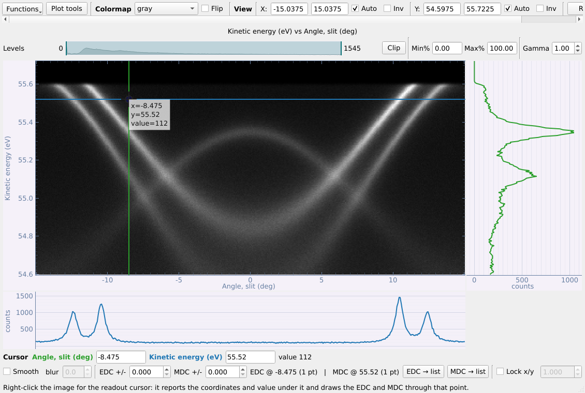

- **顶部一行**：**Functions** 菜单（本窗口能做的所有事）、**Plot tools**（在本图上
  画辅助线和文字，见下文）、色表（每个窗口独立）及 **Flip**（反转），以及视图控制——坐标范围、**Auto**、**Inv**（反向）、
  **Reset**、**Grid**。
- **图像上方**：**Levels** 色阶条（拖动两个滑块，或输入 **Min%/Max%** 百分位，
  **Clip** 应用）以及 **Gamma**。您设置的最小/最大值在移动切片位置时（contour 的
  能量、cut 的角度、空间 map 的光标）会保持不变，使各位置处于同一色标；把滑块拖回
  两端，或设为 0%–100%，即恢复为跟随每一帧自身的范围。
- **图像下方**：**Smooth**（仅影响显示，不改变数据）和 **Lock x/y**（锁定纵横比）。
- **读数光标**——在图像上右键 → *Readout cursor*。它显示光标处的数值；在 cut 上
  还会画出经过该点的 **EDC**（右侧）和 **MDC**（下方）。**EDC ±** / **MDC ±**
  设置积分窗口，并在图上以半透明带显示。在 **Cursor** 行输入坐标并回车，可把
  光标精确放到该位置。
- **EDC → list** / **MDC → list** 把当前显示的曲线作为独立数据集加入主列表
  （见[第 23 节](#23-曲线edcmdc-与自旋分辨数据)）。
- **图像右键 → Export** 导出该面板当前显示的内容——数据（`.nxs`）、图片，或
  矢量坐标轴（`.eps`），见[第 28 节](#28-作图器figure-composer)。
- **Functions → Slice → Save slice to the main list / Freeze slice in a new
  window** 保存当前切片的副本。冻结窗口（以及空间 map 上的 *Open this position in
  a new window*）会沿用原面板的最小/最大值和 gamma，便于直接对比。它有自己的
  **Plot tools**，以及用来制作论文图的 **Figure composer...** 按钮
  （见[第 28 节](#28-作图器figure-composer)）。

**Functions** 菜单现在只包含作用于该窗口本身的操作——以数据集为对象的工具都在
主窗口的工具面板中（见[第 3 节](#3-主窗口)）：

| 窗口 | Functions |
|---|---|
| map / kz map / k-map（等能面） | Arbitrary cut；Slice：保存 / 冻结切片 |
| cut | Straighten bands (FS correction)；Slice：保存 / 冻结 |
| map 的 slit cut | 对整个数据立方的 Straighten bands (FS correction)；Show the map |
| 曲线 | Curve fit、Spin analysis；Crop、Bin、Normalise、Background、Shift axis、Add √N errors |

适用但暂时无法运行的条目显示为灰色，悬停提示会说明原因。

**布里渊区勾选框。** 画过布里渊区（见[第 15 节](#15-布里渊区)）的 k-map 或已转换的
kz map 会保留它：其查看窗口顶部一行有 **Brillouin zone** 勾选框，用于显示或隐藏。

### Plot tools：在图上画辅助线和文字

每个查看窗口（cut、map、空间扫描、曲线、冻结切片）顶部一行都有 **Plot tools**
按钮，打开一个小窗口，**直接在眼前这幅图上**作画：


| 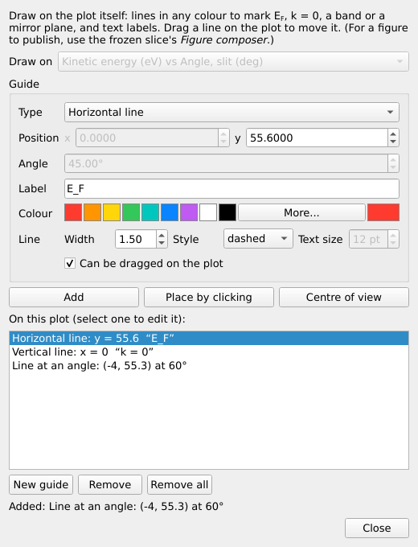 | |
|---|---|

- **Type**（类型）：*Vertical line*（竖线）、*Horizontal line*（横线）、*Line at an
  angle*（过某点的斜线；角度按图本身的单位计，即斜率为 tan(角度) 个 y 单位 / x 单位）、
  *Text label*（文字）。
- **Position**（x, y）、**Angle**（角度）、可选的 **Label**（显示在线上，如 `E_F`、
  `Γ`）、**Colour**（九种一键颜色，或 **More...** 自选）、**Width**（线宽）、
  **Style**（实线、虚线、点线、点划线）和 **Text size**（字号）。
- **Add** 在输入的位置画出（**Centre of view** 可填入当前视图中心）；**Place by
  clicking** 则在图上点击处画出。
- 在图上**拖动**线条即可移动，窗口中的数值同步更新。在列表中选中某条可**编辑**
  （修改立即生效）或 **Remove**（删除）；**New guide** 结束编辑；**Remove all**
  清空。
- 有两个面板时（空间扫描），用 **Draw on** 选择画在哪一个上。
- 移动切片时辅助线保持不变（浏览 map 时 E_F 线始终在 E_F 处），关闭 Plot tools
  窗口后也保留。面板的 **Export → Image** 也会画出它们（*Include the Plot tools
  guides*）。

*Plot tools* 用于看数据；要制作论文图，请使用**作图器（Figure composer）**及其
**Figure tools**（见[第 28 节](#28-作图器figure-composer)）。

## 6. Map：等能面及其两个切面

map 打开时显示**等能面（constant-energy contour）**。顶部滑块选择能量（**Pos**
以 eV 为单位，**Ind** 为序号；**±** 设置积分范围，可选 **mean** 或 **sum**）。
**Scan-axis cut** 和 **Slit cut** 分别在新窗口中打开两个正交切面。（扫描轴是采集
map 时扫描的那个量——通常是偏转器角，也可能是样品转角，kz map 则是光子能量——
按钮因此以它命名。）

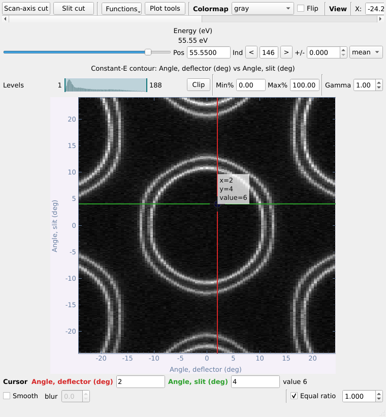

| Slit cut（狭缝角 vs 能量） | Scan-axis cut（偏转器角 vs 能量） |
|---|---|
| 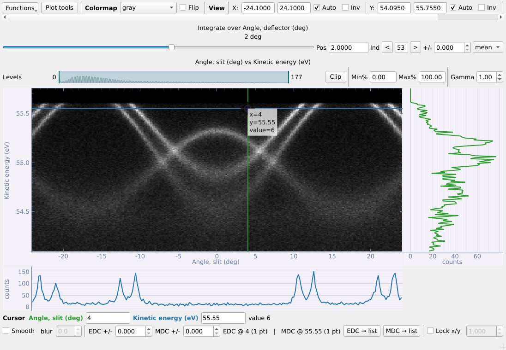 | 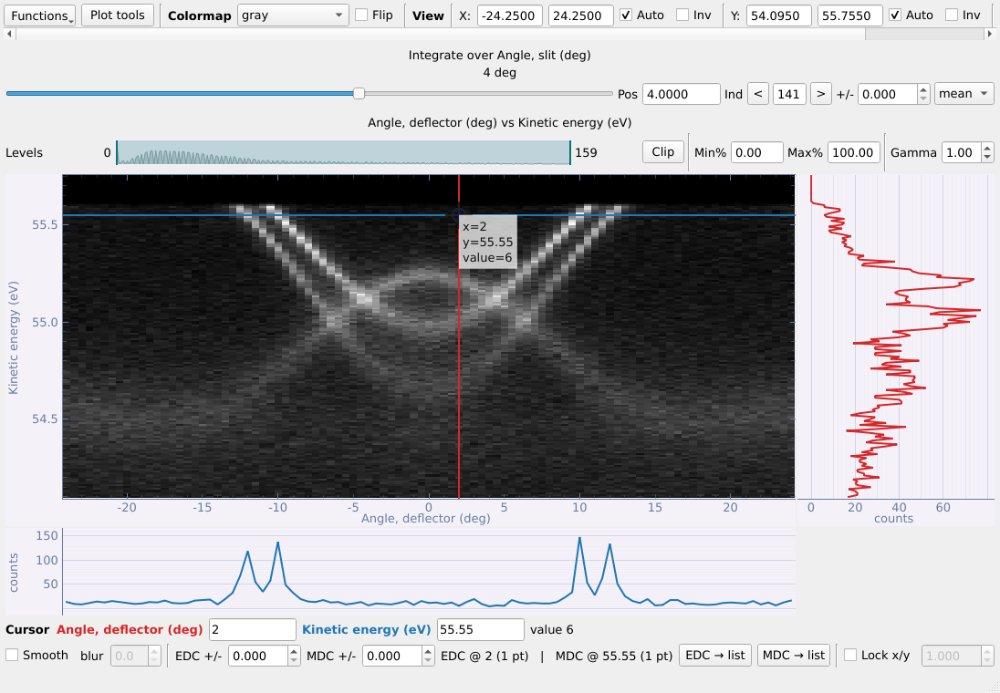 |

**三个窗口共用一个光标。** 在任一窗口中打开读数光标，其余窗口同时打开；在任一
窗口中移动光标，其余窗口会沿新位置重新切片。每个轴在所有窗口中都用同一种颜色：
**偏转器为红色、狭缝为绿色、能量为蓝色**。光标线的颜色是它保持不变的那个轴的
颜色，它所对应的 EDC 或 MDC 也用同一颜色绘制。积分宽度（± 框）属于各自窗口，
不会在窗口之间共享。

也可以直接从列表中打开 map 的切面（右键 → **Open slit cut** / **Open scan-axis
cut**），此时等能面窗口保持隐藏，需要时用 *Functions → Show the map* 调出。

## 7. 任意路径切面与费米面校正

### 7.1 任意路径切面

在任意等能面上 *Functions → Arbitrary cut...*：点击（或输入）最多六个点，切面
按顺序经过这些点——这里是 k-map 上的 Γ → M → K → Γ。勾选 **One dataset per
segment** 可让每一段分别成为一个数据集。

| 等能面上的路径 | 路径点 |
|---|---|
| 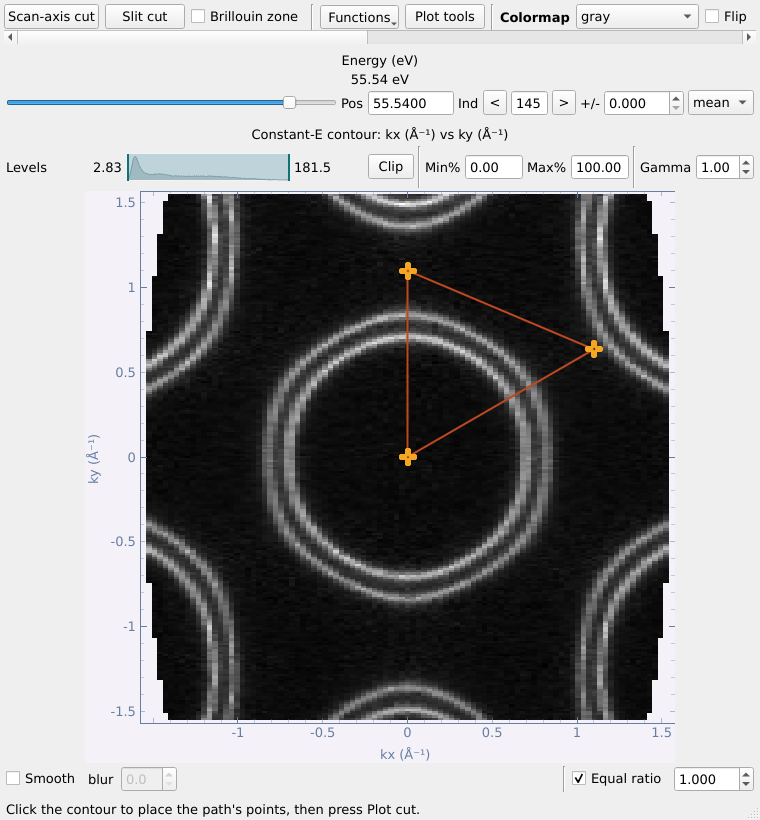 | 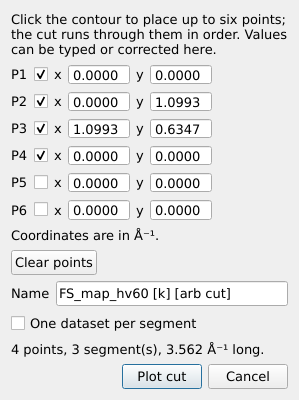 |

结果是以沿路径距离为横轴的 cut；路径的拐点用绿色虚线标出，避免把拐点处的折线
误认为物理特征。

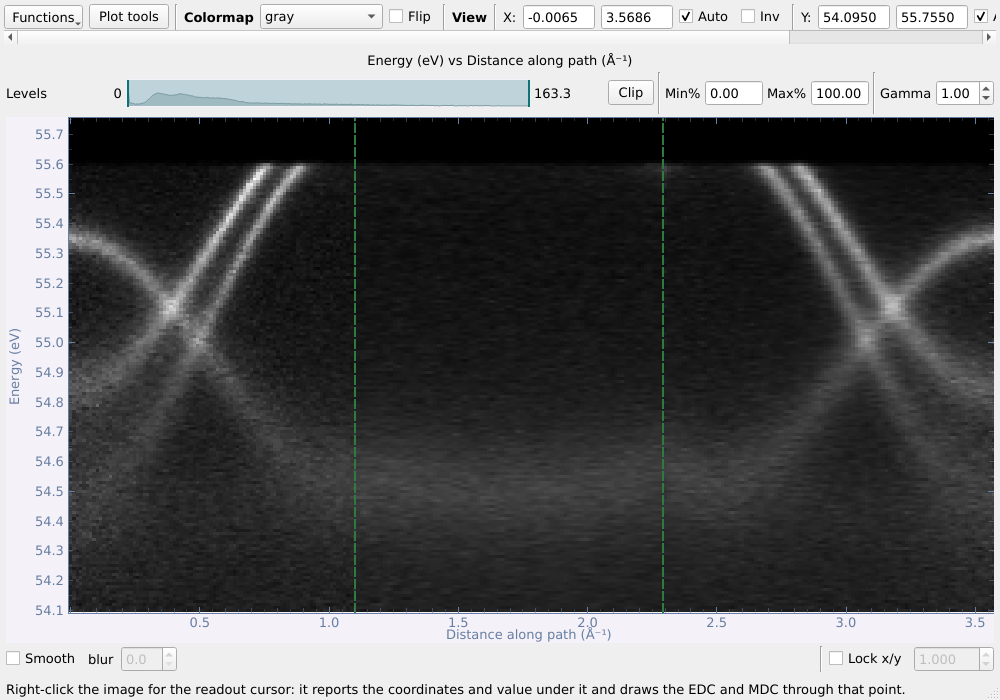

### 7.2 费米面（FS）校正

在 cut（或 map 的 slit cut）上 *Functions → Straighten bands (FS correction)...*，把本应平直的特征
拉直——通常是随分析器角度弯曲的费米边。沿该特征点击若干点，程序拟合多项式
（默认 2 阶），并把每一列在能量方向上平移。**From a reference (Au)...** 改用列表
中的金参考谱确定曲线。在 map 的 slit cut 上操作时，同样的平移会应用到整个数据
立方体。

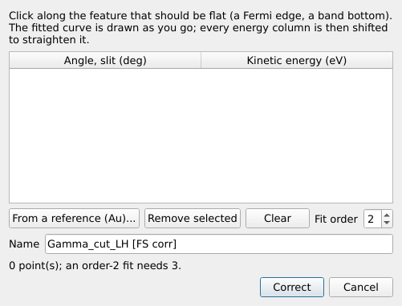

# 第二部分 Basic 标签页

**Basic** 标签页包含几乎每个数据集都要经过的处理，按工具接受的数据分组：
*2D & 3D*——费米边拟合、去除探测器网格、探测器校正；*2D only*——扣除背底、cut 的
k 转换、芯能级检查；*3D only*——map 的 k 转换、光子能量扫描的对齐与转换、布里渊区。

---

## 8. 费米边拟合

单张 cut 的常规流程：**费米边拟合 → 平移能量轴 → 转换到动量 → MDC/EDC 拟合**。
每一步都是工具面板中的一个按钮：在列表中选中 cut，点击对应按钮即可。

工具面板 → Basic → **Fermi edge fit...** 对选框内求和得到的 EDC 拟合费米边
（费米-狄拉克分布 × 线性态密度，再与高斯分辨率卷积）。它会同时打开该 cut 的查看
窗口和拟合窗口；两者绑定，关闭任一个，另一个也随之关闭。


1. 点击 **Show the selection box**，在 cut 上把选框拖到费米边处（或直接输入角度
   与能量范围）。角度范围决定哪些通道被求和，能量范围就是拟合窗口。

   

2. 先 **Estimate**，再 **Fit**。勾选 **Hold** 可固定某个参数（温度默认固定为
   文件记录值）。每个参数都给出不确定度。
3. **Offset energy axis** 生成一份能量轴为 **E − E_F** 的副本并加入列表。

*Advanced* 区域可以除去费米截断（用于能隙与参考样品），或逐通道拟合 E_F。

**对 map 拟合。** 选中一个 map（角度 map 或 k-map）后点同一个按钮：会打开该 map 的
**slit cut** 和拟合窗口，用 slit cut 的滑块选择要拟合的那张 cut。拟合后点
**Offset energy axis**，程序询问是**用这张 cut 的 E_F 平移整个 map**（*Yes*），还是
**每张 cut 各用一个 E_F**（*No*）。选后者时，右侧的 **Fitted cuts** 列表会逐步填充：
移动滑块、点 **Fit**、重复即可。同一位置再次拟合会替换之前的结果，列表中每个 E_F
都可以手动修改。两张已拟合 cut 之间的 cut 按相邻两点线性插值平移（第一张之前和
最后一张之后用最近的拟合值），插值曲线画在列表下方。点 **Offset energy axis by
these fits** 把校正后的 map 加入列表。

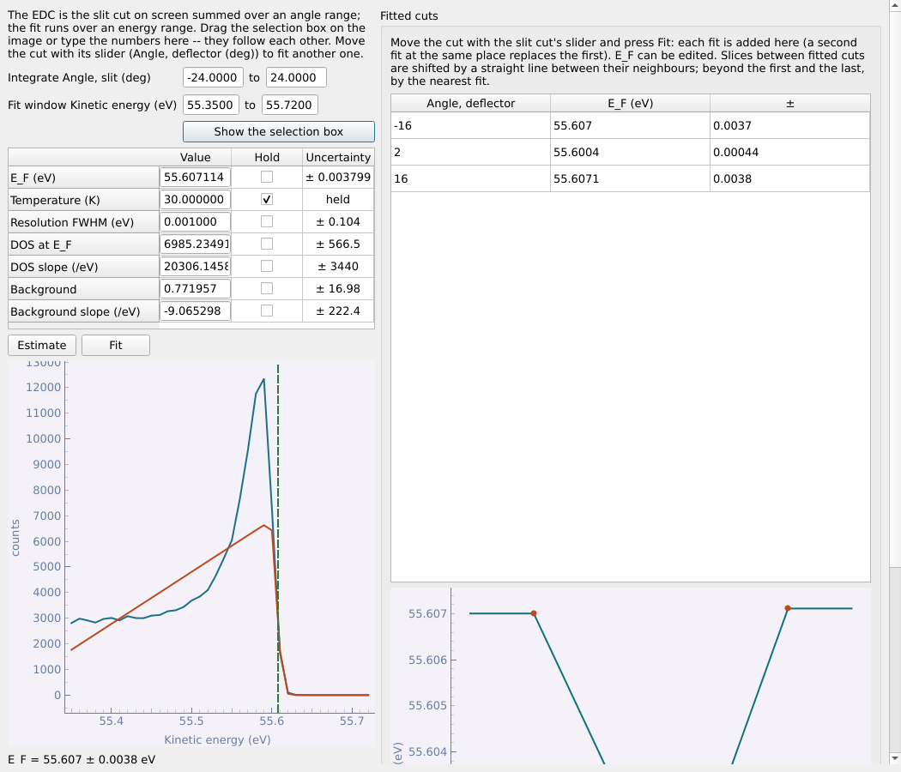

## 9. 去除探测器网格与探测器校正

### 9.1 去除探测器网格

MCP（六角）和网栅（方形）图案会印在每一幅图像上。**请最先做这一步**：只有仍在
探测器原始像素上的数据才能去网格，因此对已转换、校正或平滑过的数据，该按钮会
拒绝并说明原因。

选中 map（或 kz map）或 cut，点工具面板 → Basic → **Remove detector grid...**。
对 map 不需要参考测量——网格在每个切片中都位于同样的像素上，而光电子信号会移动。
点击 **Find and remove the grid**：

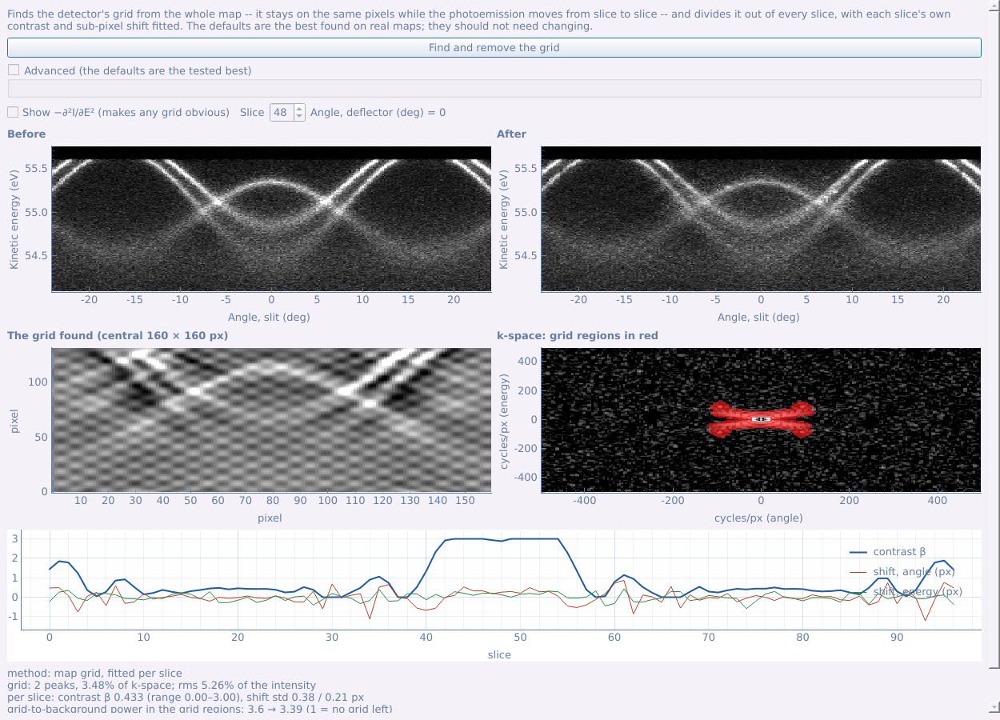

- 所选切片的 **Before / After**，使用同一色阶（勾选 **Show −∂²I/∂E²** 可让残余
  网格一目了然）。
- 找到的**网格图案**、其在 **k 空间的区域**（红色），以及每个切片拟合的**对比度
  与平移**。
- 网格区域中剩余的功率（1 表示网格已完全去除）。
- **Also list the grid pattern** 会保留一个 `[grid]` 数据集；之后用相同透镜模式和
  通能测得的 cut 会自动找到并使用它。

### 9.2 探测器校正

作用于原始测量的 cut、map 或 kz map：

1. **梯形畸变** —— 勾选 *Correct a trapezoidal image*，把四个黄色角点拖到受光区的四个角上；
   右图显示校正为矩形后的结果，每行总计数保持不变。
2. **坏区** —— **Add a region** 并拖到坏点或热点上，或点击 **Find bad pixels** 自动查找；
   填补方式 *smooth*（适合点状坏区）或 *linear along* 某个轴（适合条状坏区）。
3. **应用** —— **Apply to list**。之后再对结果做去网格、费米能级和 k 转换。

## 10. 扣除背底

工具面板 → Basic → **Background subtraction...**（cut）去除不属于能带的强度：
**Shirley** 或 **Tougaard** 非弹性背底、所有角度共有的底（每一能量行的某个百分位数）、
平滑的**多项式**——或者除去**费米截断**（按文件记录的温度和分辨率计算的
Fermi–Dirac 函数，起点为文件记录的 E_F，没有记录时取角度积分 EDC 下降最陡处）。
窗口与 Advanced 页的处理窗口相同——源数据与结果并排、实时预览、**Apply** 把结果
加入列表——见[第 16 节](#16-平滑求导曲率与对称化)。

## 11. 把 cut 转换到动量空间

工具面板 → Basic → **k conversion (cut)...** 把角度轴转换为 k∥（Å⁻¹）。cut 上会画出
一条**竖直线**：把它拖到 Γ 点的狭缝角处。此时认为该 cut 经过 Γ——若 cut 并不经过 Γ
则不严格，但在只测了这一张 cut 时这是唯一的选择。

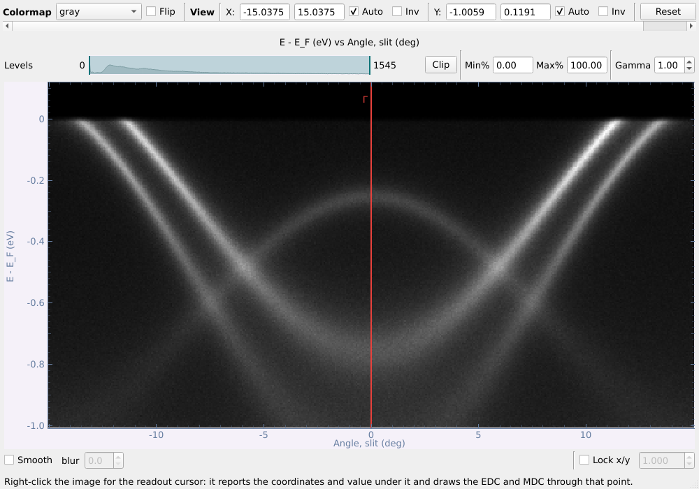


- **Advanced: Γ off this cut** 用于不经过 Γ 的 cut：输入 Γ 的偏转器角与狭缝角，
  或用 **From a converted map...** 从同一样品已转换的 map 继承。
- 如果该 cut 已经平移到 E − E_F，对话框会自动把扣除的 E_F 填入 **Energy offset**
  （下方的提示会说明）：转换时使用真实的动能，而结果的能量轴仍保持 E − E_F。
- **记住参数。** 对话框从上一次转换同样大小（各轴点数相同）的 cut 时的参数开始——
  这正是同一样品一系列 cut 的常见情形。map 和 kz 转换也是如此。

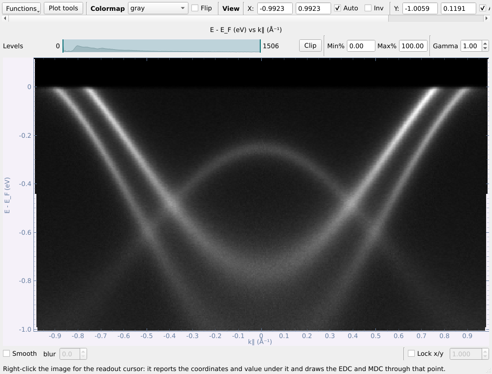

## 12. 芯能级检查（Core-level check）

宽范围的芯能级扫描也以 cut 的形式列出。选中它，点工具面板 → Basic →
**Core-level check...**，即可判断各个峰的来源。

1. 输入样品所含元素——`NbSCl` 或 `Nb, S, Cl`——然后按 **Next**。
   *Match within*（0.5 eV）是峰与手册中结合能的最大偏差，在此范围内即认为是样品信号。

   

2. 检查能量参考。若窗口内包含费米边，则拟合得到 E_F；否则取 hν − W。
   如光子能量、功函数或 E_F 有误可直接修改（绿色竖线可拖动）；若 hν − E_F
   明显偏离 4–5 eV，说明光子能量不准。按 **Analyse**。

   

3. 结果：以结合能为横轴的积分 EDC，每个峰都有标注——绿色 *sample*
   （标出轨道），橙色 *uncertain*（2 eV 内有样品能级：化学位移或荷电，由您判断），
   红色 *not the sample*（列出可能的常见元素：污染、高次光、俄歇峰）。
   点击表格某行可查看全部候选；在 *Assignment* 列可填写您自己的判读。

   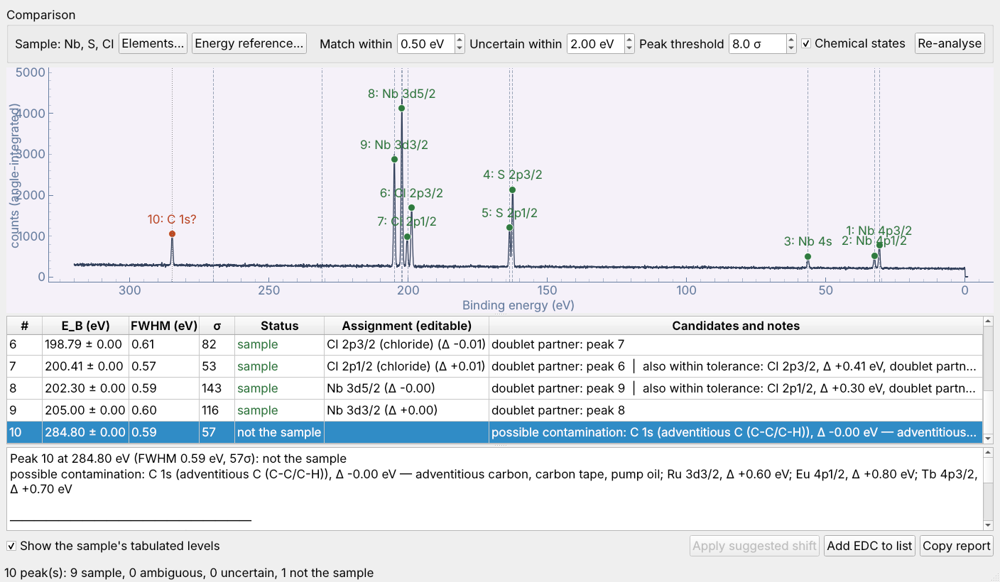

**弱峰与手动添加峰**：勾选 **Log counts** 可在强峰旁看清弱峰；**Min height**
（默认为最强峰的 0.2%）设定可被找到的峰的最小高度。要添加搜索遗漏的峰，按下
**Click to add peak** 后在图上点击（双击始终有效），或在 *or at* 后输入结合能并点
**Add**：其位置由局部拟合精修，标记为 ◆，并列出 ±2 eV 内所有表列能级。
**Remove selected** 删除选中的峰；**Reset peaks** 恢复自动找到的峰并清除手动添加的
峰。您手动填写的判读在 **Re-analyse** 后仍会保留。

**Peak table...** 列出所有表列能级，可按元素和结合能范围筛选：查找某个峰、在图上
显示某能级，或以该能级为判读将其添加为峰。**Select range** 在图上显示一个可拖动的
区间；**Zoom window...** 把该区间（或当前视图）在独立窗口中打开，窗口带光标、光标处
的高斯拟合，以及除以强度的负二阶导数——强峰旁的肩峰或弱峰也能和强峰一样清楚。

若所有峰整体偏移相同的量，备注中会给出提示，**Apply suggested shift**
可一键修正（样品荷电或 E_F 有误）。**Add EDC to list** 将结合能标度下的 EDC
加入列表；**Copy report** 复制全部结果文本。仍有疑问时，换一个光子能量再测：
芯能级的结合能不变，俄歇峰和高次光会移动。

## 13. Map 的 k 转换

选中角度 map，点工具面板 → Basic → **k conversion (map)...**。map 会以一个只有图像的
等能面窗口打开——没有切面按钮和其他功能——旁边是转换窗口，两者一起关闭。把读数
光标拖到应成为 **k = (0, 0)** 的点（对话框会跟随光标），然后点 **Convert**，结果
作为新的 `k-map` 行加入列表。

| 用于选取 Γ 的等能面 | 转换窗口 |
|---|---|
|  | 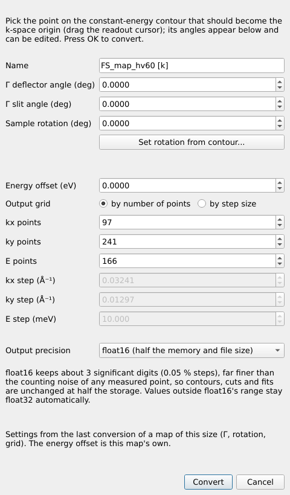 |

- **Γ deflector angle / Γ slit angle**：将成为 k = (0, 0) 的那一点的两个角度，
  由读数光标自动填入。
- **Sample rotation** 绕表面法线旋转 map；**Set rotation from contour...** 通过在
  等能面上点击一个方向（例如沿镜面线的两点）读出旋转角。
- **Output grid**：按点数或按分辨率（Å⁻¹、meV）设置输出网格。点数默认等于实测
  点数——kx 点数 = 偏转角数，ky 点数 = 狭缝角数，E 点数 = 能量点数。
- **Energy offset** 在转换前加到能量轴上，用于能量轴不是真实动能的情况
  （对 E − E_F 的 map 会自动填好）。
- 参数从上一次转换同样大小的 map 时开始，同一系列的第二个 map 无需重新输入。

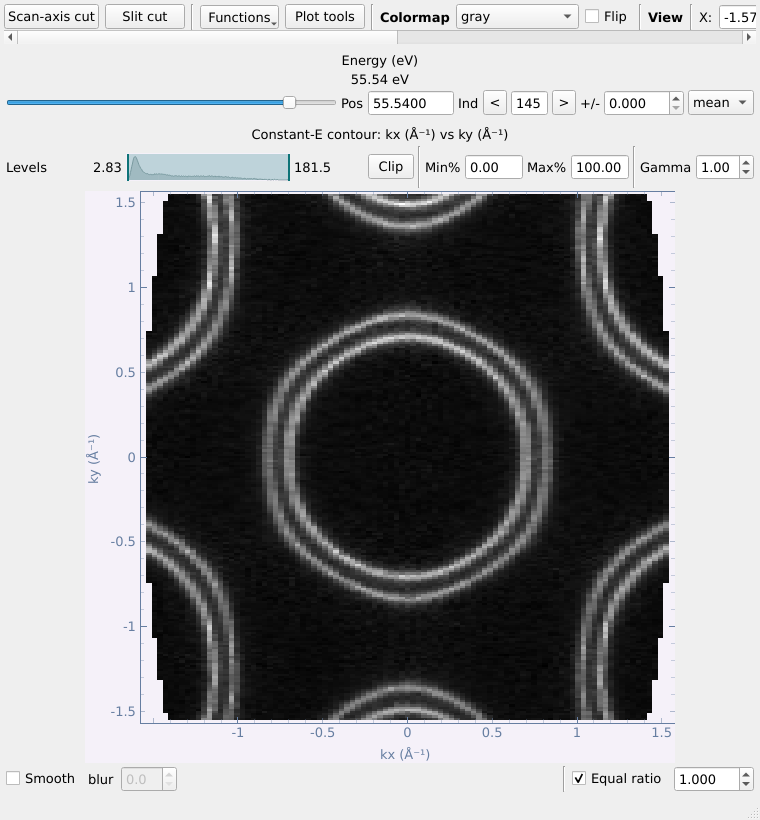

## 14. 光子能量扫描（kz）

光子能量扫描在列表中显示为 `kz map`；其"等能面"是某一能量下光子能量对角度的图。

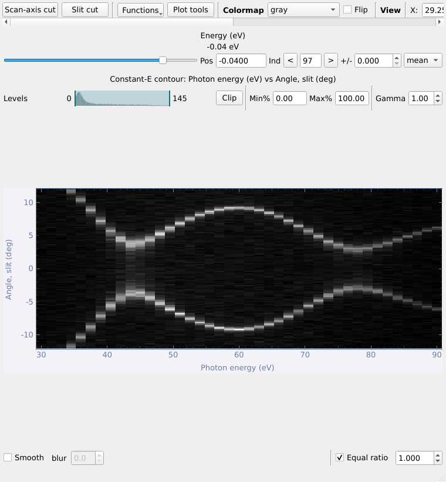

### 14.1 对齐 kz map 的费米能级

文件中并没有记录每张谱真正的费米能级位置。工具面板 → Basic → **Align Fermi levels
(kz)...** 直接从谱本身测量它；kz map 的 slit cut 随之打开，两者一起关闭。

1. slit cut 随之打开，上面有一个选框。把选框拖到费米边处——角度范围决定求和的
   通道，能量范围是拟合窗口。

   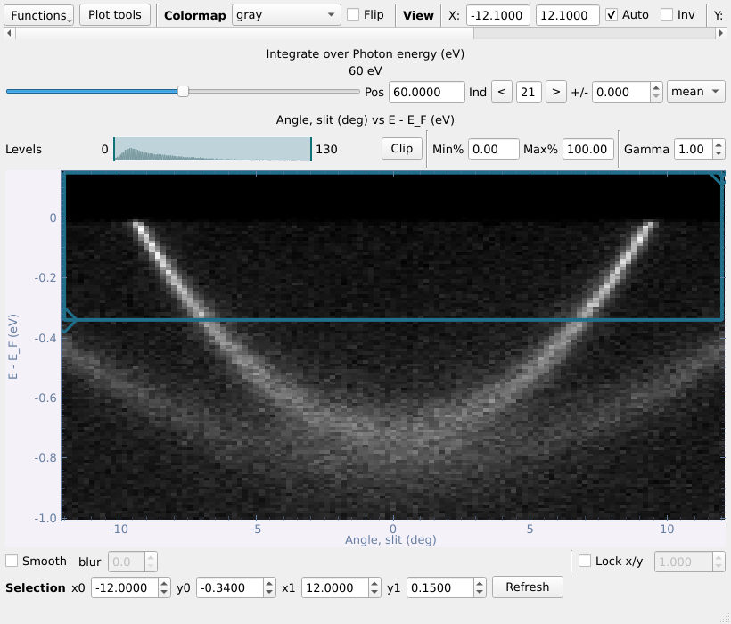

2. **Fit and assemble**：对每张谱使用同一个选框（按探测器像素序号），把每张谱
   平移使其自身的费米边位于零点，把数据立方体裁剪到所有谱共有的能量范围，并
   （默认）**按每张谱的总强度归一**，以消除光通量的变化。

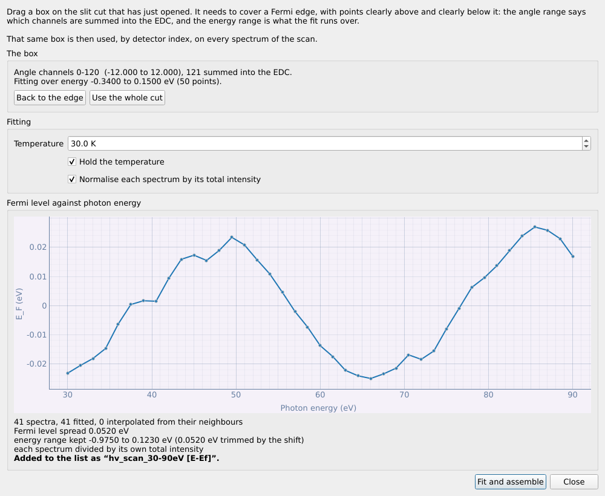

图中给出 E_F 随光子能量的变化。曲线平滑说明拟合可靠；拟合不可信的点会被标记，
并用相邻点插值补上。

### 14.2 把 kz map 转换到动量空间

工具面板 → Basic → **kz conversion...** 把扫描转换为 (k_z, k∥)。参数从上一次转换同样
大小的扫描时开始。

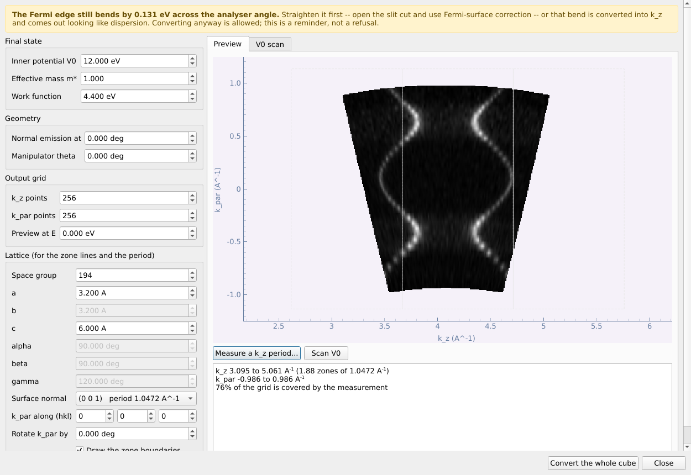

- **内势 V0** 是未知量：修改它时预览会在毫秒内重新转换一个能量切片。
- 给定**晶格**（空间群、a、b、c）、**表面法线**和面内方向后，预览上会画出布里渊
  区边界。
- **Scan V0** 在一系列 V0 下转换，报告 k_z 周期与晶格匹配时的 V0，以及 V0 能被
  确定到什么精度。
- **Measure a k_z period...**：点击相隔一个布里渊区的同一特征上的两点，程序列出
  与之匹配的倒格子晶面。
- 黄色横幅提示费米边仍随分析器角度弯曲——应先在 slit cut 上做 Straighten bands (FS correction)。
- **Convert the whole cube** 生成 `kz map (k)`。

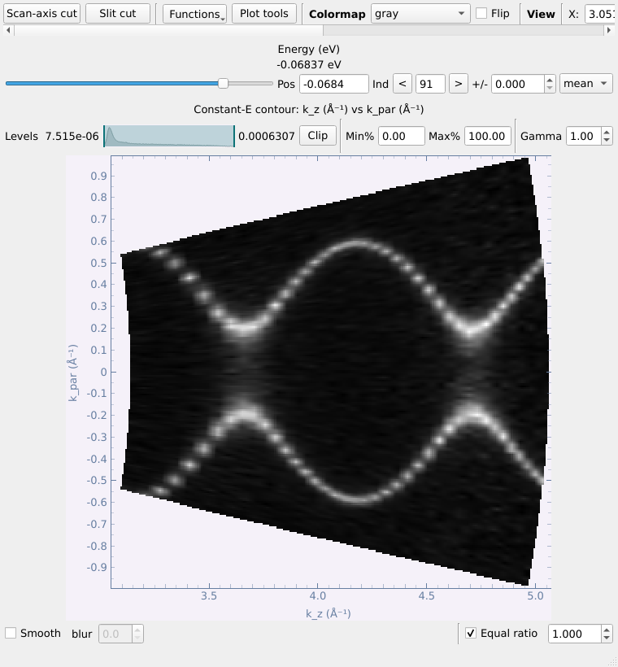

## 15. 布里渊区

选中 k-map（或已转换的 kz map），点工具面板 → Basic → **Brillouin zone...**。与 map
转换一样，它会打开一个专用的等能面窗口和布里渊区窗口，两者一起关闭。

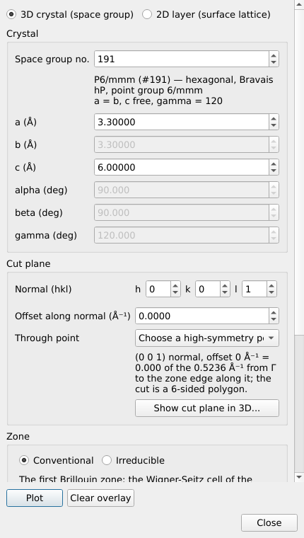

1. 先选**空间群**（1–230）；被空间群约束的晶格参数显示为灰色并自动跟随。也可
   切换到 **2D layer** 使用二维表面晶格。
2. **Cut plane**：表面法线 (hkl) 及沿法线的偏移——画出的是三维布里渊区被该平面
   截出的截面，适用于任意晶面，而不只是 (001)。**Through point** 列出平面经过高对称点
   （菱方晶体为 Γ、Z、L、F……）时的偏移量，直接选择即可，无需自己计算。
   **Show cut plane in 3D...** 可预览，图中标出高对称点，并圈出该平面经过的点；
   **Label high-symmetry points** 会把这些点标在等能面图上，方便设置方位角。
   对话框会自动沿用上一次使用的晶体参数。
3. 选择 **Conventional**（常规）或 **Irreducible**（不可约）区；设置 **Azimuth**
   （或 **Pick direction from contour...**）；**Repeat across the field of view**
   在视野内重复绘制。
4. **Moiré** 加入第二层（扭转或晶格失配）及其莫尔布里渊区。
5. **Plot**。

窗口较高时可以滚动，并且和其他所有窗口一样可以调整大小。

**布里渊区成为数据集的属性。** 画过之后，它就属于该 k-map：保存 `.nxs` 文件时一并
写入，查看窗口顶部的 **Brillouin zone** 勾选框可显示或隐藏它。**Clear overlay**
将其移除。

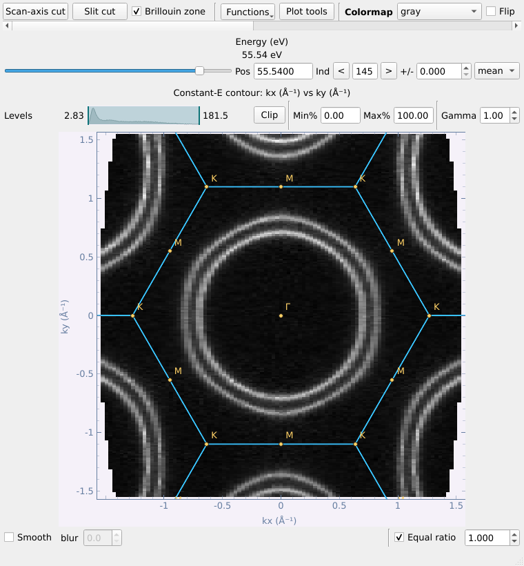

导出时也可以画出它：**Export → Image...** 中有 **Include the Brillouin zone**，
**Axes only (.eps)...** 中有 **Draw the Brillouin zone in the box**，布里渊区会以矢量
线条叠在 Illustrator 中的图像上。

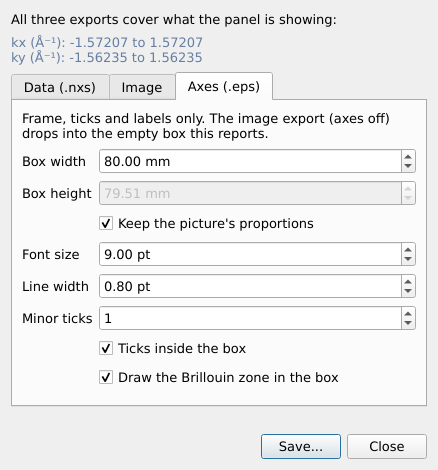

# 第三部分 Advanced 标签页

**Advanced** 标签页包含随后的分析：作图器（*1D & 2D*，见
[第 28 节](#28-作图器figure-composer)）；平滑、锐化能带的滤波、对称化与脊线提取
（*2D & 3D*）；堆叠图、MDC 与 EDC 拟合以及 cut 运算（*2D only*）；切片序列图和
四种三维视图（*3D only*）。曲线和空间扫描在各自的查看窗口中处理。

---

## 16. 平滑、求导、曲率与对称化

每种滤波都有自己的窗口，在列表中选中一个或多个 cut（或 map）后从工具面板打开：

| 标签页 | 按钮 | 作用 |
|---|---|---|
| Basic | **Background subtraction...** | 扣除不属于能带的强度：Shirley 或 Tougaard 非弹性背景、所有角度共有的本底、平滑多项式——或除去费米截断 |
| Advanced | **Smooth...** | 高斯、Savitzky–Golay 或滑动平均平滑，可先去尖峰 |
| Advanced | **Second derivative...** | 预平滑后求 −d²I/dE² 或 −d²I/dk²，使能带更锐利 |
| Advanced | **Curvature...** | 一维或二维曲率（Zhang 等人），比二阶导数更贴合能带 |
| Advanced | **Symmetrise...** | 以一条线为镜面对称化 cut；对 map，镜像或旋转其等能面 |

每个结果都是新的数据集，并记录生成它的处理步骤。

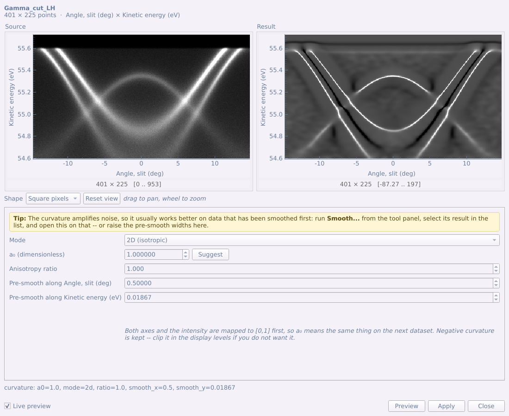

- **Source**（原图）与 **Result**（结果）并排显示、色阶一致，便于看出参数是否把
  能带"吃掉"了；两者同步平移和缩放。
- **先平滑。** 二阶导数和曲率窗口打开时会给出提示：两者都会放大噪声，通常对先平滑
  过的数据效果更好——先运行 **Smooth...**，在列表中选中其结果，再对它打开滤波；
  或者在窗口中加大预平滑宽度。平滑过的结果在列表中带有 **‹smoothed›** 标签（由它
  生成的数据也带此标签）；对这样的数据，窗口不再给出提示，只显示一行"已平滑"，
  预平滑宽度默认为 0。
- **Shape**：*Square pixels*（每个数据点为正方形——对角度-能量 cut 不失真）、
  *Equal axes*（两轴单位长度相同——适合角度-角度或 k-k 图，两轴单位相同时自动
  选用）、*Fill the box*（填满窗口）。
- **Live preview** 在修改参数时实时重算；**Apply** 把结果加入列表。
- 初始值：**Symmetrise** 默认以过角度（或 k）= 0 的竖直线为镜面，即 k → −k；
  *Background subtraction* 中的 **Fermi cut-off** 的 E_F 取文件记录的值，若没有则取
  角积分 EDC 下降最陡处，温度和分辨率也从文件读取。

对 map，处理按平面进行，并首先询问**作用于哪组平面**——等能面还是色散切面，
因为等能面的曲率与 cut 的曲率是不同的物理量。**Preview at** 选择预览的平面；
**Apply to the whole cube** 对所有平面执行。各操作和宽度以所选平面的真实轴名标注
（如 *Second derivative along Kinetic energy*），平滑宽度默认取各轴范围的 1/100。

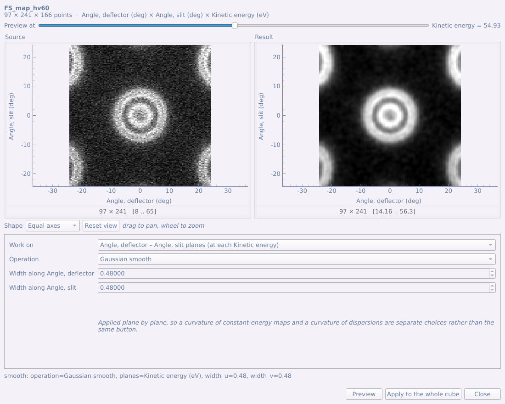

列表下方的 **Truncate...**、**Compress...** 和 **Self-normalise...** 可同时改变一个
或多个数据集的网格或标度——前提是它们类型相同，且各轴点数一致：**Truncate** 裁剪
到某一范围，**Compress** 合并像素，**Self-normalise** 每张谱除以自身总强度。

**Self-normalise** 把数据的每一部分除以它自身的总强度（或峰值）：

- **Normalise** 下拉框用 ARPES 的说法选择“每一部分”是什么，并默认选常规做法：
  cut 默认 *each EDC*（每条 EDC），map、k-map、kz map 默认 *each cut (slit ×
  energy at one scan step)*（每张 cut 各自归一，可去除扫描过程中光通量或束流的
  漂移）。其他选项：每条 MDC、map 的每条 EDC、每张等能面，或 *custom*（自定义）。
- **Summed over** 显示求和所沿的轴，可以手动勾选；下方的一句话说明当前勾选的
  效果（例如 “Each plane over Angle, slit × Kinetic energy is divided by its own
  total — one factor for every Angle, deflector”）。
- **Sum only over** 把求和限制在某个求和轴上的一个窗口内——默认是能量轴——例如
  只用某个芯能级的能量范围。

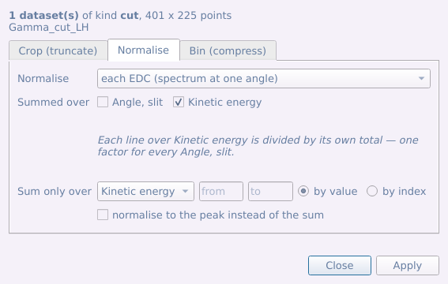

## 17. 脊线提取（Ridge detection）

工具面板 → Advanced → **Ridge detection...**（cut 或 map）把能带当作强度的脊线
来追踪，每个点精确到亚像素，比二阶导数更锐利，也不会画出虚假的双线。

- **Smoothing**：每个轴的平滑宽度，以该轴的单位计——约为能带宽度。
- **Threshold**：逐渐提高，直到只剩下能带（源数据上的黄色点）。
- **Result to list**——脊线图像（map 逐平面处理，可选平面）；**Save ridge
  points...**——一个 CSV，紧束缚拟合（[第 26 节](#26-紧束缚拟合)）可以读取。

## 18. 堆叠图

**Stack plot (EDC / MDC)...**（工具面板 → Advanced，选中一张 cut）：EDC 或 MDC 的
瀑布图，可设置曲线条数、合并、归一化、偏移、错切与配色；**Send to figure
composer** 把它作为一个图面板送入作图器。

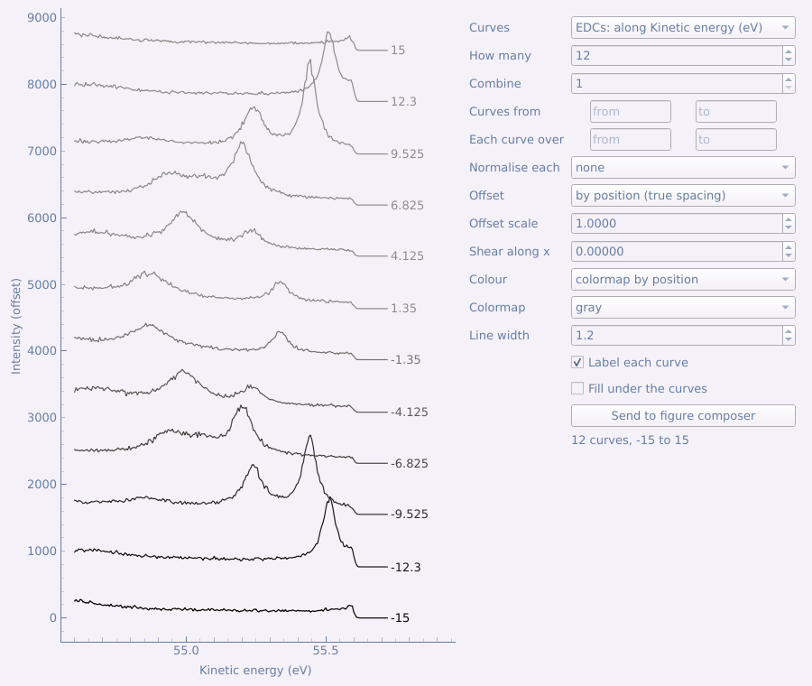

## 19. MDC 拟合与 EDC 拟合

工具面板的 Advanced 页中有两个逐行拟合峰的工具：

- **MDC fit (k-cut only)...** 拟合动量分布曲线，再从拟合峰位读出能带：费米速度、
  有效质量、自能。它只接受横轴已经是 Å⁻¹ 的 cut——以 eV·deg 为单位的费米速度没有
  意义——否则按钮显示为灰色。
- **EDC fit...** 拟合能量分布曲线，适用于任何 cut，可在模型中包含费米截断。由拟合
  能带得到 v_F 和 m\* 需要 cut 已在动量空间。

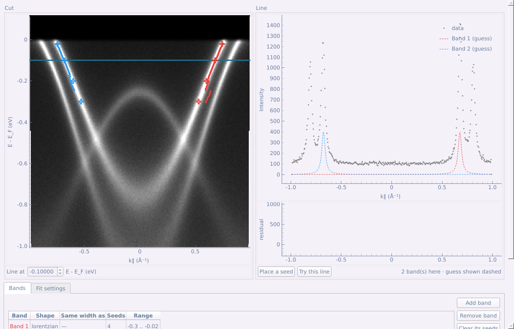

面板顶部的 **Guided fit (step by step)** 会在控件旁逐步引导完成整个拟合，每一步
简要说明这一步的意义，并用橙色框标出要用到的部分：MDC（EDC）拟合在做什么、峰形、
拟合范围（把蓝线拖到能带起点 / 终点，按 *Start here* / *End here*）、能带、种子点
（引导会把蓝线依次移到范围内的五个位置——在每个位置点击右侧曲线上该能带的峰）、
试拟合一行、拟合整个序列、读取结果。每一步具备拟合所需的条件后 *Next* 才可点击。

图像和控件之间有可拖动的分隔条，控件始终可见；窗口放不下时，鼠标滚轮在图像上滚动的是
窗口本身（Ctrl + 滚轮缩放图像）。

手动操作：

1. **Bands** 页：每条能带分支点一次 **Add band**；选中一条能带，按 **Place a
   seed**，再在右侧曲线上点击峰的位置。沿能带放四五个种子点就够了；**Line at**
   切换当前查看的行。
2. **Try this line** 显示当前行的拟合结果（虚线为初始猜测）。
3. **Fit settings** 页：峰形（Lorentzian、Gaussian、Voigt）、背景、步长，然后
   **Fit the series**。拟合出的峰位画在图上，点的大小代表振幅。
4. **Dispersion...** 拟合能带：**v_F**（直线）、**m\***（抛物线），并检查拟合
   在多大范围内稳定。**Self-energy...** 给出 Re Σ 与 Im Σ。

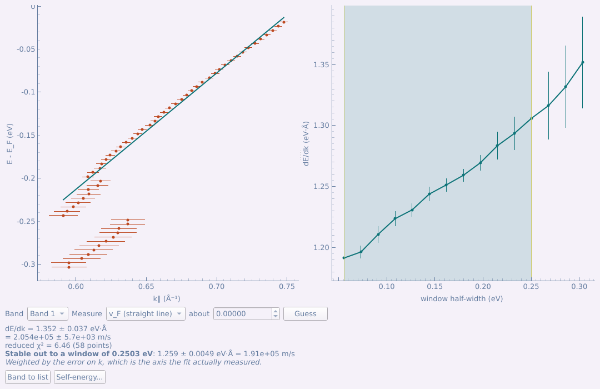

**Save table...** 保存所有行的拟合结果；**Band to list** 把一条能带加入主列表。

**两条直线分支的交点。** 在 **Dispersion...** 窗口中选择 *v_F*（直线）时，其他
每条已拟合的能带也以同样方式拟合，并给出两条直线的交点及其不确定度（由两次拟合
传递而来）：把狄拉克锥的两侧分别拟合得到的狄拉克点，或任意两条能带的交叉点。
若某个拟合点的误差坍缩（峰宽拟合到零），它不再独占色散拟合的全部权重：任何一点的
权重都不超过十个典型点。

## 20. Cut 运算：二色性与参考谱归一

把两张 cut 组合成第三张：线二色性（LH − LV）、圆二色性、除以金参考谱，或普通的
差、比、和。在列表中选中两张 cut，点工具面板 → Advanced → **Cut arithmetic (two
cuts)...**（先选的为 A；窗口中可交换）。只有恰好选中两张 cut 时该按钮才可用。

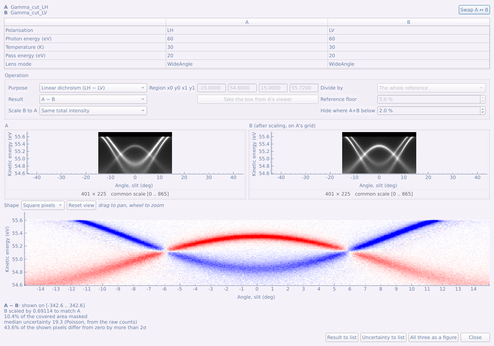

- **顶部表格**对比两次测量记录的条件（偏振、光子能量、角度、样品位置、温度、
  通能、透镜模式）。橙色行表示差异超过容差——在样品上两个不同位置之间做的
  二色性图，反映的其实是*位置*差异。
- **Purpose** 预设：*Linear dichroism*（A − B，B 按总强度缩放）、*Circular
  dichroism*（(A − B)/(A + B)）、*Divide by a reference*（除以参考谱）、*Custom*。
  若偏振看起来颠倒了会给出警告（可用 **Swap A ↔ B** 交换）。
- **Scale B to A** 按总强度或某一区域的强度缩放；**Hide where A+B below** 屏蔽
  背景区域。
- A、B 使用同一色阶；结果用以零为中心对称的红-白-蓝色阶。若两者都是原始计数，
  会传播泊松误差，并在图下方给出统计。
- **Result to list**、**Uncertainty to list**、**All three as a figure**。

## 21. 切片序列图（Slice series figure）

选中 map → 工具面板 → Advanced → **Slice series figure...**：把数据立方的一系列二维
平面切片排成一页论文图——一系列能量处的等能面，或一系列角度 / 动量处的 cut——可等
间距或指定位置，可积分，共用一个色阶，只在外侧边缘标注坐标。（注意与 **3D slices**
区分，后者是在三维视图中画三个平面。）

| 设置 | 结果 |
|---|---|
| 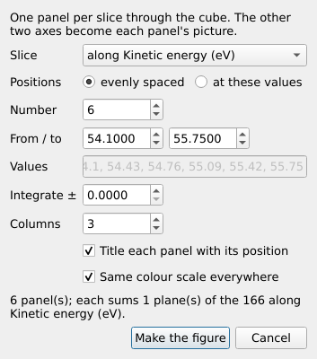 | 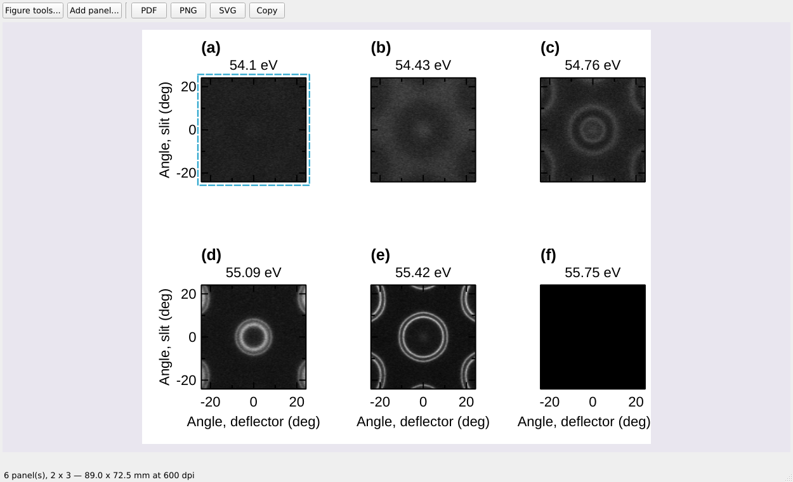 |

## 22. 三维视图

Advanced 页中有四个以三维方式显示 map 的工具，各自在独立窗口中打开——拖动图像即可
旋转：

- **3D slices...**——穿过数据立方的三个正交平面，每个平面的位置可自行设定（每个轴
  有勾选框、滑块和输入框）。
- **Notched cube...**——切掉一个角的立方体：一张等能面和两张色散图合在一幅图中。
- **Volume projection...**——整个体数据沿视线方向投影：最大强度、求和、alpha 合成，
  或带光照的等值面。
- **Stacked slices...**——平行切片在三维中层叠排列（见下文）。

| 3D slices | Notched cube |
|---|---|
| 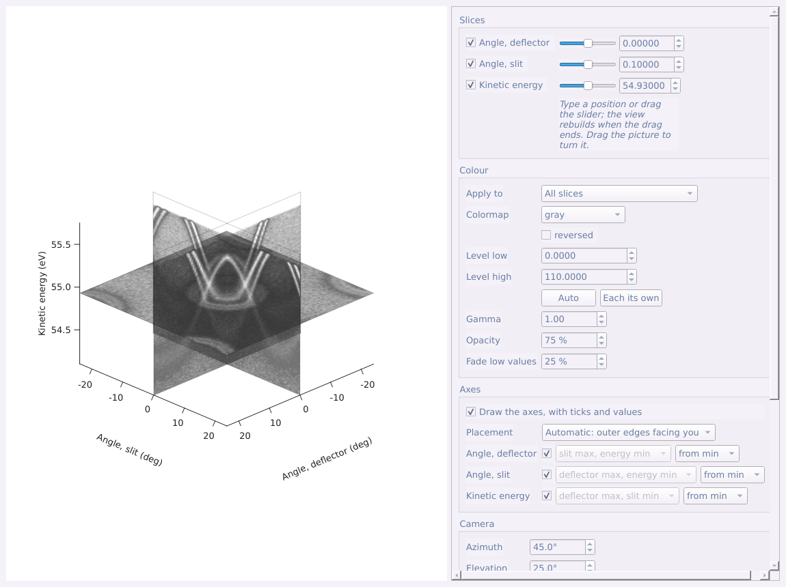 |  |

- **采样。** 每一帧都要对数据立方重新采样，因此窗口默认以 *Balanced* 采样打开，
  能跟上鼠标操作。当前采样写在 **Save the view...** 下方；**Change sampling...**
  可选择区域以及 *Fast*、*Balanced* 或 *Fine*，并从完整数据重新绘制。

  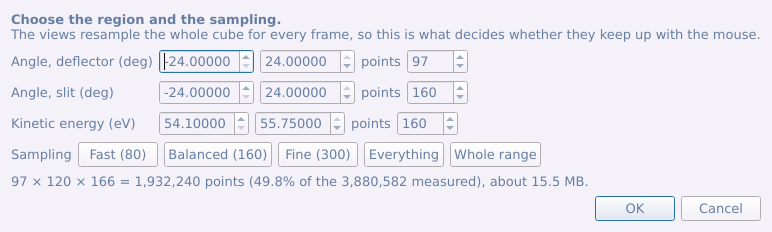

- **颜色。** *Apply to* 可一次设置**所有切片**的颜色，或只设置某一方向（例如等能面
  用一种色表，色散面用另一种）：色表（及 *reversed*）、色阶（**Auto**，或 **Each its
  own** 每个切片各用自己的色阶）、gamma、**Opacity**（不透明度）和 **Fade low
  values**（让弱强度部分变透明，从而看到后面的平面）。
- **坐标轴。** 勾选 **Draw the axes, with ticks and values**。*Placement* 可以是自动的
  ——放在朝向你的外侧棱上，随视角转动而变化——也可以手动指定：每个轴沿立方体的
  哪条棱，以及从 **from min** 还是 **from max** 开始计数。
- **Camera**：方位角、仰角、深度比例；**Look into it** 正对所选平面。
  **Outline the faces** 和 **Orientation tripod** 为可选项。
- **Save the view...** 通过与所有面板相同的导出窗口导出图像（PNG、TIFF、JPEG，可设
  尺寸和 dpi）。**To figure composer...** 把当前视图作为一个面板加入论文图。

### 层叠切片（Stacked slices）

**Stacked slices...**（工具面板 → Advanced → 3D only）把数据立方的平行切片在三维
中层叠画出：等能面沿能量轴一张叠一张，或 cut 沿 k_z（或光子能量）一张排在另一张
后面——这是展示能带演化的常见画法。

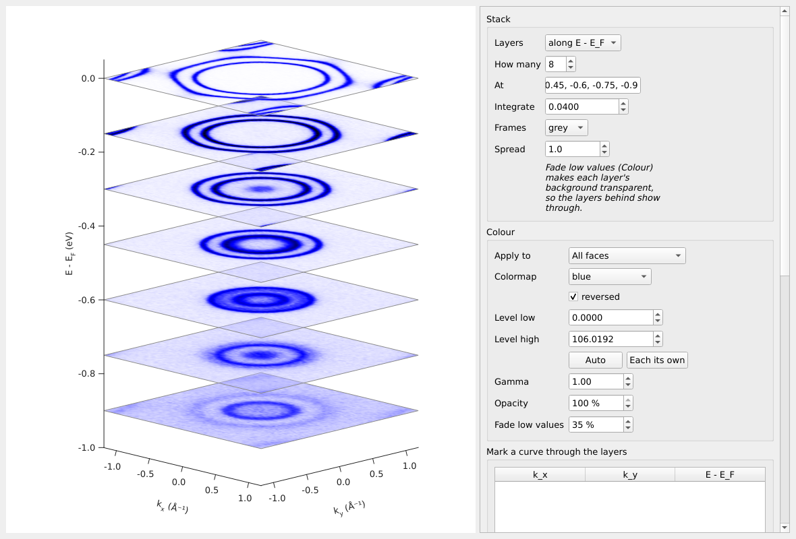

- **Layers**——层叠所沿的轴；**How many** 均匀分布各层，或在 **At** 中输入位置
  （逗号分隔，以该轴的单位计）；**Integrate** 把每层在该宽度内平均。
- **Frames**——每层的外框（灰色、黑色或无）。
- **Spread** 沿层叠轴拉伸盒子，使斜视时各层彼此分开而不互相遮挡：沿 k_z 层叠几张
  cut 时，*Spread* 取 3、方位角约 40°，每张 cut 几乎都能完整看到。
- **Fade low values**（*Colour*）在这里从 35 % 起：每层的背景透明，后面的层可以
  透过来。
- **Mark a curve through the layers**——以数据自身单位给出的点（每层一个，例如两条
  能带的交点），用红、黑、蓝……曲线连接并画在层叠图上方，可在第一个点处加标注。
- 所有三维视图的坐标轴现在都会让图像*及其标签*适应窗口或图面板（不再是固定边距），
  按每个轴的空间稀疏刻度，并在轴标题中写出上下标（`E - E_F`、`k_x`）。

## 23. 曲线：EDC、MDC 与自旋分辨数据

任意图像下方的 **EDC → list** / **MDC → list**，或自旋分辨文件，都会得到曲线
数据集，在**曲线窗口**中打开：

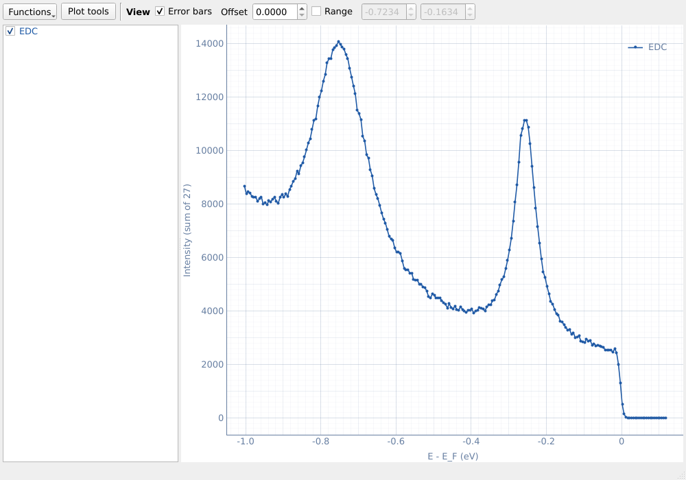

可以隐藏通道、用 **Offset** 做成瀑布图、显示 **Error bars**（来自 σ 通道）；
**Range** 标记一个 x 范围供各操作使用。*Functions → Transform* 提供
**Crop**（裁剪）、**Bin**（合并）、**Normalise**（归一）、**Subtract a
background**（扣背景：常数、线性、Shirley）、**Shift the axis**（平移横轴）和
**Add counting errors (√N)**（添加计数误差）；每个操作都生成新数据集，并正确
传播 σ。

### 23.1 曲线拟合

*Functions → Curve fit...*：**Peaks on a background**（Lorentzian、Gaussian 或
Voigt 峰，点击放置或 **Find peaks** 自动寻峰；无 / 常数 / 线性 / Shirley 背景；
仪器分辨率；可选 **× Fermi edge** 费米截断），或者直接拟合 **Fermi edge**（费米边）。
权重可取通道自身的 σ、√N 或均匀权重。每个参数都给出误差，残差以 σ 为单位显示。


**Fit to list** 保存数据、拟合、残差及各分量；**Copy results** 复制制表符分隔的
结果表。费米边拟合可用 **List a copy with E_F = 0** 生成平移后的副本。

### 23.2 自旋分析

自旋 EDC 打开时每个自旋通道一条曲线：

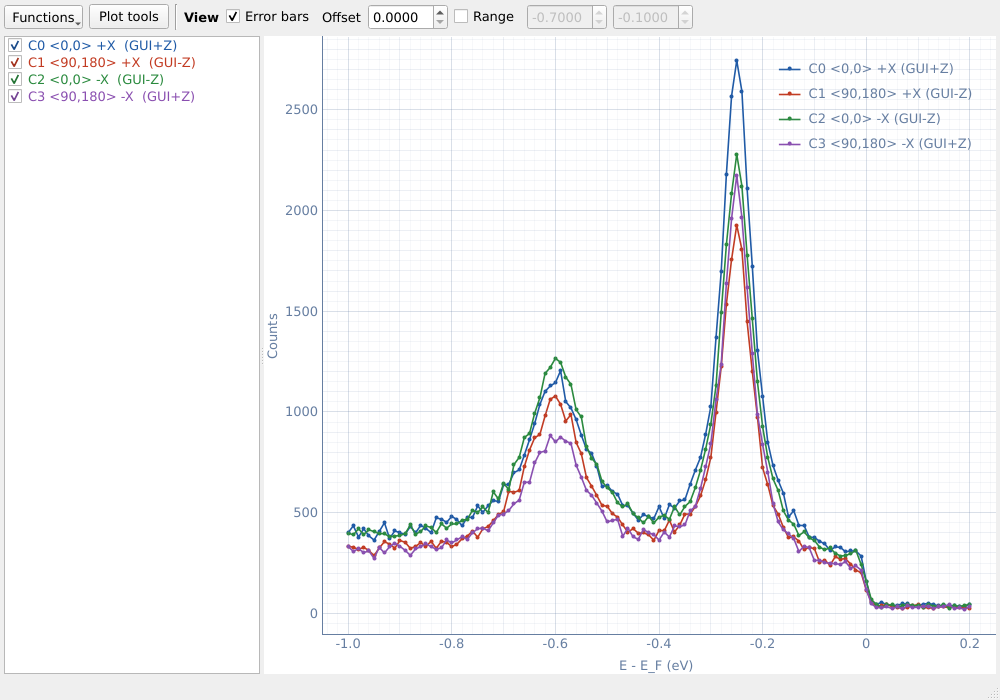

*Functions → Spin analysis...*：

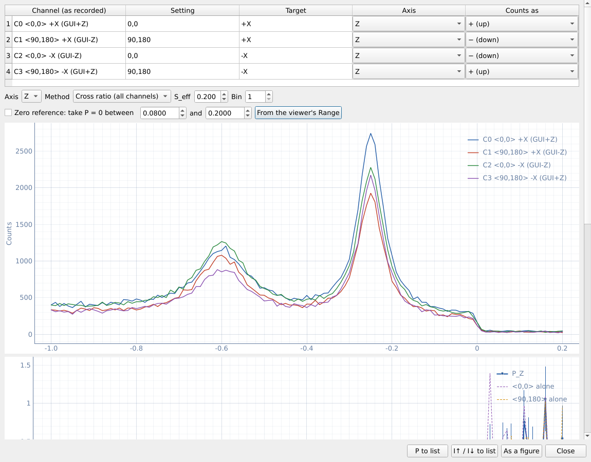

- 表格读取每个通道的标签（样品台设置、靶磁化方向、计为"上"的轴和符号）；
  **Axis** 与 **Counts as** 可手动修改。
- **Cross ratio**（交叉比，通道齐全时为默认）可精确消除透过率和靶反射率；也可用
  **单对通道**，但它带有仪器不对称性，程序会测量并报告该不对称性（ε）。
- **S_eff**（Sherman 函数，默认 0.2）、**Bin**、可选的 **Zero reference** 窗口。
- 图：原始通道、带误差棒的极化率 P，以及带误差的 I↑ / I↓。
- **P to list**、**I↑ / I↓ to list**、**As a figure**（打开作图器）。

## 24. 空间分辨扫描（nano-ARPES）

实空间扫描打开时左侧是**空间分布图**（每个位置的总强度），右侧是**光标处的
E-k 谱**。拖动红色靶标即可查看另一点的谱。在面板上右键可进行两种积分：

- 在空间图上，**Integrate selection → E vs k panel** 把样品某一区域内的谱求和；
- 在谱上，**Integrate selection → spatial panel** 画出所选 (k, E) 窗口内的强度
  在样品上的分布——用于寻找畴区或样品边缘。


# 第四部分 Calculation 标签页

**Calculation** 标签页包含计算而非测量得到的内容：实空间的晶体及其布里渊区、
拟合到数据上的能带模型，以及别人算好的能带结构。其中的窗口都以编号步骤打开。

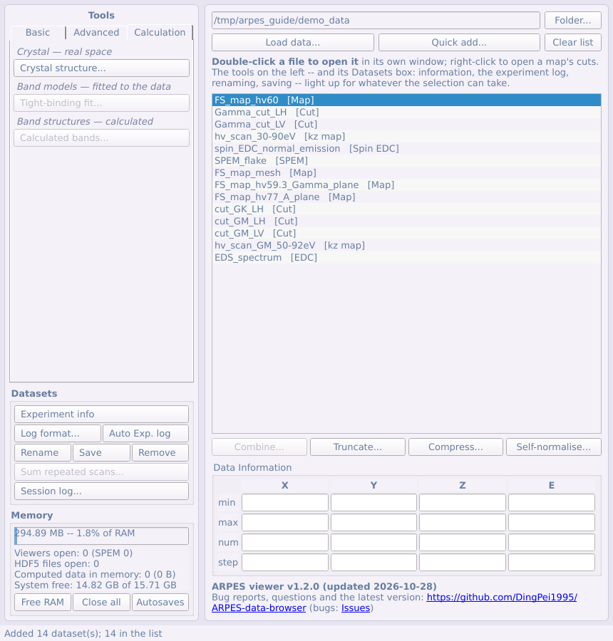

---

## 25. 晶体结构

工具面板 → Calculation → **Crystal structure...**（无需选中数据；选中的 k-map 可以
画在布里渊区的平面上）。共五步：

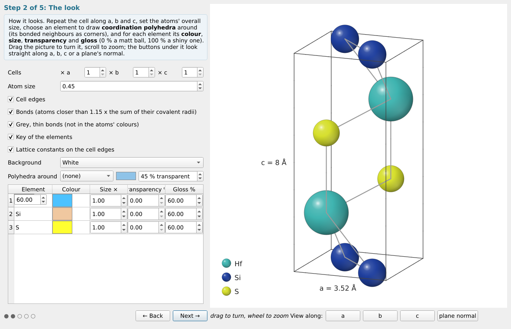

1. **结构**——手动输入（晶胞、用于确定心型的空间群、原子），取布里渊区工具上次
   用的晶体，或 **Read a CIF file**（应用其对称操作，读取其空间群）。
2. **外观**
   - 沿 a、b、c 的晶胞数、原子整体大小、晶胞棱和化学键（使用原子颜色，或
     *grey, thin*）；
   - 每种元素的**颜色**、**大小**、**透明度**和**光泽**（0 %：哑光球，100 %：带
     锐利高光的亮球）；
   - **Polyhedra around** 某元素：其配位多面体（以成键近邻为顶点），颜色和透明度
     单独设置——如 TiSe₆ 八面体、CuS₄ 四面体；
   - **Key of the elements**（每种元素一个球加名称）、**Lattice constants on the
     cell edges**（`a = 3.52 Å`、`c = 8 Å`）。

   拖动图像旋转，滚轮缩放；*View along* a、b、c 或晶面法向。
3. **解理面**——勾选 *Draw a plane*，给出 (hkl)，滑动它，或在列表中双击某个
   **原子层**把平面放在那里；*Hide the atoms above* 显示终止面；位于平面内的原子用
   红圈标出。
4. **布里渊区**——晶体的布里渊区、标注的高对称点、穿过它们的**路径**（红色，例如
   `Γ-M-K-Γ-A-L-H-A` 或一段 `K-H`）、带箭头的 k_x、k_y、k_z 轴，以及最多两个垂直于
   (hkl) 的**平面**——默认过 Γ 点和在布里渊区顶面，颜色各自设置。
   - 平面上的 **map**：选中 k-map 在给定能量的等能面（在 *integrate* 范围内平均），
     画在该平面上并裁剪到布里渊区——实测费米面就画在它所在的布里渊区里。*azimuth*
     使 map 相对布里渊区的 k_x 旋转。
   - **Label on the left**：这里列出的点（`L, M`）标注在其最左侧的对称等价点上，
     随图像旋转而更新，避开路径和坐标轴。

   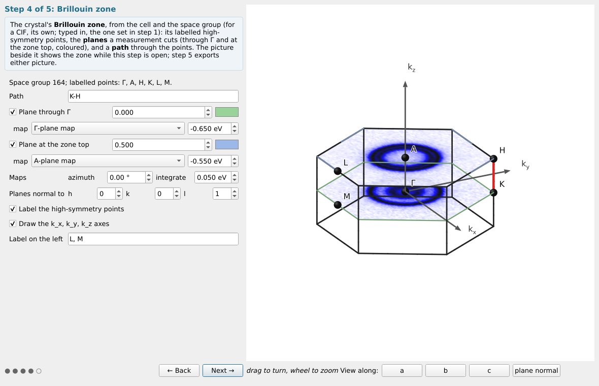
5. **导出**——晶体或布里渊区：**Save picture...**（任意尺寸的 PNG，按该尺寸重新
   绘制）或 **To figure composer...**。由 CIF 生成的图片以该 CIF 为来源，因此图的
   数据文件夹会保存它（[第 28 节](#28-作图器figure-composer)）。

## 26. 紧束缚拟合

选中一个 k-map（或不选，使用点文件）：

1. **晶格** —— 二维层（a、b、γ）或三维晶体，或 **Take the crystal from the Brillouin-zone
   tool**；a 轴相对 kx 的方位角；近邻壳层数。
2. **能带点** —— 移到某个能量后点击 **Trace this energy**（脊线提取），或勾选 *Click* 在能带
   上点击，或 **Read points from a file**。两三个能量比一个好：单一等能线只确定能带形状，不确定
   能量尺度。
3. **拟合** —— 得到各跃迁积分及其误差和均方根偏差；模型的等能线以红色画在第 2 步的平面上。
   只有一个能量时固定 t1；方位角只大致已知时勾选 *Refine the azimuth*。出现橙色提示表示这些
   点无法区分各壳层：请减少壳层数。
4. **使用模型** —— **Model to list**（模型的谱函数，作为 map 与数据并排查看）、
   **Save parameters...**、**Copy results**。

## 27. 计算能带（Calculated bands）

工具面板 → Calculation → **Calculated bands...** 把能带计算结果与测量放在一起。
选中要比较的数据——k-map、动量空间的 kz map 和动量空间的 cut——或者什么都不选，
只看计算结果。共四步。

与所有分步窗口（Crystal structure、Tight-binding fit、Sum repeated scans、Detector
corrections）一样，它**关闭前会先确认**——最后一步的 Close 正好在原来 Next 的位置，
手快多点一下也不会丢掉工作；标题栏的关闭按钮和 Esc 同样会确认。**在输入框中按回车
只是确认该数值**（并更新相应的图）——在本程序的所有窗口中都不会触发 Next、Close 或
其他按钮；只有获得焦点的按钮才响应回车。所设的参数会**保留**：下次打开时窗口恢复
原样（左下角 **Restore defaults** 可恢复默认）。

**1. 计算结果。** 先选**想看什么**：

- **E–k dispersion**（色散）——沿路径的能带，或沿实测 cut 的能带。任何计算结果都行。
- **Constant-energy contours**（等能线）——与 k-map（费米面 map）比较。
- **3D Fermi surface**（三维费米面）。

后两者需要**整个布里渊区内**的能带（能带网格或哈密顿量）；只沿路径的能带给不出，
窗口会直接说明而不是继续往下走。这一选择也决定 **Open calculation...** 文件列表的
排序：第一个过滤器只显示能给出所需结果的文件类型。若选中了 k-map，默认选等能线；
选中了 cut，默认选色散。文件也可以直接拖进窗口；**Reopen …** 重新打开上次的文件。

| 文件 | 写出程序 | 内容 | 能显示 |
|---|---|---|---|
| `.bxsf`（XCrySDen 能带网格） | Wien2k、Quantum ESPRESSO、VASP、Wannier90 | 整个布里渊区内的能带，插值 | 三者都可 |
| `_hr.dat`（及旁边的 `.win`） | Wannier90、任何紧束缚模型 | 哈密顿量，在每个 k 点精确对角化；轨道权重 | 三者都可 |
| `wannier90_hr_fplo.dat`（及 `KPOINTS`、`wannier_name_center.txt`） | FPLO 的 Wannier 哈密顿量 | 同 `_hr.dat`；按 Wannier 函数、壳层（"Cr 3d"）和自旋的权重 | 三者都可 |
| 每行 `k1 k2 k3 E1 E2 …` 的 `band.dat`（及 `KPOINTS`） | FPLO + Wannier 工具 | 三维能带网格 | 三者都可 |
| 含 `Ek_3D` 的 MATLAB `.mat`（及 `KPOINTS`） | 理论方的 MATLAB，由上述三维 `band.dat` 生成 | 三维能带网格 | 三者都可 |
| `EIGENVAL`（及 `POSCAR`、`PROCAR`） | VASP | 沿路径或网格上的能带；原子与轨道权重 | 网格时三者都可 |
| `_band.dat`（及 `labelinfo`） | Wannier90 | 沿路径的能带 | 色散 |
| `.spaghetti_ene`（及 `.klist_band`） | Wien2k | 沿路径的能带 | 色散 |
| `band.dat`、`Eigenvalue.dat`（及 `KPOINTS`、`orbital.dat`） | FPLO + Wannier 工具（`k_path.exe`、`H.exe`、`plot.exe`） | 沿路径的能带（第三列为权重） | 色散 |

文件按**内容**而不是文件名识别：途中被改了名的标准文件（例如其实是 `_hr.dat` 的
`hamiltonian.txt`）照样能打开。FPLO 工具的 `KPOINTS`（第一行为"段数 每段点数"，然后
是正、倒格矢，再是每段两端点及 `! 标签`）给出晶胞和标签——请放在能带文件旁边；没有
时晶胞取自布里渊区工具的晶体。长时间读取（101³ 网格、136 条能带的三维 `band.dat`
约 2 GB；大的 `_hr.dat`）会显示带 Cancel 的**进度条**；大网格只保留 E_F 附近的能带
（*Reading options ▸ Big grids*）。

**Which file? ...**：不知道一堆文件里哪个是计算结果时，选择理论方发来的文件夹，
其中每个文件都会被读取并用通俗的话说明——它是什么、能显示什么、读取还缺什么（晶胞、
标签）、是否是改了名的标准文件，或是被**拆成几段**的同一个文件（`band.dat.1、
band.dat.2`，`band_part1.dat …`，`xaa、xab`——为通过上传大小限制而拆分）。绿色行
可以直接打开得到所需结果；**Join the pieces, then open** 把各段在旁边合并回一个文件
再打开。

*Reading options ▸*（通常不用改）：*Set E_F myself* 覆盖文件中的费米能级；
*bxsf k units* 用于不含 2π 写出的网格；*Big grids: keep bands from … to …*（相对
E_F）。

**晶体。** 晶胞（a、b、c、α、β、γ）从计算结果中读出，决定各点名称的**空间群**由晶胞
形状猜测。读入后两者都被**锁定**（*From the Brillouin-zone tool* 也一样），避免误改
计算的晶格。需要有意修改时勾选 **Change the lattice parameters**：输入新的晶胞（或取
布里渊区工具的晶胞）会把计算缩放到该晶胞——能带以分数坐标保存，随布里渊区一起伸缩。

**其他格式的计算结果。** 理论方给的文件不属于以上任何一种时，最稳妥的做法是请对方
提供（或自己转换为）标准格式之一：整个布里渊区用 `.bxsf`，哈密顿量用 `_hr.dat` +
`.win`，路径用两列的 `_band.dat`（距离、能量；能带之间空一行）加
`_band.labelinfo.dat`。需要向对方确认：哪几列、k 的排列顺序、k 的单位（含不含 2π、
分数坐标还是笛卡尔坐标）、能量是否已减去 E_F。

**2. 计算结果的样子**——取决于第 1 步的选择：

- **Along a path**（色散）。计算能带穿过高对称点（`Γ-M-K-Γ-A-L-H-A`；`G` 代表 Γ，
  `|` 表示跳跃），画在**沿同一路径的测量数据**上，后者由选中的 map 拼成：每段面内
  路径取自在其 k_z 平面上测量的 map（Γ-M-K-Γ 取自 Γ 平面 map，A-L-H-A 取自布里渊区
  顶面的 map），Γ-A 取自 kz map。每张 map 的 k_z 由光子能量和内势 V0 算出；必要时在
  表格中修改，取消勾选可排除某张 map，并给出晶体 a 轴在 map 上的方位角。
  **Highlight bands** 把所选能带画粗并着色、其余为灰色——填文件中的能带编号
  （`41-44`），或填 `EF` 表示所有穿过 E_F 的能带（第 1 步会列出它们）。
- **Constant-energy contours**（等能线）。某一能量下、k 空间任意平面上的计算等能线，
  平面的设置与布里渊区工具相同：**法向 (hkl)**（相对惯用倒格矢；(001) 即 k_x-k_y），
  **k⊥** 为平面沿该法向离 Γ 的距离——**Through point** 让平面穿过某个高对称点
  （(001) 时 Γ K M 在 0，A H L 在 π/c）；**In-plane rotation** 让图中两个面内坐标轴
  绕法向旋转（例如与实测 map 的方位角对齐）。**k⊥ integration window** 在平面两侧一定
  k⊥ 范围内对能带求和——沿 (hkl) 法向，而不是绝对 k_z——模拟有限 k⊥ 分辨率的 map；
  积分强度以灰度画在中间平面的等能线下面。**Show the plane in the Brillouin zone...**
  打开可旋转的三维布里渊区，显示该平面（红色）、k⊥ 窗口的两个面（浅红）以及平面上的
  高对称点，并随平面的修改实时更新。平面上的布里渊区轮廓以灰色虚线画出。
- **3D Fermi surface**（三维费米面）。能带穿过该能量的曲面，限制在第一布里渊区内，
  并画出布里渊区棱边和高对称点。拖动旋转，滚轮缩放；在 *Energy* 中按回车即重画；
  *Detail* 在速度与平滑之间取舍（哈密顿量先在网格上对角化，有进度条）。**Open in its own
  window** 在单独的大窗口中显示（可 *Save picture*）；能量、精细度和能带仍在这里设置。
  这一目标没有可比较的东西，因此跳过 Compare 步骤。

每条能带的**颜色**（从列表选择，或 *Other colour...*）、曲面的**透明度**以及是否**显示**，
都在能带表中设置。多条能带可以用同一种颜色——例如把电子口袋设为一种颜色、空穴口袋
设为另一种——并且一条能带在等能线和三维视图中保持同一颜色。

**Colour by orbital weight** 沿路径画"胖能带"，或在所选轨道权重超过一半处把等能线
分段着色。

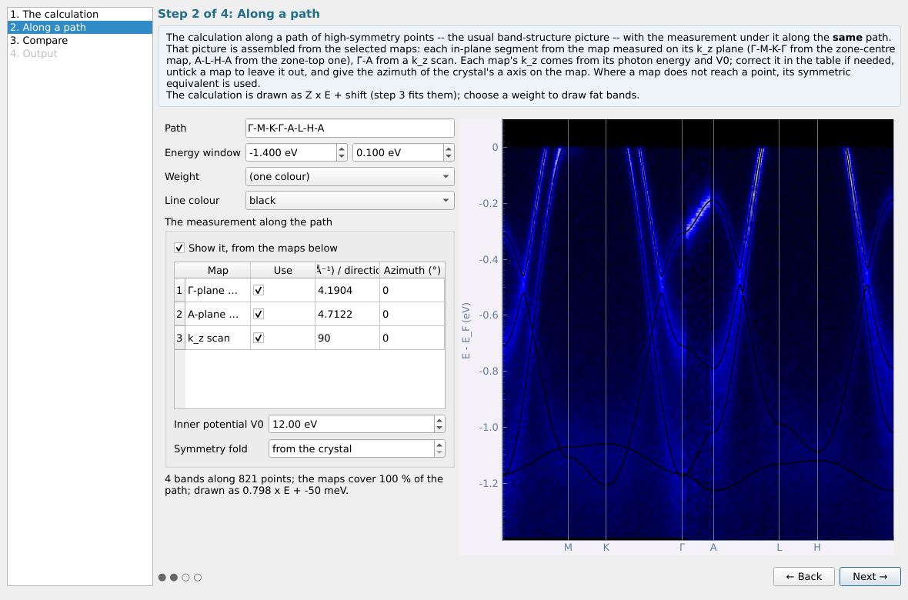

**3. 比较。** 一次比较一个测量，计算能带画在真正测量的位置上：**cut** 得到沿其方向
的能带——在固定的 k_z 平面上，或在其光子能量所到达的曲面上（k_z 沿 cut 并随能量
变化）；**map** 得到所选能量的计算等能线。**Fit to the cut's bands** 追踪实测能带
（脊线提取），求出 **Z**——能带宽度重整化，实测 E = Z × 计算 E + 平移——以及
**平移**，每个点与最近的能带匹配，稳健拟合。Z 和平移在之后每一步、每个输出中都
生效。在演示 cut 上得到 Z = 0.798、平移 −49.8 meV，正是生成演示数据时所用的值
（0.8 和 −50 meV）。

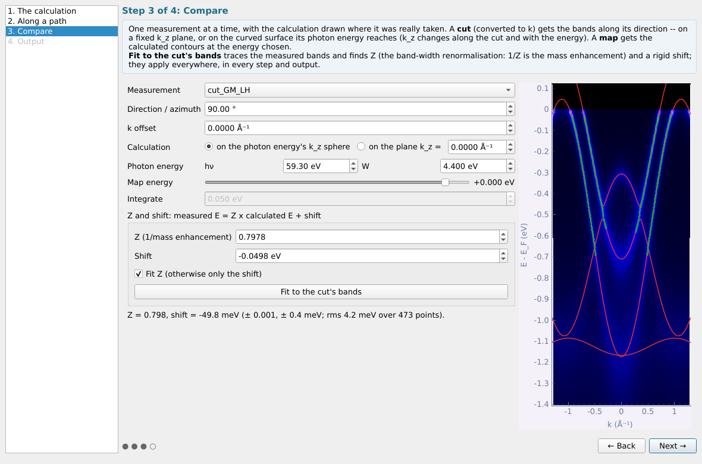

**4. 输出。** 没有选中任何测量时，第 3 步会说明这一点：直接按 Next。

- **To figure composer...** 生成所勾选的面板——默认按第 1 步的选择勾选：沿路径的
  测量及其上的计算能带、单独的计算能带（坐标轴上标出各点名称）、所比较的 cut 或 map
  及其计算结果、在所列能量处单独的计算等能线（不需要 map）、第 2 步画出的三维费米面，
  以及——勾选 **Constant-energy series of the compared map** 时——各能量的实测 map
  并以虚线画出布里渊区（上排）和计算等能线（下排）。
- **Save … to main panel**（与上一个按钮同一行）把计算结果作为主面板查看窗口能打开的
  数据放进列表，保存的内容取决于第 1 步的选择：
  - *色散*——一张 cut：把能带做成谱（指定宽度的洛伦兹线型），沿所比较的 cut 或沿
    路径。沿路径的 cut 会保留高对称点：cut 查看窗口在顶部显示各点名称并在每点画虚线
    （**High-symmetry points**，默认勾选；k 数值仍在底部坐标轴），作图器则把它们标在
    k 轴上。
  - *等能线*——**Save calculated map to main panel**：第 2 步平面上（其 (hkl)、k⊥、
    面内旋转和 k⊥ 窗口）在 *Energies of the saved map* 范围内各能量的计算强度，作为一个
    k-map，可以像实测 map 一样切片、比较。
  - *三维费米面*——按钮变灰：查看窗口只能打开 cut 和 map，不能打开曲面；请用作图器
    （或 *Save picture*）。

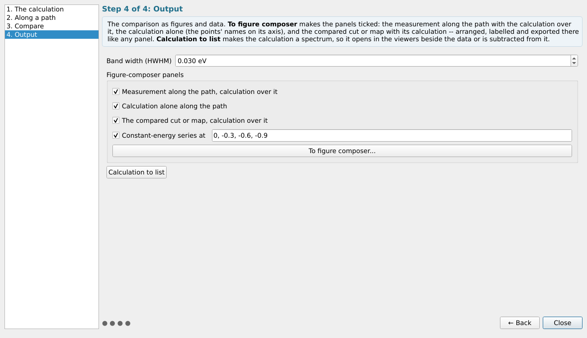

# 第五部分 作图与输出

一张图如何拼合、连同数据保存和导出——最后用两张图一步步演示。

---

## 28. 作图器（Figure composer）

**不选中任何数据**时，工具面板 → Advanced → **Figure composer...** 打开一张空白画板，
就像论文中的一张图：按期刊栏宽排好四个空面板 (a)、(b)、(c)、(d)。选中若干 cut（或
曲线）时，每个数据集成为一个面板（冻结切片窗口的 **Figure composer...** 按钮同理；
堆叠图和三维视图各有自己的 **To figure composer** 按钮）。

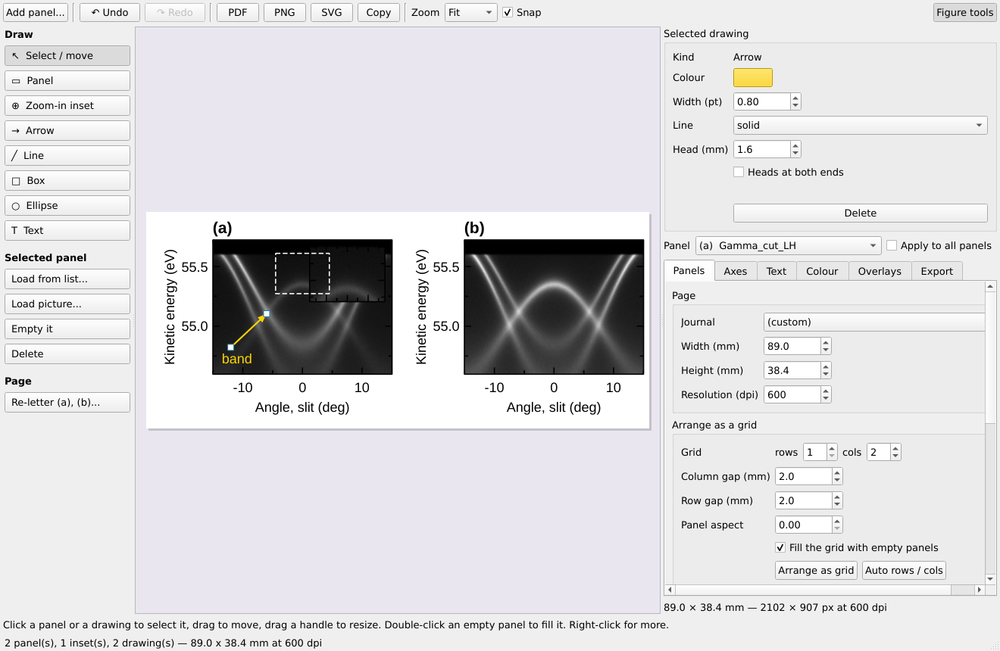

- **排版。** 单击面板选中它；拖动面板移动位置，拖动其控制点调整大小（在角点按住
  Shift 保持比例）。面板会吸附到其他面板的边缘和 0.5 mm 网格（**Snap**）；方向键
  微调 0.5 mm（Shift：5 mm）。*Arrange as grid*（右侧 Panels 页）按行 × 列重新
  排列。**Re-letter** 按阅读顺序重新标注 (a)、(b)……
- **填入内容。** 双击空面板，或用左侧 **Load from list...** / **Load picture...**：
  从主列表载入数据集，或从文件载入图片（PNG、JPEG、TIFF……——示意图或别处做的图；
  保持原比例，没有坐标轴）。
- **插图。** **Zoom-in inset**：在面板上拖出一个区域——角落里出现放大该区域的小图，
  原图上用虚线框标出区域。在另一个面板内部画 **Panel** 则得到一个插图，可填入其他
  数据。插图没有标号，随所在面板一起移动。
- **绘图。** **Arrow**（箭头）、**Line**（辅助线）、**Box**（方框）、**Ellipse**、
  **Text**（文字）：在画板上拖动（文字为单击）。选中的图形可以移动、拖动端点或角点，
  并在右侧上方设置颜色、线宽、线型、填充和文字。双击文字可编辑；Del 删除选中项；
  右键有更多选项（置于顶层、删除……）。
- **坐标轴与字体。** 画板旁的 figure tools 作用于选中的面板（或全部面板）：范围、
  刻度、标签、哪些边显示数字、该面板自己的字号、色图、色标、参考线。
- **Undo / Redo**（Ctrl+Z / Ctrl+Y）可撤销任何改动。**PDF**、**PNG**、**SVG**
  导出，**Copy** 复制到剪贴板；空面板不会写入文件。注意作图器的 **Figure tools**
  不是查看窗口的 **Plot tools**（后者在实时图上画辅助线）。

### 排列面板

单击一个面板，再 **Ctrl+单击**（或 Shift+单击）其他面板即可选中多个。然后左侧的
**Arrange** 按钮：

| 按钮 | 作用 |
|---|---|
| ⇤ Left、Right ⇥、⤒ Top、Bottom ⤓ | 对齐它们的左 / 右 / 上 / 下边（对齐到最外侧那条） |
| ↔ Centres、↕ Centres | 把它们的中心放在同一条竖线 / 横线上（第一个选中面板的） |
| Space ↔、Space ↕ | 从左到右 / 从上到下等间距（三个或以上） |
| = Width、= Height | 都取第一个选中面板的宽度 / 高度 |


### 面板字母与色标

- **Letters in line**（*Text* 页，默认开启）：并排面板的字母位于同一高度，上下排列
  面板的字母位于同一左边缘，不论每个面板有怎样的标题或坐标轴。**Nudge (mm)** 移动
  单个面板的字母（例如避开较长的轴标题）；**Re-letter** 按阅读顺序重新命名为
  (a)、(b)……
- **Colour bar**（*Colour* 页）：**Ends** 在两端写数值、*High* / *Low* 字样或不写；
  **Length (%)** 为面板高度或宽度的百分比；**Position** 为 *right*（竖立在面板旁）
  或 *below*（横躺在面板下方，居中）。三维视图的色标按实际画出的立方体确定大小，
  而不是按其外框。


### 曲线：线、符号与误差棒

*Overlays* 页，**Curves drawn on the panel**：在列表中选中曲线（不选则为全部），然后
设置其**颜色**、**线宽**、**线型**（实线、虚线、点线……）、**符号**（圆、方、三角、
菱形，可设大小）以及是否**用线连接**；**± σ as error bars** 把曲线的两条 ±σ 点线
变成各点上的误差棒。点 **Apply to the curves** 应用。含空缺（NaN）的曲线分段画出。

### 保存图以便再次编辑，连同数据

**Save** / **Save as...** 以程序自己的格式 `fig1.afig` 保存：页面、其上的绘图，以及
每个面板连同数据和设置——用 **Open...**（或在主窗口的 **Load data...** 中选中它）
再次打开，就能从停下的地方继续编辑。三维视图保存为它所显示的图片。

在它旁边，**`data for fig1/`** 中每个面板一个文件夹（`a`、`b`……）：

```
data for fig1/
  a/  processed/  面板所显示的内容：图像存为 .nxs cut（可在查看窗口中
                  再次打开），其中的线（计算能带、等能线、曲线）存为
                  lines.csv，图片存为 .png
      original/   它的来源：最初的测量文件（经 k 转换、对称化、切出的
                  平面会追溯到最初读入的文件）、计算结果及与之一起读入的
                  文件（.win、POSCAR……）、图片文件或 CIF
      sources.txt 文件中的哪个条目，以及中间经过的处理
  b/  ...
```

即使面板显示的是经过许多步计算的结果，原始文件也会被复制：每个数据集都记得它
最初来自哪个文件。再次打开的图如果其原始文件已经移动，会使用它自己之前的数据
文件夹中的副本。

## 29. 导出单个面板与保存数据

在任意图像上右键 → **Export** → **Data (.nxs, Igor)...**、**Image...** 或 **Axes only
(.eps)...**。导出的总是该面板当前显示的内容（包括显示范围）：数据导出为本程序
可重新读取的数据集，或导出给 Igor Pro（`.itx` 文本或 `.ibw` 二进制 wave，带坐标标度、
单位，元数据写在 wave note 中）；图片应用当前色表（PNG、TIFF 或 JPEG，可设定尺寸和 dpi，
可带或不带坐标轴，如有 Plot tools 辅助线或布里渊区也可一并画出）；或者把边框、刻度
和标签导出为矢量 PostScript，便于在 Illustrator 中放入图片（可在框内画出布里渊区，
见[第 15 节](#15-布里渊区)）。


**Save**（工具面板 Datasets 区）把选中的数据集写入你自己的 `.nxs` 文件（选中多行时
写入同一个文件）；也可在文件类型中选择 Igor Pro 格式：一个包含全部数据的 `.itx`，或每个
数据集一个 `.ibw`。Igor 文件只是副本，列表中的行保持不变。

## 30. 实例：用作图器完成两张图

下面两张图由演示数据（[第 2 节](#2-用演示数据试用)）用程序的窗口生成，并在作图器
中拼合。`devtools/figure_tests.py` 执行的正是这些步骤，可以与本节对照阅读。

### 图 1：等能面


**(a) 切角立方体。** 把 Γ 平面 map 转换到动量空间（[第 13 节](#13-map-的-k-转换)）；
选中 k-map → Advanced → **Notched cube...**。用 *Change sampling...* 把 k_x、k_y
限制在 ±1.25 Å⁻¹ 内、E 到 E_F 为止；切口放在 k_x = k_y = 0、一直到最低能量，角为
**+ − +**；色图 *blue*，反转；方位角 −52°，仰角 24°。**To figure composer...**：
新建一张图。在作图器的 *Colour* 页：打开 **Colour bar**，Ends 为 *high-low*，
Position 为 *below*，Length 60 %。

**(b) 实测与计算的等能面。** 选中 Γ 平面 k-map → Calculation → **Calculated
bands...**；打开 `demo_calc_hr.dat`；第 2 步 **Weight** 选 `Se-pxy`；第 3 步选择
k-map，*Integrate* 0.050 eV，然后选一张 cut 做 **Fit to the cut's bands**（Z 和平移
同样作用于等能线）；第 4 步勾选 **Constant-energy series at** `0, -0.3, -0.6, -0.9`，
取消其他勾选，**To figure composer...** → (a) 所在的图。得到八个面板：以虚线画出
布里渊区的实测 map，以及单独的计算等能线，权重低于一半处为红色、高于一半处为绿色。
在每个面板中设置色图（*blue*，反转）、范围 ±1.2，去掉下排的标题（*Text* 页）；用
**Text** 工具加上 (i)…(viii) 以及 Γ、M、K 标注。

**(c) 层叠等能面。** 选中 k-map → Advanced → **Stacked slices...**；*Layers* 沿
E − E_F，位于 `0, -0.15, -0.3, -0.45, -0.6, -0.75, -0.9`，*Integrate* 0.04，
*Fade low values* 45 %，z 方向比例 2.2，方位角 −45°，仰角 14°。**To figure
composer...** → 同一张图。

**排列。** 先把面板大致拖到位（2 × 4 张等能面排成两行，(a) 在左，(c) 在右），然后
选中 (a)、(b) 的上排和 (c)，按 **⤒ Top**；选中一行等能面按 **Space ↔**，每行再按
**= Height**。字母会自动对齐；用 **Nudge** 把 (b) 的字母左移 6 mm，避开其 k_y 标题。
只有 (a)、(b)、(c) 带字母：清空其他面板的 *Letter* 框。**Save as...**
`example_figure_1.afig`（数据文件夹会写在旁边），再用 **PNG** / **PDF** 导出用于
论文。


### 图 2：沿 k_z 追踪的能带交叉


**(a) 晶体结构。** Calculation → **Crystal structure...** → *Read a CIF file*
`demo_tetragonal_crystal.cif`。第 2 步：Hf 青绿、Si 深蓝、S 黄色，光泽均为 85 %，
原子大小 0.52；*Grey, thin bonds*；*Lattice constants on the cell edges*（不显示
元素图例）。第 3 步：*Draw a plane* (001)，放在晶胞中部、两层 S 之间，灰色。旋转
到方位角 −68°、仰角 14°。第 5 步：**To figure composer...** → 新建一张图。

**(b) 画有实测 map 的布里渊区。** 选中 Γ 平面和 A 平面的 k-map，然后 Calculation →
**Crystal structure...** → *Read a CIF file* `demo_crystal.cif`。第 4 步：*Path*
`K-H`（两条能带交叉的那条线，红色）；*Plane through Γ* → map 选 *Γ-plane map*，
−0.65 eV；*Plane at the zone top* → map 选 *A-plane map*，−0.55 eV；*Label on the
left* 填 `L, M`。第 5 步：*Picture of* **The Brillouin zone** → **To figure
composer...** → (a) 所在的图。

**(c) 沿 k_z 层叠的 cut。** 把光子能量扫描转换到动量空间
（[第 14 节](#14-光子能量扫描kz)），选中它 → Advanced → **Stacked slices...**：
*Layers* 沿 k_z，位于各 cut 的四个 k_z（8.0、8.3、8.6 和 9.0 π/c），*Fade* 30 %，
**Spread** 3，方位角 40°，仰角 12°。在 **Mark a curve through the layers** 中加入
每张 cut 上的交叉点（k_z, k_∥, E）——取自 (d)——红色。**To figure composer...**。

**(d) cut、其 MDC 以及交叉点随 k_z 的变化。**

- (i)–(iv)：在 k_z map 的查看窗口中，在每个 k_z 处 **Functions → Slice → Save slice
  to the main list**；把每张 cut 放入作图器（**Add panel...**）。沿两条交叉能带的
  虚线是计算结果（Calculated bands 第 3 步，在 k_z = … 平面上），已按拟合得到的 Z
  和平移移动：第 4 步只勾选 *The compared cut* 后按 **To figure composer...**，就
  得到带有这些线的 cut；在 *Overlays* 页把线型设为 *dashed*。用 **Box** 工具画出
  虚线框。
- (v)：选中第一张 cut → Advanced → **Stack plot (EDC / MDC)...** → MDC，40 条曲线，
  每条合并 3 行，覆盖虚线框的能量范围；**Send to figure composer** → 这张图。穿过
  MDC 的辅助线是同样的计算能带，取每条 MDC 的能量。
- (vi)：每个 k_z 的交叉能量——由每张 cut 上的 **MDC fit** 和 **Dispersion...** 得到，
  其中 *Crosses band … at k = …, E = … ± …* 给出数值及误差——画成带误差棒的点
  （*Overlays*：符号 *circle*，不连线，**± σ as error bars**），计算得到的交叉线随
  k_z 的变化画成红线。

**排列。** (a)、(b)、(c) 放在第一行：选中这三个，按 **⤒ Top** 和 **= Height**；(d) 的
六个面板放在第二行，同样 **⤒ Top** 和 **= Height**。字母只保留 (a)、(b)、(c)、(d)。
**Save as...** `example_figure_2.afig`。

两张图的每个面板之后都可以修改——打开 `.afig`，选中面板，使用图工具即可；数据
文件夹既保存了图中显示的数据，也保存了它所来自的测量。

# 第六部分 日常维护

---

## 31. 自动保存、内存与恢复

- **自动保存**：每个计算得到的数据集（k-map、处理后的 cut、拟合结果……）一经生成，
  就以**不压缩**的方式写入本次会话的文件夹 `~/.arpes_viewer/sessions/`。实空间
  扫描除外（它们就是测量数据本身，而且很大）。
- **正常关闭即删除自动保存文件**：关闭主窗口并确认后（所需数据已保存，或选择
  *Close anyway*），程序会关闭所有查看窗口，并立即删除本次会话的文件夹。某个数据集
  一旦被保存到你自己的文件，它的自动保存副本也会立即删除。
- **崩溃后的恢复**：只有程序没有正常关闭（崩溃、被强制结束）时，会话文件夹才会
  保留：下次启动时会提示恢复其中的数据集，三天后自动删除。
- **操作日志**：`~/.arpes_viewer/sessions/operations.log`，每次存储 / 保存 /
  丢弃记录一行——用来查找数据的去向。
- **Memory 区**（工具面板底部）：显示本程序与系统的内存占用、打开的窗口数与 HDF5 文件数，以及
  内存中的计算数据量。**Free RAM** 丢弃计算数据的缓存副本（需要时从自动保存的
  文件重新读取）；**Close all** 关闭所有窗口并释放内存。
- **Autosaves**（Memory 区内）在系统文件管理器中打开自动保存文件夹，
  可以手动删除旧的临时副本。当前会话的文件夹（状态栏中显示其名称）正在使用，请勿删除。
- **耗时操作**（读取大 map、转换、去网格、拼接文件夹）在后台线程运行，带进度条，
  且可以真正取消。
- **关闭程序**时如有未保存的计算数据，会先询问，并列出这些数据集的名字：
  **Save to a file...**（保存）、**Close anyway**（不保存直接关闭，自动保存副本
  随之删除）或 **Cancel**（取消关闭）。

## 32. 技巧与常见问题

- **工具按钮是灰色的**——把鼠标悬停在按钮上，提示会说明原因（例如 MDC 拟合要求 cut
  已经是 Å⁻¹ 单位，cut 运算需要两张 cut）。在列表中选中合适的行，按钮就会亮起。
- **查看窗口的 Functions 菜单里找不到某个工具**——它在工具面板中（见[第 3 节](#3-主窗口)
  的“功能现在的位置”），三个标签页都看一看。
- **窗口比屏幕还高**——窗口打开时不会超过屏幕高度，内容可以滚动，Apply / Close 按钮
  始终在底部。所有窗口都可以调整大小。
- **没有提供 k 转换**——该 map 的第一个轴不是角度（而是光子能量、温度等）。请在
  载入窗口检查 *First axis of a map is*。
- **对 E − E_F 的 cut 做 k 转换**——能量偏移会根据费米拟合自动填好；如果是用其他
  方式平移的能量轴，请在 *Energy offset* 中填入 E_F 对应的动能（光子能量 − 功函数）。
- **文件被误读**——在载入窗口中手动指定读取器，并参阅 README 中的 *Assumptions
  worth knowing about*（SOLEIL 文件的轴顺序）。
- **在大 map 上拖动光标卡顿**——从文件惰性读取的 map 每个窗口重新切片约需 0.1 s，
  因此其他窗口会等鼠标停下再更新；map 读入内存后即可实时跟随。
- **输入数字**——无论系统语言如何，所有数字框都使用小数点（`0.05`），不接受逗号。
- **系统开始使用交换内存**——留意 Memory 进度条（超过内存三分之一变为琥珀色，
  超过一半变为红色），使用 **Free RAM** 或 **Close all**。
